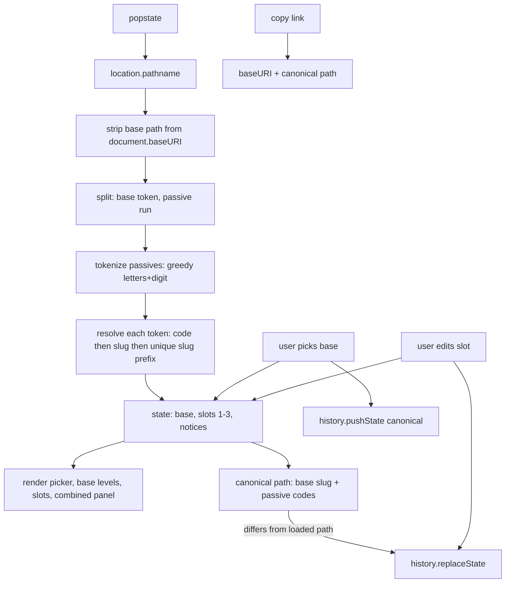

# Class Combo Viewer - Plan

## Goal Capsule

- Objective: a Drill to Earth's Core player can pick a base class plus up to three passives, see every effect at once in a game-styled view, and share the build with a short link like `/scout/sal2sal3prie3`.
- Means: static, framework-free ES-module app on GitHub Pages (KTD1, KTD2) driven by `data/classes.json` as the single source of truth (KTD3), with frozen short codes and a lenient resolver (KTD4, KTD5), History API path routing with a 404.html fallback (KTD8), and a built-ins-only check/build/test toolchain (KTD12).
- Authority hierarchy: user statements in the session > this plan's Product Contract > Key Technical Decisions > implementer judgment.
- Stop conditions: a class entry in `data/classes.json` fails the check script; a URL in the Test scenarios resolves differently than specified; the Pages deploy needs any dependency beyond Node built-ins and the official Pages actions; theme work would require changing the data contract.
- Execution profile: implementation runs on sonnet; one unit per commit in the order U1, U2, U3, U4, U6, U7, U5; each unit's Verification passes before the next unit starts.
- Tail ownership: the implementer runs the Verification Contract, opens the PR with evidence in the body, and hands the deployed deep-link smoke check to the user (Pages must be enabled on the repo).

---

## Product Contract

### Summary

A single-page viewer for Drill to Earth's Core class and passive combinations. The player selects one base class (all five levels shown) and up to three passive slots (levels 1 to 3 of any class), and can mark owned class levels to filter choices. The URL path encodes the build and updates instantly; pasting the link restores the build. Styling echoes the in-game class shop. Extending the roster means appending one JSON entry that a check script validates.

### Problem Frame

The game shows class effects one class at a time and passive rolls one slot at a time, so comparing "Scout with Salvager 2 + Salvager 3 + Priest 3" against another build means screenshots and memory. Players want a link that captures a build, renders every effect together, and survives roster growth without breaking old links.

### Requirements

**Data**

- R1. `data/classes.json` is the only class source; the app, tests, and check script read it and nothing else defines classes.
- R2. Every class entry has `code`, `slug`, `name`, `tier` (key of `tiers`), `event`, `gear[]`, `levels[5]` (levels 4 and 5 tagged `team` and `master`), and `source`.
- R3. Codes are unique, lowercase letters only, and each code is a prefix of its own slug. Slugs are unique, lowercase letters only.
- R4. Every shipped code is frozen. A committed registry pins each code to its slug; the check fails when a data entry is missing from the registry, or when an entry's code or slug differs from it.
- R5. A new class receives the shortest prefix of its slug that is not an existing code and is a prefix of no other slug. When no proper prefix qualifies (the new slug is a prefix of an existing slug, e.g. `prince` beside `princess`), the code is the full slug. The code is computed once, when the class is added to the registry, and never recomputed.

**URL**

- R6. Path grammar is `/<base>[/<passives>]` where `<base>` is a class token and `<passives>` is a run of `<token><level>` groups, level in 1 to 3.
- R7. A token resolves by exact code, then exact slug, then unique prefix of a slug; case is ignored; a token that matches nothing or more than one slug is invalid.
- R8. The canonical URL uses the base class slug and passive codes, lowercase, no trailing slash, at most three passive groups in slot order with empty slots compacted out; the app rewrites any non-canonical loaded URL to canonical form without adding history.
- R9. Invalid base: show the picker with no base, drop all passive groups, and show a dismissible notice. Invalid passive group, malformed chunk, or level outside 1 to 3: drop that group, keep the rest, show a notice. Groups are validated first, then the first three valid groups are kept. Path segments after the passive run are ignored with a notice.
- R10. Duplicate passive classes are allowed (Salvager 1 and Salvager 2 together); a passive of the base class is allowed and not blocked.
- R11. Changing the base pushes a history entry; changing a passive slot replaces the current entry; back and forward re-render from the URL.
- R12. Copy-link copies the canonical absolute URL (base path included) and shows a transient "Link copied" state; if the clipboard write fails, the URL appears selected in a read-only field for manual copy.

**UI**

- R13. Base class picker shows every class with name and tier diamonds (event classes show orange diamonds), grouped by tier, with a text filter on class name and passive text; selecting one renders its five level rows with TEAM and MASTER labels on rows 4 and 5.
- R14. Three passive slots; each slot picks a class and a level 1 to 3 and shows that level's text verbatim. An empty slot shows a "Choose class" placeholder; picking a class selects level 1; each filled slot and the base have a clear control. Clearing a slot compacts the remaining slots per R8.
- R15. A combined-effects panel is the single reading surface: compact rows labeled Base 1 to 5 and Slot 1 to 3, each with its level color chip and verbatim text; empty slots are omitted; no numeric stacking math.
- R16. When the base is Recruit, the combined panel shows a note that passives from other classes are +25% stronger (level 5 text verbatim).
- R17. Theme follows the in-game class shop: near-black rounded panels with a subtle light border, bold rounded sans in white, colored level blocks (1 blue, 2 purple, 3 gold, 4 teal, 5 silver), tier diamond colors from `tiers[].color`; implemented with CSS custom properties.
- R18. Layout works at phone width (16px side gutters, no horizontal scroll) and on a 3440px-wide desktop. Wide layout echoes the shop: picker left, base levels center, slots and combined panel right. Phone layout shows the build first and collapses the picker behind a "Change class" control once a base is selected.
- R27. Controls are real buttons and selects with visible focus rings and keyboard operation; selected levels and owned toggles carry `aria-pressed` and a non-color cue; tier diamonds carry accessible text (e.g. "Tier 4").
- R28. Invalid-URL notices render as a bar above the build, one dismissible line per notice naming the token and reason (unknown, ambiguous, bad level, malformed); notices clear on the next user change or navigation.
- R29. While data loads, a "Loading classes" panel shows; if the data fetch or parse fails, an error panel names the failed URL and offers Retry.

**Ownership (local state)**

- R23. The player can mark, per class, which levels 1 to 5 they own; marks persist in the browser across visits and never appear in the URL.
- R34. Ownership is edited in one "My classes" grid, not per class page: one row per class (name, tier diamonds) with five level toggles colored by level; checking the class name marks level 1 owned and unchecking it clears the row. Rows are filterable by name and togglable between "all classes" and "owned only".
- R24. An "owned only" toggle filters the base picker to owned classes and limits each slot's class and level choices to owned class levels 1 to 3; it never alters a build loaded from a URL, and a slot's current value always stays selectable. Premise: the game rolls passives only from owned class levels (in-game hint: "Unlocking class levels allows you to roll them as Passives").
- R25. A loaded build that uses unowned levels still renders in full, with those slots or the base marked by a "not owned" label (not only muted styling, which would read like the MASTER row).
- R26. Ownership exports to and imports from a roster code short enough to paste in Roblox chat: no URL, no spaces needed, at most 1 + (class count) characters. Invalid import text shows an inline error and leaves marks unchanged. With "owned only" on and nothing owned, the picker shows an empty message pointing to the ownership toggles.
- R30. Roster code format: one version character, then one character per registered class in registry order, each character encoding that class's five owned-level bits; trailing all-unowned characters are trimmed. Decoding is case-insensitive, ignores hyphens and spaces, and treats classes past the end of the code as unowned, so codes stay valid as classes are added.

**Team planning**

- R31. A team view holds up to 8 players. Each player has a local label, an optional imported roster code, and a build (base plus up to 3 passives).
- R32. The team view renders players as a grid of compact build cards; each card flags parts the player does not own per their roster, when one is imported.
- R33. The team's builds share as one URL (`/team/<build>~<build>…`, each build `<baseSlug>.<passive run>`); labels and rosters stay in the lead's browser and never enter the URL.

**Hosting and quality**

- R19. Deployed to GitHub Pages under `/<repo>/` via GitHub Actions; `404.html` is a copy of the built `index.html` so deep links render.
- R20. The same files run locally at `/` via a built-ins-only dev server with SPA fallback.
- R21. `node scripts/check-data.mjs` validates R2 to R5 and exits non-zero on any violation; `node --test` covers resolution and URL parsing; both run in CI before deploy.
- R22. README documents adding a class, including how to derive the code and run the check.

### Key Decisions

- Slot rarity (Common to Mythic) and shards are excluded from URL and UI (session-settled: user-directed — chosen over encoding rarity per slot: rarity only shifts roll odds and is not part of build identity). Governs R6, R14.
- Codes are frozen and the parser is lenient (session-settled: user-approved — chosen over recomputing minimal prefixes on every roster change: recomputation breaks old links; the user's example `pri3` is ambiguous between Priest and Princess, so canonical is `prie3`). Governs R4, R5, R7.
- Path URLs via the History API with a 404.html fallback (session-settled: user-approved — chosen over hash URLs: readable share links that match the user's example; selection changes stay instant either way). Accepted cost: Pages serves deep links with HTTP 404, so chat apps may not unfurl a preview. Governs R11, R19.
- No SSG or framework; plain HTML, CSS, and ES modules load JSON at runtime (session-settled: user-approved — chosen over Eleventy or Astro: nothing to template and zero dependencies to maintain). Governs R1, R20, R21.
- Combined-effects summary lists verbatim passive text grouped by slot with no stacking math; Recruit master shown as a note (session-settled: user-approved — chosen over computed totals: effect texts are heterogeneous and the game's stacking rules are unknown). Governs R15, R16.

### Scope Boundaries

- In: 31-class data file, viewer, URL codec, theme, check script, tests, Pages deploy, README.
- In: per-browser ownership marks with filtering, the chat-pasteable roster code, and a team planning view for up to 8 players.
- Out: live game data, log or OCR dashboards, roll-odds or shard calculators, slot rarity, daily stock state, accounts, server-side storage, analytics.

#### Deferred to Follow-Up Work

- Sparse roster code: a second format (signaled by the version character) listing only owned classes as position-plus-levels pairs, for players who own few, late-listed classes.
- Live run room: players join a shared run-id and edit their own build in real time, optionally with chat. Needs a relay outside GitHub Pages; leading option is a Cloudflare Worker with one Durable Object per room over WebSockets. Separate plan.

### Success Criteria

- `/scout/sal2sal3prie3` renders Scout with Salvager 2, Salvager 3, Priest 3 on the deployed site and locally.
- `/Sc/salvager2pri3/` loads, drops `pri3` with a notice, and rewrites the URL to `/scout/sal2`.
- Appending a valid class entry and running the check script passes; changing an existing code fails the frozen-codes test.

---

## Planning Contract

### Key Technical Decisions

- KTD1. **No framework, ES modules only.** `index.html` loads `src/app.mjs` as a module; all state lives in one plain object; rendering replaces panel content from state. Rationale: instant re-render for 31 classes needs no diffing library, and zero dependencies keeps the repo maintainable by appending JSON.
- KTD2. **Base path from `<base href>`.** `index.html` ships `<base href="/">`; the build script rewrites it to the `BASE_PATH` env value (the workflow passes `/<repo>/`). All asset and data URLs are relative, so they resolve against the base at any 404 depth; the router strips the pathname of `document.baseURI` before parsing. Rationale: one file set works at `/` locally and `/<repo>/` on Pages with no runtime guessing.
- KTD3. **Data loaded at runtime via fetch.** The app fetches `data/classes.json` relative to base. Rationale: the data file stays the single source of truth with no generated copies.
- KTD4. **Resolution order: code, slug, unique slug prefix; codes frozen by a registry.** The resolver in `src/resolve.mjs` is a pure module shared by app, tests, and the check script. Exact code match comes first, so a code that is also a prefix of another slug (`c` vs a future `cannoneer`, `prin` vs a future `prince`) stays unambiguous. The registry is `scripts/codes.lock.json` (code to slug); it is tooling only and is not shipped. Rationale: old links stay stable; slug prefixes give lenient hand-typed links; the registry makes accidental code changes fail CI.
- KTD5. **New-class code rule runs only for entries missing from the registry.** `scripts/codes.mjs` computes the R5 code; the check reports the expected code for an unregistered entry and fails until the entry and registry agree. Adding a class means adding the data entry and its registry line in the same change. Rationale: each code is validated once at addition and never recomputed, so later classes cannot invalidate earlier codes.
- KTD6. **Empty path shows the picker with no base selected.** No default class. Rationale: a default would make `/` a build and confuse share links.
- KTD7. **Slot order preserved, no dedupe, max three, compacted.** Valid tokens map to slots 1 to 3 in order; extra groups are dropped; empty slots are compacted so filled slots are always 1 to n. Rationale: duplicates are legal, and the game's numbered slots carry rarity only, which this tool excludes, so slot position has no build meaning beyond order.
- KTD8. **History policy: pushState on base change, replaceState on slot change and on canonicalization.** Rationale: back returns to the previous base without a history entry per click.
- KTD9. **Invalid tokens degrade, never block.** Unknown base shows the picker plus notice; invalid passive groups are dropped with a notice; the URL is canonicalized via replaceState. Rationale: links from a future or misspelled roster still open something useful.
- KTD10. **Tokenizer is a greedy `letters+digit` scan.** Codes are letters-only and levels are one digit, so `sal2sal3prie3` splits unambiguously; a group whose digit is not 1 to 3 is invalid; any maximal chunk that does not form `letters+digit` (`sal22` yields `sal2` plus invalid `2`; trailing `prie`; punctuation) becomes one invalid group. Rationale: no separators needed, matching the user's example, and malformed input degrades per KTD9.
- KTD11. **Theme via CSS custom properties, font Nunito 700/900 from Google Fonts.** Palette tokens on `:root`; Nunito's rounded heavy weights approximate the game's look; fallback `system-ui, sans-serif`. Rationale: concrete, swappable, no asset bundling.
- KTD12. **Built-ins-only toolchain.** `scripts/check-data.mjs`, `scripts/build.mjs`, `scripts/serve.mjs` use `node:` built-ins only; tests use `node --test`. `package.json` holds scripts only, no dependencies. Rationale: user constraint; nothing to install in CI.
- KTD13. **Deploy with the official Pages actions.** `actions/checkout`, `actions/configure-pages`, `actions/upload-pages-artifact`, `actions/deploy-pages`; the implementer confirms current major versions at execution time. Rationale: standard, token-free Pages deploy.
- KTD14. **Single-build codec is its own pure unit.** Parsing one build string to `{base, slots, notices}` and serializing it back live in `src/router.mjs` as pure functions with no DOM or history access. Rationale: the team view and the deferred run room reuse it unchanged.
- KTD15. **Ownership in `localStorage`, keyed by class code, levels as a set.** One versioned key holds the ownership map (frozen code to owned level numbers) and the "owned only" flag; reads and writes are wrapped in try/catch so a blocked or empty store degrades to "nothing owned" and the app still works. Levels are a set, not a max, because levels 4 and 5 unlock by depth independently of 2 and 3. Rationale: browser-local state needs no server; frozen codes keep stored marks valid as the roster grows.
- KTD16. **Roster code uses the Crockford base32 symbol set with a letters-first value map.** Five owned-level bits per class fit one base32 character exactly (bit 0 = level 1 … bit 4 = level 5). The symbols are Crockford's 32 (digits plus letters without I, L, O, U), so they avoid look-alike characters. Values 0 to 21 map to the 22 letters `ABCDEFGHJKMNPQRSTVWXYZ` and values 22 to 31 to the digits `0`–`9`, so the common patterns (none, L1, L1–2, L1–3, L1–4) are letters and long digit runs, which Roblox chat tends to replace with `#`, are rare. The version character is value 0 (`A`) for this format. Class order is the order of `data/classes.json`; new classes are appended at the end, and the check script fails when that order differs from the insertion order of the append-only `scripts/codes.lock.json`. The UI sorts for display, so file order only drives the roster code. Decoding also maps Crockford aliases `O`→`0` and `I`/`L`→`1`. Example: 31 classes all at L1–3 encode as `A` plus 31 `H` characters (32 chars). Rationale: one character per class is simple to reason about and to extend, and the user wants a single short version marker rather than a format tag.

### High-Level Technical Design



Directional URL grammar:

```text
path      := "/" [ base [ "/" passives ] ] [ "/" ]
base      := token
passives  := group{1,3}            ; extra groups dropped
group     := token level
token     := [a-z]+                ; case-folded before matching
level     := "1" | "2" | "3"       ; other digits invalidate the group
resolve   := exactCode | exactSlug | uniqueSlugPrefix | invalid
canonical := "/" baseSlug [ "/" (slotCode slotLevel){1,3} ]
```

Directional new-class code rule: given new slug `s`, existing codes `C`, and all other slugs `S`, pick the smallest `k` such that `p = s[0..k)` is not in `C` and no member of `S` starts with `p`; if no `k` below the slug length qualifies, use the full slug. Examples against the current roster: `cannoneer` gives `ca`; `priestess` gives `prieste` (because `pries` and `priest` both prefix the slug `priest`); `prince` gives `prince`. Registered codes are never recomputed.

### Output Structure

```text
drill-dashboard/
├── index.html                  app shell, <base href="/">, module script
├── src/
│   ├── app.mjs                 boot: fetch data, wire router, render
│   ├── resolve.mjs             pure tokenizer + token resolution (shared)
│   ├── router.mjs              pure build codec + history wrapper
│   ├── render.mjs              DOM builders for picker, base, slots, combined panel
│   ├── owned.mjs               ownership store, roster code codec
│   ├── team.mjs                team codec (up to 8 builds)
│   └── theme.css               custom properties, layout, level/tier colors
├── data/
│   └── classes.json            single source of truth (exists)
├── scripts/
│   ├── check-data.mjs          exported checkData(data) + CLI wrapper
│   ├── codes.mjs               new-class code derivation (R5)
│   ├── codes.lock.json         frozen code-to-slug registry
│   ├── build.mjs               check, copy to dist/, rewrite base href, write 404.html
│   └── serve.mjs               dev server: root dir, optional base prefix, SPA or 404 fallback
├── tests/
│   ├── resolve.test.mjs        resolution, tokenizer, code rule
│   ├── check-data.test.mjs     checkData violations and registry stability
│   ├── router.test.mjs         parse and canonicalize scenarios
│   ├── owned.test.mjs          roster code and storage fallback
│   └── team.test.mjs           team codec
├── .github/workflows/pages.yml
├── package.json                scripts only
├── .gitignore                  dist/
└── README.md
```

---

## Implementation Units

### U1. Data contract, check script, resolver with tests

- **Goal:** lock the data shape and code rules and ship the pure resolution module every later unit depends on.
- **Requirements:** R1, R2, R3, R4, R5, R7, R21; KTD4, KTD5, KTD10.
- **Dependencies:** none.
- **Files:** `src/resolve.mjs`, `scripts/codes.mjs`, `scripts/codes.lock.json`, `scripts/check-data.mjs`, `tests/resolve.test.mjs`, `tests/check-data.test.mjs`, `package.json`, `.gitignore`.
- **Approach:**
  1. `src/resolve.mjs` exports the tokenizer and the resolver over the class list (KTD4, KTD10).
  2. `scripts/codes.mjs` exports the R5 derivation; `scripts/codes.lock.json` is seeded with the 31 current code-to-slug pairs.
  3. `scripts/check-data.mjs` exports a pure `checkData(data, registry)` that returns a list of violations: R2 fields and types, tags on levels 4 and 5, tier keys (compare as strings; `tier` is a number, `tiers` keys are strings), R3, R4 registry agreement, and the R5 expected code for unregistered entries. Its CLI wrapper reads `data/classes.json` (or a path in argv), prints violations, and exits 1 on any.
  4. `package.json` defines `test`, `check`, `build`, `serve` scripts with no dependencies.
- **Patterns to follow:** greenfield; pure functions, no DOM, only `node:` built-ins in scripts.
- **Test scenarios:**
  - Token `sc` resolves to Scout by exact code.
  - Token `salvager` resolves to Salvager by exact slug.
  - Token `scou` resolves to Scout by unique slug prefix.
  - Token `pri` is ambiguous (Princess, Priest) and is invalid.
  - Token `SAL` resolves to Salvager after case folding.
  - Token `c` resolves to Crafter by exact code.
  - Run `sal2sal3prie3` tokenizes to `[sal,2],[sal,3],[prie,3]`.
  - Runs `sal4` and `sal0` each yield one invalid group.
  - Code rule for slug `cannoneer` against the current roster yields `ca`.
  - Code rule for slug `priestess` against the current roster yields `prieste`.
  - Code rule for slug `prince` against the current roster yields `prince`; with Prince added, `prin` resolves to Princess and `prince` to Prince.
  - With a hypothetical `cannoneer` entry (code `ca`) added, token `c` still resolves to Crafter and token `ca` resolves to Cannoneer.
  - Registry stability: with `cannoneer`/`ca` registered, adding `cart` yields `car` and `checkData` reports no violation for Cannoneer.
  - `checkData` on the shipped data and registry returns no violations; the CLI exits 0.
  - An unregistered new entry gets a violation naming its expected R5 code.
  - A data entry whose code differs from the registry gets a violation.
  - A data entry with `tier: 6` gets a violation; `tier: 4` passes although `tiers` keys are strings.
- **Execution note:** implement the resolver and code rule test-first; the scenarios above are the contract later units rely on.
- **Verification:** `node --test` passes; `node scripts/check-data.mjs` exits 0.

### U2. App shell, router, and local dev server

- **Goal:** load data, parse the URL into state, render a minimal view, and keep URL and state in sync with the history policy.
- **Requirements:** R6, R7, R8, R9, R10, R11, R12, R20; KTD2, KTD6, KTD7, KTD8, KTD9, KTD14.
- **Dependencies:** U1.
- **Files:** `index.html`, `src/app.mjs`, `src/router.mjs`, `src/render.mjs` (minimal), `scripts/serve.mjs`, `tests/router.test.mjs`.
- **Approach:**
  1. `router.mjs` exports a pure parser from a base-relative path to `{base, slots, notices}`, a pure serializer to the canonical path, and thin history helpers that prepend the base path.
  2. `app.mjs` shows the loading panel, fetches the data (error panel with Retry on failure, R29), parses the location, renders, replaces the URL when not canonical, and listens for `popstate`.
  3. Copy-link resolves the canonical path against `document.baseURI` (R12).
  4. `serve.mjs` takes a root directory (default repo root) and an optional `BASE_PATH` prefix. Serving the repo root, it returns `index.html` for extensionless paths. Serving `dist/`, it answers misses under the prefix with `404.html` and status 404, mirroring Pages.
- **Patterns to follow:** U1's pure-module style; render from state only.
- **Test scenarios:**
  - `/` parses to no base, empty slots, no notices.
  - `/scout` and `/sc` both parse to base Scout with empty slots; canonical is `/scout`.
  - `/scout/sal2sal3prie3` parses to Scout with Salvager 2, Salvager 3, Priest 3, in that order, and is already canonical.
  - `/Sc/salvager2PRIE3/` canonicalizes to `/scout/sal2prie3`.
  - `/scout/sal2pri3` keeps Salvager 2, drops `pri3`, adds a notice naming the ambiguous token, and canonicalizes to `/scout/sal2`.
  - `/scout/sal1sal2sal3prie1` keeps the first three groups and canonicalizes to `/scout/sal1sal2sal3`.
  - `/zzz/sal2` yields no base, a notice, empty slots, and canonical path `/`.
  - `/scout/sal22` keeps Salvager 2, drops invalid `2` with a notice, canonical `/scout/sal2`.
  - `/scout/sal2prie` keeps Salvager 2, drops trailing `prie` with a notice.
  - `/scout/sal2/extra` keeps Salvager 2, ignores `extra` with a notice.
  - `/scout/pri3sal1sal2sal3` drops `pri3`, then keeps the three valid groups.
  - Manual: with `data/classes.json` temporarily unreachable, the error panel names the URL and Retry recovers once it is restored.
  - `/scout/sc1` keeps Scout 1 as a passive of the base class.
  - `/jackolantern/j1` resolves the event class by slug and code.
  - Serializing base Scout with slots `[Salvager 2, Salvager 3]` gives `/scout/sal2sal3`.
  - Manual: run the dev server, open `/scout/sal2`, confirm it renders with no console errors; change base, press back, confirm the previous base returns.
- **Verification:** `node --test` passes; the dev server serves `/scout/sal2` with HTTP 200 and the view renders.

### U3. UI and game theme

- **Goal:** full picker, base panel, three passive slots, combined panel, and the in-game look.
- **Requirements:** R12, R13, R14, R15, R16, R17, R18, R27, R28; KTD11.
- **Dependencies:** U2.
- **Files:** `src/render.mjs`, `src/theme.css`, `index.html` (font link, panel skeleton).
- **Approach:**
  1. `theme.css` defines tokens on `:root`: `--bg #0b0b0e`, `--panel #15161b`, `--panel-border #2a2c35`, `--text #ffffff`, `--text-stroke rgba(0,0,0,.6)`, `--level-1 #3b82f6`, `--level-2 #a855f7`, `--level-3 #f5b942`, `--level-4 #2dd4bf`, `--level-5 #b8bcc8`, `--tier-white #f4f4f5`, `--tier-blue #3b82f6`, `--tier-purple #a855f7`, `--tier-gold #f5b942`, `--tier-red #ef4444`, `--tier-orange #f97316`, `--accent-green #22c55e`, `--accent-red #ef4444`. Dark is the only theme; `body` gets an explicit background.
  2. Nunito 700 and 900 via Google Fonts with `display=swap`; headings and level numerals use 900 with a dark text-shadow outline.
  3. Level rows: colored left block with the big numeral and TEAM or MASTER caption for 4 and 5; dark body with centered white text.
  4. Tier diamonds: inline SVG rhombi colored from `tiers[tier].color`, orange when `event` is true.
  5. Picker: grid of class cards sorted by tier then name. Slots: three cards per R14, each with a class select, three level buttons, and a clear control; the selected level gets its level color plus a border cue (R27).
  6. Combined panel per R15 and R16.
  7. Header: notice bar (R28) and a Copy link button with copied and fallback states (R12).
  8. Layout per R18: three columns above 720px with a capped max width; single column below with the build first and a "Change class" disclosure for the picker.
  9. Contrast: verify white text on the gold and silver level blocks; darken the block or text stroke if it fails WCAG AA for large text.
- **Patterns to follow:** render from state (U2); insert data text via text nodes, never raw HTML.
- **Test scenarios:**
  - Manual at `/scout/sal2sal3prie3`: base panel shows five Scout rows; rows 4 and 5 show TEAM and MASTER; slots show Salvager 2, Salvager 3, Priest 3 with the exact data-file texts.
  - Manual at `/recruit/sal1`: combined panel ends with the Recruit +25% note.
  - Manual at `/jackolantern`: picker card and base header show three orange diamonds.
  - Manual at 390px width: no horizontal scroll; the three slots stack.
  - Manual at 3440px width: panels stay readable within the capped width.
  - Manual: clicking a slot level updates the URL without a new history entry; picking a new base adds one.
  - Manual at `/scout`: three empty slots show "Choose class"; picking Salvager in slot 2 lands it as slot 1 at level 1 and the URL becomes `/scout/sal1`.
  - Manual at `/scout/sal1sal2`: clearing slot 1 leaves Salvager 2 as slot 1 and the URL becomes `/scout/sal2`.
  - Manual at `/scout/sal2pri3`: the notice bar names `pri3` as ambiguous; dismissing it removes the line.
  - Manual: Copy link shows "Link copied" and the pasted URL is canonical and absolute.
  - Manual: the whole build can be made with keyboard only; focus rings are visible.
- **Verification:** `node --test` still passes; browser check at 390px, 1280px, and 3440px with zero console errors.

### U6. Ownership marks and filtering

- **Goal:** let the player mark owned class levels and filter selection by them.
- **Requirements:** R23, R24, R25, R26, R30, R34; KTD15, KTD16.
- **Dependencies:** U4.
- **Files:** `src/owned.mjs`, `src/render.mjs`, `src/app.mjs`, `src/theme.css`, `scripts/check-data.mjs`, `tests/owned.test.mjs`, `tests/check-data.test.mjs`.
- **Approach:**
  1. `owned.mjs` exports a pure roster codec per KTD16 (ownership map plus ordered class list to code, and back) and a small store that loads and saves the map through an injectable storage object.
  2. `checkData` gains the KTD16 order rule: data order must match registry insertion order.
  3. A "My classes" view (R34) is the single place to edit ownership, reachable from the header and holding the roster code control; the picker cards and base panel only display an owned indicator.
  4. A header toggle "Owned only" filters the picker and slot choices per R24; filter state is also kept in storage.
  5. Unowned parts of a loaded build get a muted style and a "not owned" label per R25.
  6. A "Roster code" control shows the code with a copy button (displayed in groups of four separated by hyphens) and accepts a pasted one.
- **Patterns to follow:** pure codec plus thin side-effect wrapper, same as U2's router.
- **Test scenarios:**
  - Empty ownership encodes to `A` and decodes to an empty map.
  - Every class at levels 1 to 3 encodes to `A` plus one `H` per class, in data order.
  - Miner (first class) at levels 1 to 5 only encodes to `A9` (value 31 maps to `9`), trailing unowned classes trimmed.
  - Round trip: a random ownership map over all 31 classes decodes back to itself.
  - Decoding `a9`, `A-9`, and `A 9` all equal decoding `A9`; `O` decodes as `0` and `I`/`L` as `1`.
  - A code longer than the class list ignores extra characters with a notice; a code shorter than the list leaves later classes unowned.
  - A code with an unknown version character, or a character outside the symbol set (`U`, `!`), is rejected with an error and leaves marks unchanged.
  - Appending a new class to the data and registry leaves every existing code decoding to the same map.
  - `checkData` reports a violation when two data entries are swapped relative to the registry order.
  - A storage object that throws on read yields an empty map and no exception.
  - A storage object that throws on write leaves the in-memory map updated and raises no exception.
  - Manual: in "My classes", check Salvager and toggle levels 2 and 3 without leaving the grid; unchecking the name clears the row.
  - Manual: mark Salvager 1 to 3, enable "Owned only", confirm the picker lists only Salvager and slot level buttons offer only owned levels.
  - Manual: with nothing owned, open `/scout/sal2sal3prie3`; the build renders in full with every part labeled not owned.
  - Manual: reload the page; marks and the filter toggle persist.
  - Manual: with "Owned only" on and nothing owned, open `/scout/sal2`; slot 1 still shows Salvager 2, labeled not owned, and the picker shows the empty message.
  - Manual: importing `!!!` shows an inline error and leaves marks unchanged.
  - Manual (user, in game): paste three sample roster codes into Roblox chat and confirm they arrive unfiltered; if they are filtered, record which and stop for a format decision.
- **Verification:** `node --test` passes; the manual scenarios pass in a browser with no console errors.

### U7. Team planning view

- **Goal:** a team lead can collect up to 8 players' roster codes and plan each player's build in one grid.
- **Requirements:** R31, R32, R33; KTD14, KTD16.
- **Dependencies:** U6.
- **Files:** `src/team.mjs`, `src/router.mjs`, `src/render.mjs`, `src/app.mjs`, `src/theme.css`, `tests/team.test.mjs`, `tests/router.test.mjs`.
- **Approach:**
  1. `team.mjs` exports a pure team codec: a `~`-joined list of builds, each `<base token>.<passive run>`, parsed and serialized with KTD14's single-build codec; at most 8 builds.
  2. The router recognizes the `/team/` prefix and routes to the team view; `/team` with no builds opens an empty team.
  3. Each grid card shows the player label, the build in compact form, a roster-code paste field, and "not owned" flags from that player's roster; clicking a card edits its build with the same picker and slots as the single view.
  4. Labels and rosters are stored locally keyed by card position; the URL carries builds only (R33).
  5. Copy link copies the team URL.
- **Patterns to follow:** KTD14 codec reuse; the single-build view's render functions.
- **Test scenarios:**
  - `/team/scout.sal2sal3prie3~miner.rec1c2` parses to two builds with the expected bases and slots.
  - A team with an invalid build (`zzz.sal2`) keeps the other builds and adds a notice naming the bad build.
  - More than 8 builds keeps the first 8 with a notice.
  - Serializing two builds gives the canonical `~`-joined path with base slugs and passive codes.
  - `/team` parses to an empty team.
  - Manual: paste two different roster codes into two cards; each card flags only its own player's unowned parts.
  - Manual: reload; labels and rosters persist; the URL still carries only builds.
- **Verification:** `node --test` passes; the manual scenarios pass in a browser with no console errors.

### U4. Build and GitHub Pages deploy

- **Goal:** produce `dist/` with the correct base href and 404 fallback, and deploy on push to main.
- **Requirements:** R19, R21; KTD2, KTD13.
- **Dependencies:** U3.
- **Files:** `scripts/build.mjs`, `.github/workflows/pages.yml`.
- **Approach:** `build.mjs` imports `checkData` and fails on violations, cleans `dist/`, copies `index.html`, `src/`, and `data/`, rewrites `<base href="/">` to `BASE_PATH` (default `/`), and writes `dist/404.html` identical to the rewritten `index.html`. The workflow triggers on push to `main` and manual dispatch, grants `pages: write` and `id-token: write`, runs the check, the tests, and the build with `BASE_PATH` set to `/<repo name>/`, then uploads `dist/` and deploys.
- **Patterns to follow:** built-ins only (KTD12).
- **Test scenarios:**
  - Building with `BASE_PATH=/drill-dashboard/` produces `dist/index.html` and `dist/404.html` with identical content and `<base href="/drill-dashboard/">`.
  - Building with no env produces `<base href="/">`.
  - The build exits 1 when the data has a duplicate code.
  - With `BASE_PATH=/drill-dashboard/` serving `dist/` via `serve.mjs`, `/drill-dashboard/scout/sal2` renders via the 404 copy and its `src/app.mjs` and `data/classes.json` requests return 200.
  - `dist/` contains no `scripts/` or `codes.lock.json`.
- **Verification:** before U6 starts, the local build and prefixed-serve scenarios pass. After merge (user-owned per Tail ownership): workflow green on main and `https://<owner>.github.io/<repo>/scout/sal2sal3prie3` renders.

### U5. README: adding a class

- **Goal:** a maintainer can add a class without reading the code.
- **Requirements:** R22, R5.
- **Dependencies:** U7.
- **Files:** `README.md`.
- **Approach:** sections for what the tool is, the URL format with the `/scout/sal2sal3prie3` example and the code table, ownership marks, roster codes, the team view, local run, and "Adding a class": copy an entry, fill fields, run the check to get the expected R5 code, set it on the entry, add the code-to-slug line to `scripts/codes.lock.json` in the same change, rerun the check, and note that registered codes never change and deploy happens on merge to main. Worked examples: `cannoneer` to `ca`, `prince` to `prince`.
- **Patterns to follow:** final-state prose, one paragraph per line.
- **Test scenarios:** Test expectation: none -- documentation unit; followed once with a throwaway entry that the check script accepts.
- **Verification:** a dummy class added per the README passes `node scripts/check-data.mjs`; the entry is then reverted.

---

## Verification Contract

| Gate | Command or check | Pass signal |
|---|---|---|
| Unit tests | `node --test` | zero failures |
| Data check | `node scripts/check-data.mjs` | exit 0 |
| Build | `BASE_PATH=/drill-dashboard/ node scripts/build.mjs` | `dist/index.html` and `dist/404.html` byte-identical, correct base href |
| Local app | `node scripts/serve.mjs`, open `/scout/sal2sal3prie3` | build renders, no console errors |
| Layout | browser at 390px and 3440px | no horizontal scroll, panels readable |
| Prefixed serve | `BASE_PATH=/drill-dashboard/ node scripts/serve.mjs dist`, open `/drill-dashboard/scout/sal2` | renders via 404 copy, assets 200 |
| Deploy (post-merge, user) | Actions run on main, open `/<repo>/scout/sal2sal3prie3` | green run, build renders |

---

## Definition of Done

- All seven units committed in the Goal Capsule order, each passing its Verification.
- Verification Contract gates up to "Prefixed serve" executed with fresh output recorded in the PR body; the Deploy gate is handed to the user.
- `data/classes.json` unchanged except where the check script required a fix, and `scripts/codes.lock.json` matches it.
- README "Adding a class" followed once end to end.
- Cleanup: `dist/` gitignored and absent from commits; no stray fixtures, scratch files, or abandoned-attempt code; no dependencies in `package.json`.
