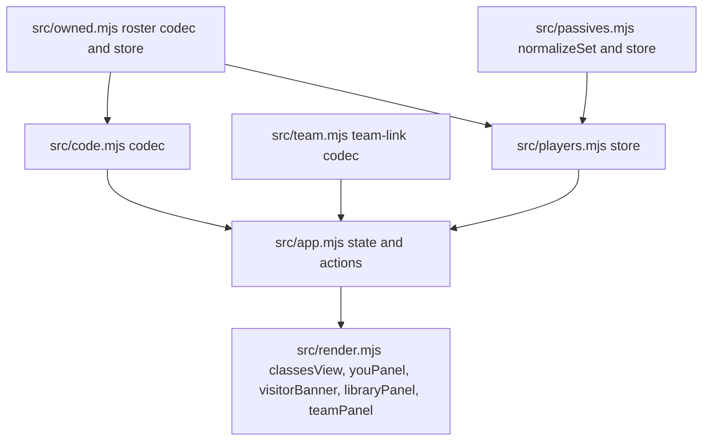

# Players, Teams, and Player Code v1 - Plan

## Goal Capsule

- Objective: a Drill to Earth's Core player can hand out one code or link that carries their whole class state (base class and level, passive sets, owned levels), and a team lead can paste such links into a saved players library, compose named teams of up to eight players, and pick each player's class from what that player owns while seeing that player's real passives.
- Means: hyphen-split build code as the URL path with `?u=` and `?s=` query carriers (D1, D2, D4), a single players-and-teams store with "Me" computed live from the existing owned and passives stores (D6, KTD3), team links that open read-only with a Save action (D8, KTD5), and removal of every legacy decoder and format (D3, KTD9).
- Authority hierarchy: user statements in the session > this plan's Product Contract > Key Technical Decisions > implementer judgment.
- Stop conditions: a change would require keeping or re-adding a legacy format listed under D3; a URL or code in a unit's Test Scenarios parses differently than specified; a team card would need to edit passives; the work would need a dependency beyond Node built-ins.
- Execution profile: implementation runs on sonnet subagents; one unit per commit in the order U1, U2, U3, U4, U5, U6; each unit's Verification passes before the next unit starts.
- Tail ownership: the implementer runs the Verification Contract on `PORT=8099` (never port 8090), records evidence in the PR body, and hands the deployed smoke check to the user.

---

## Product Contract

### Summary

The build code becomes the URL path: `/c5-sal2sal3sc1-15XF5XD?u=thefotios&s=mi-rec1sc2.sal-c2` is base Crafter at level 5 with passives Salvager 2, Salvager 3, Scout 1, the owner's username, and every other saved passive set ("Copy link" also appends the roster segment). The Classes page gains a username field, "Copy my code" (short code for chat), and "Copy link" (full share URL), and shows someone else's link as a read-only build with "Save to players". The Team page becomes a players library (one paste box that accepts a link, a path, or a bare code) plus named teams of up to eight library players; each card lets the lead switch the player's class among classes that player owns and shows that class's saved passives. "Me" is a live library entry backed by the Classes page. All legacy formats, decoders, and stores are removed.

### Problem Frame

Today a link carries one build and the team page keeps per-card labels and rosters by position, so a lead re-types each player's state per card and cannot see a player's real passives for another class. Passive sets are facts about a player (re-rolling costs currency), so team planning is choosing the best permutation of players and classes from what they already have, which needs each player's full state in one shareable unit.

### Requirements

**Build code and share links**

- R1. A build code is `<base code><level 1-5>[-<passive run>][-<roster>]`, hyphen-split; the first segment is the base class code plus its level digit, a later segment ending in a digit is the passive run, and a later segment ending in a roster letter (`X B C D F G`, case-insensitive) is the roster in the v2 run-length format.
- R2. The passive run is class code plus level digit (1 to 3) groups, at most three, no duplicates, never the base class, any order on input and canonical order (registry order, then level) on output; class tokens match exact codes only, case-insensitive.
- R3. The URL path is the build code; the username travels as `?u=<name>` and every other saved passive set as `?s=` with dot-separated `<base code>-<passive run>` items; `u` and `s` are independent and either may be absent.
- R4. A share input is accepted as a full URL on any host, a path, or a bare code; invalid tokens, extra segments, malformed items, and a roster segment that fails to decode are dropped with a notice, and an unknown base class rejects the input with a reason.
- R5. The roster decoder stops stripping hyphens; `E` and `U` stay reserved as roster version markers.

**Classes page**

- R6. The address bar shows only the build code of the selected base, `/c5-sal2sal3sc1`, with the level taken from my owned level; a base I own at level 0 shows `/` and disables both copy actions with the hint "Unlock <class> to share".
- R7. "Copy my code" copies the build code without roster or query; "Copy link" copies the absolute share URL with roster, `u` (when I have a username), and `s` (when other sets exist).
- R8. The username field lives in the "You" panel (the renamed roster disclosure) beside the roster code; a username is letters, digits, at most one underscore not at either end, 3 to 20 characters, compared case-insensitively.
- R9. Opening a link whose `u` is set and is not my username, or that carries a roster or `s` without `u` matching me, shows that player's build read-only (base levels unlocked per their roster or the code's level, passives shown without an Edit button) under a banner "<name>'s build" with a name field prefilled from `u` and a "Save to players" button. The name is validated inline (R8 rules; my own username is rejected with "That's you"); when it matches a saved player the button reads "Update <name>". After saving, the button becomes "Saved" with a link to the Team page and the URL is unchanged.
- R10. Opening my own link (`u` equals my username, or a bare code without roster or `s`) shows the link's passives without saving them, as today; `s` on my own link is ignored and never overwrites my saved sets.

**Players library**

- R11. The Team page has one paste box that accepts any share input (R4); a name is required (`u` wins; the adjacent name field is used when `u` is absent); pasting for an existing name updates that player everywhere and shows "Updated <name>"; pasting my own username is rejected with "That's you — edit your build on the Classes page"; parse notices are shown under the paste box.
- R12. A player record holds `name`, `base`, `levels` (class code to max level 1 to 5), and `sets` (class code to passive set); a record built from a link carries the roster's levels when present, otherwise only the base at the code's level. Updating an existing player from input without a roster or `s` merges: it sets `base`, `levels[base]`, and `sets[base]` and keeps the player's other levels and sets; input with a roster or `s` replaces the record.
- R13. "Me" is a live library entry computed from the owned store, the passives store, and my username; its `base` is my last selected class on the Classes page, else my first owned class. It is never a pasted snapshot, is not removable, and is listed first. Without a valid username the Me row shows "Set your username" linking to the You panel, and Me cannot be added to a team.
- R14. Removing a player removes them from every team; changing my username re-keys my memberships; setting my username to a saved player's name asks "That's a saved player — is it you?" and on confirm removes that saved player and re-keys its memberships to Me.
- R15. A team link pasted into the library is rejected with "Open a team link to save its players".

**Teams**

- R16. Teams are named, hold at most eight members referencing library players by name, and a player may belong to many teams; the active team is remembered.
- R17. A team card shows the player's name, a class selector limited to classes the player owns (levels above 0), that class's five levels with unlocked ones per the player's levels, and that class's saved passives or "No passives saved"; passives are never editable on a card. A member whose stored class the player no longer owns shows the player's own `base` instead.
- R18. A team link is `/team/<name>.<build code>~<name>.<build code>?n=<team name>`, each member's build code carrying the selected class (after the R17 fallback), its level, and that class's saved passives only; the team name is trimmed and at most 40 characters.
- R19. Opening a team link shows it read-only with "Save team"; saving creates the team, adds players from the link whose names are not in the library (existing players are untouched), maps my own name to Me, activates the team, and navigates to `/team`; links never auto-import.
- R20. On the Team page the address bar is `/team`; "Copy link" in the header copies the active team's link and is disabled when there is no active team.
- R20a. Empty states: library with only Me shows "Paste a link to add players"; no teams shows "Create a team to start"; an empty team shows "Add players from your library"; "Add player" is disabled with "All players added" when every library player is on the team, or at eight members.

**Legacy removal**

- R21. The `A`-prefixed roster decoder, owned store v1 acceptance (the owned store keeps writing and reading only its current v2 payload, so existing ownership survives), slug and slug-prefix resolution, slug paths such as `/scout/sal2`, level-less base paths, the `/team/scout.sal2~…` format, the `class-combo-viewer:team` store, the in-card passive picker, `withoutBase`, and the canonicalizing address-bar rewrite are removed along with their tests.

### Key Decisions

- D1. **Build code grammar is hyphen-split with the base level in the first segment.** (session-settled: user-directed — chosen over a separate `/c5/` path segment: one token pastes into chat and self-describes without the roster). Governs R1, R2.
- D2. **The URL path is the build code; the username is `?u=`.** (session-settled: user-directed — chosen over a named route: the address bar doubles as the short code). Governs R3, R6.
- D3. **No backwards compatibility; first shared release is schema v1.** (session-settled: user-directed — chosen over keeping legacy decoders: only the user has used the app). Governs R5, R21.
- D4. **Shared players carry all their passive sets via `?s=`.** (session-settled: user-directed — chosen over "one build plus roster": a card can switch class and still show real passives; codes may exceed Roblox chat length, links work regardless). Governs R3, R12, R17.
- D5. **Team cards switch class but never edit passives.** (session-settled: user-directed — chosen over an in-card passive picker: re-rolling costs currency, so sets are player facts). Governs R17, R21.
- D6. **"Me" is a live library entry synchronized with the Classes page.** (session-settled: user-directed — chosen over a pasted self snapshot: one source of truth for my state). Governs R13.
- D7. **Player identity is the case-insensitive username; re-pasting updates in place; a name is required to save.** (session-settled: user-approved — chosen over generated ids: Roblox usernames are unique). Governs R8, R11, R14.
- D8. **Team links open read-only with "Save team"; nothing auto-imports.** (session-settled: user-approved — chosen over auto-import: opening a link must not mutate the library). Governs R19.
- D9. **One paste box fills the library; teams are named and reference library players.** (session-settled: user-directed — chosen over per-card paste fields: a player edited once updates every team). Governs R11, R15, R16.
- D10. **"Copy my code" and "Copy link" both live on the Classes page.** (session-settled: user-directed). Governs R7.

### Scope Boundaries

- The Classes page keeps its class list, Edit mode, roster code, passive picker, and saved-set behavior; only the URL, the "You" panel, the copy actions, and the foreign-link view change.
- Team cards show level text as today; no aggregated or combined effects.

#### Deferred to Follow-Up Work

- Effect taxonomy and combined team effects.
- Team links carrying rosters or all sets (a player saved from a team link can switch class only after a full share link is pasted).
- Renaming a library player, exporting the library, server-side or shared state, AI summaries.
- Deploy configuration changes.

---

## Planning Contract

### Key Technical Decisions

- KTD1. **New pure module `src/code.mjs` owns the build code, `s`, and share-input codecs; `tokenize` moves there from `src/resolve.mjs`, which is deleted.** Class lookup is `classByCode` (exact, lowercase) only. Segment classification after the hyphen split uses the last character: a digit means passive run, a roster letter means roster; each kind at most once, any order accepted, canonical order `build-run-roster` on output. Rationale: the two tails never collide (a run ends in a digit, a roster in a letter), so no markers are needed. Cites D1, D2, D3. Directional grammar sketch:

```text
share    := [scheme://host][basePath] code [ '?' query ]  |  '/team/' members [ '?n=' team ]
code     := build [ '-' run ] [ '-' roster ]
build    := classcode digit15
run      := group{1,3}             group := classcode digit13
roster   := v2 run-length text ending in X|B|C|D|F|G
query    := params in any order: [ 'u=' name ] [ 's=' setitem ( '.' setitem )* ]
setitem  := classcode '-' run
members  := member ( '~' member )*   member := name '.' code
name     := [A-Za-z0-9_]{3,20} with at most one '_' not at either end
```

- KTD2. **One player record shape everywhere: `{ name, base, levels, sets }`.** `levels` is `{ [classCode]: 1-5 }`, `sets` is `{ [classCode]: [{ code, level }] }` normalized with `normalizeSet` from `src/passives.mjs`. A parsed share, a library entry, Me, and a team-link member are all this shape; a player's build is `base`, `levels[base]`, `sets[base]`. The roster string is derived with `encodeRoster(classes, levels)` and omitted when it would be `X`. The code's base level wins over the roster's level for the base. Rationale: one normalizer and one serializer serve every view. Cites R12.
- KTD3. **New store `src/players.mjs`, key `class-combo-viewer:players`, `{ v: 1, me, players, teams, active }`, injectable storage and id generator, never throws.** `players` is an array of KTD2 records keyed by lowercase name; `teams` is `[{ id, name, members: [{ name, base }] }]`; `active` is a team id. Me is not stored as a player: the app builds the Me record from `me`, the owned store, and the passives store (which is keyed by slug; `mePlayer` converts to class codes), and `playerByName(store, me, name)` resolves Me first. `upsert` rejects my own name; `remove(name)` drops memberships; `setMe(name)` re-keys memberships with the old name and returns `{ conflict }` for a name that exists in `players`, and `claimAsMe(name)` removes that player, re-keys its memberships, and sets `me`. A membership whose `base` the player no longer owns resolves to the player's own `base` at read time; the store does not rewrite it. Rationale: one versioned key with referential members keeps every team consistent on edit. Cites D6, D7, D9, R13, R14, R16.
- KTD4. **`src/team.mjs` is rewritten as a pure team-link codec: `parseTeamLink(classes, segment, search)` and `serializeTeamLink(classes, team, resolvePlayer)`.** Members are `name.code` joined by `~`; no blank marker. A member whose name or code fails is dropped with a notice; the ninth and later members are dropped with a notice. Each member parses to a KTD2 record with `levels = { [base]: level }` and `sets = { [base]: slots }`. Names pass `isValidName`, so they contain no `.`, `~`, `-`, or characters needing percent-encoding, and the separators are unambiguous. The old `parseTeam`, `serializeTeam`, and `createTeamStore` stay exported beside the new codec until U5 rewrites their only caller. Cites D8, R18, R19.
- KTD5. **Team-link save creates missing players and leaves existing ones untouched; the member's `base` comes from the link.** A full share link is the authoritative source of a player's facts; a team link carries a selection. Cites R19.
- KTD6. **Address-bar policy: Classes page pushes `/<build code>` on base change and replaces it on passive change; no query is ever written by the app; the Team page writes `/team`; an opened URL is left as is.** A visitor view (R9) and a team-link view (R19) do not touch history until the user navigates. Rationale: any `/team/<members>` path is therefore a shared link, and the active team needs no URL state. Cites D2, D3, R6, R20.
- KTD7. **Visitor view is app state `state.visitor` (a KTD2 record plus `name` draft and notices), not a build.** The loadout renders from the visitor's `levels` and `sets[base]`; `basePanel` and `passiveRow` take an `owned` map argument instead of reading `state.store`. Selecting any class in my list clears the visitor and runs `setBase`. Cites R9, R10.
- KTD8. **Username input and validation live in the "You" panel; `isValidName` is exported from `src/players.mjs`.** The field saves on change when valid and shows an inline error otherwise; Copy link omits `u` while the name is empty. Cites R8.
- KTD9. **Legacy removal is done in the unit that rewrites the last caller, so the app loads after every unit, and U6 proves nothing remains.** `src/owned.mjs` loses `decodeLegacy`, `LEGACY_SYMBOLS`, the hyphen strip, and v1 acceptance in U1. U4 removes `parsePath`, `serializePath`, `pushBuild`, `replaceBuild`, and the canonicalizing rewrite (the Classes page is their only caller); `parseBuild`, `serializeBuild`, `withoutBase`, and `src/resolve.mjs` keep serving the old team view until U5. U5 removes the old team view, `parseTeam`, `serializeTeam`, `createTeamStore`, `parseBuild`, `serializeBuild`, `withoutBase`, `src/resolve.mjs`, and `tests/resolve.test.mjs`, leaving `src/router.mjs` with only `relativePath`, `absoluteUrl`, `pushPath`, `replacePath`, `currentPath`, `teamSegment`, `sortSlots`, `addSlot`, `removeSlot`, `sameSlot`, `MAX_SLOTS`. Cites D3, R21.
- KTD10. **Built-ins-only toolchain and test layout stay as they are.** `node --test` over `tests/<module>.test.mjs`, pure modules take `{ getItem, setItem }`; the SPA fallback in `scripts/serve.mjs` serves `index.html` for paths whose extension is not a known asset type, which covers `/team/bob.c5-sal2`.

### High-Level Technical Design



Classes page flow: location path plus search go to `parseShare`; the result is Me's link (R10), a visitor (R9), or empty; the address bar is derived from my base and level (KTD6). Team page flow: `/team` renders the library and the active team from the store; `/team/<members>` renders the parsed link read-only until "Save team".

---

## Implementation Units

### U1. Build code and share codec, roster cleanup

- **Goal:** `src/code.mjs` parses and serializes build codes, `s` sets, and share inputs; `src/owned.mjs` drops legacy decoding.
- **Requirements:** R1, R2, R3, R4, R5, R12, R21 (owned parts).
- **Dependencies:** none.
- **Files:** `src/code.mjs` (new), `src/owned.mjs`, `tests/code.test.mjs` (new), `tests/owned.test.mjs`.
- **Approach:** Copy `tokenize` from `src/resolve.mjs` into `src/code.mjs` unchanged (`src/resolve.mjs` stays until U5). A segment classified as a roster that fails `decodeRoster` is dropped with a `malformed` notice carrying the decoder's message. `u` and `s` are read independently from the query. Export `classByCode`, `parseBuildCode(classes, text)` returning `{ base, level, slots, roster, notices }` (`roster` is the decoded owned map or null; an unknown base yields `base: null` with a notice and drops the rest), `serializeBuildCode(classes, player, { roster })` returning `c5-sal2sal3sc1` with `-<roster>` appended when `roster` is true and `encodeRoster` is not `X`, `parseSets` and `serializeSets` for the `s` grammar (unknown base or invalid run dropped with a notice; a set for the build's base is ignored in favor of the path), `parseShare(classes, text, basePath)` returning `{ player, notices }` (KTD2 record; `name` from `u`, trimmed, or empty) or `{ error }` for empty input, unknown base, or a team link (`error: 'Open a team link to save its players'`), and `serializeShare(classes, player, baseURI)` returning the absolute URL with `u` when `name` is set and `s` when other sets exist. Notice reasons reuse the `src/router.mjs` vocabulary (`unknown`, `level`, `malformed`, `extra`, `duplicate`, `self`); `ambiguous` is removed. In `src/owned.mjs` remove `decodeLegacy`, `LEGACY_SYMBOLS`, the `A` branch, the hyphen in the strip regex (spaces still stripped), and `parsed?.v !== 1` acceptance.
- **Test Scenarios:**
  1. `c5-sal2sal3sc1` parses to Crafter 5 with slots Salvager 2, Salvager 3, Scout 1 and round-trips.
  2. `c5-sc1sal3sal2` serializes in canonical order `c5-sal2sal3sc1`.
  3. `C5-SAL2` is case-insensitive; `c0` and `c6` give a level notice and no base.
  4. `c5-15XF5XD` parses roster only; `c5-sal2-15XF5XD` and `c5-15XF5XD-sal2` both parse run and roster and serialize as `c5-sal2-15XF5XD`.
  5. `c5-sal2-sal3` (two runs) keeps the first with an extra notice; a fourth group is dropped; `c5-c2` is a self notice; `c5-sal2sal2` is a duplicate notice; `c5-zz1` is unknown; `c5-sal` is malformed; `c5-sal2sc` (a run ending in a letter) drops the roster segment with a malformed notice.
  5a. `/c5-sal2?s=mi-rec1` (no `u`) parses the Miner set and an empty name.
  6. `scout-sal2` (slug) and `scout` are unknown base errors; `/scout/sal2` is an error.
  7. `parseShare` accepts `https://example.com/c5-sal2?u=Bob`, `/c5-sal2?u=Bob`, `c5-sal2`, and `https://host/dttec-tools/c5-sal2` with basePath `/dttec-tools/`, all giving base Crafter and name `Bob` where present.
  8. `?s=mi-rec1sc2.sal-c2` yields sets for Miner and Salvager; `?s=zz-rec1.mi-mi1` drops both with notices; an `s` item for the path's base is ignored.
  9. Share with roster `15XF5XD` and base `c5` gives `levels` with Crafter at 5 (code wins) plus the roster's other classes; share without roster gives `levels = { c: 5 }`.
  10. `serializeShare` emits `u` only when `name` is non-empty and `s` only for sets other than the base's; the output re-parses to an equal record.
  11. `parseShare('/team/bob.c5-sal2')` returns the team-link error; empty text returns an error.
  12. `decodeRoster` rejects `A…` codes with an invalid character error, no longer strips hyphens (`15X-F` is an error), still strips spaces, and still rejects a leading `E` or `U`; the owned store ignores a `v: 1` payload.
- **Verification:** `npm test` green; `tests/code.test.mjs` covers every scenario above.

### U2. Players and teams store

- **Goal:** `src/players.mjs` persists my username, library players, and teams with the KTD3 API.
- **Requirements:** R8, R11, R13, R14, R16.
- **Dependencies:** U1.
- **Files:** `src/players.mjs` (new), `src/passives.mjs` (add `all()` returning every saved set as `{ [classCode]: slots }` keyed by class code), `tests/players.test.mjs` (new), `tests/passives.test.mjs`.
- **Approach:** Export `isValidName`, `mePlayer(classes, name, ownedStore, passiveStore)` building the Me record, `playerByName(store, me, name)`, and `createPlayersStore(storage, classes, { newId })`. Store API: `me`, `setMe(name)` returning `{ ok: true }` or `{ error }`, `players` (sorted by lowercase name), `get(name)`, `upsert(record, { merge })` normalizing via `normalizeSet` and `isValidName`, rejecting an unknown base, a base level of 0, or my own name, and with `merge` keeping the existing record's other levels and sets (R12), `remove(name)`, `claimAsMe(name)`, `teams`, `active`, `setActive(id)`, `createTeam(name, members)`, `renameTeam(id, name)`, `deleteTeam(id)`, `addMember(id, name, base)`, `removeMember(id, name)`, `setMemberBase(id, name, base)`. Enforce at most eight members and one membership per name per team; `deleteTeam` of the active team activates the first remaining team. Load discards malformed entries field by field, as `src/passives.mjs` does.
- **Test Scenarios:**
  1. `isValidName` accepts `bob`, `Bob_2`, `a1b2c3`; rejects `_bob`, `bob_`, `b_o_b`, `ab`, 21 characters, `bob.x`.
  2. Upsert then upsert with the same name in another case replaces the record and `players` has one entry.
  3. Upsert rejects an unknown base and a record whose `levels[base]` is 0; sets with self passives or four entries are normalized.
  4. `remove('bob')` removes Bob from two teams; the teams keep their other members.
  5. `setMe('Fotios')` then `setMe('thefotios')` re-keys a membership stored under `fotios`; `setMe('bob')` while Bob is saved returns a conflict and leaves `me` unchanged; `claimAsMe('bob')` removes Bob, sets `me` to `bob`, and keeps his team memberships.
  5a. `upsert` of a record named like `me` (any case) is rejected; `upsert(bareRecord, { merge: true })` on Bob keeps his other levels and sets and replaces only `base`, `levels[base]`, and `sets[base]`.
  6. `createTeam` assigns ids from the injected generator and activates the first team; `addMember` refuses a ninth member, a duplicate name, and Me while `me` is empty; `setMemberBase` updates one member.
  7. `deleteTeam` of the active team activates the first remaining team or null.
  8. A storage that throws on `setItem` keeps state in memory; a malformed payload loads as empty; `v: 2` is ignored.
  9. `mePlayer` reflects owned store and passives store changes on each call, uses the passives store's last base (else the first owned class) as `base`; `playerByName` returns Me for my name in any case before a saved player.
  10. `passives.all()` returns saved sets keyed by class code and omits empty sets.
- **Verification:** `npm test` green.

### U3. Team link codec

- **Goal:** `src/team.mjs` parses and serializes the R18 team link; the old format and store are gone.
- **Requirements:** R18, R19 (parse side), R21 (team parts).
- **Dependencies:** U1, U2.
- **Files:** `src/team.mjs`, `tests/team.test.mjs`.
- **Approach:** Add, beside the existing exports (removed in U5), `parseTeamLink(classes, segment, search)` returning `{ name, members: [{ name, player }], notices }` where `player` is a KTD2 record from `parseBuildCode`, and `serializeTeamLink(classes, team, resolvePlayer)` returning `{ path, search }` with `path = /team/<name>.<code>~…` and `search = ?n=<encoded team name>` (empty when the team name is empty). A member without `.`, with an invalid name, or with an unknown base is dropped with a notice naming the raw member. `/team` and `/team/` parse to an empty member list. The team name is trimmed and capped at 40 characters.
- **Test Scenarios:**
  1. `/team/bob.c5-sal2sal3~ann.mi3?n=Raid%20A` gives name `Raid A` and two members with the expected bases, levels, and sets.
  2. Round-trip: a team whose members resolve to records with `sets[base]` serializes to the same path, including a member whose set is empty (`ann.mi3`).
  3. `bob` without a code, `b.o.b.c5`, `bob.scout-sal2`, and `bob.c9` are each dropped with a notice; valid members around them survive.
  4. Nine members keep the first eight with a notice.
  5. `/team` and `/team/` give no members and no notices; `/team/bob.c5/extra` gives an extra notice.
  6. A member whose stored base the player no longer owns serializes with the player's own `base`.
- **Verification:** `npm test` green; the app still loads at `/team` on `PORT=8099`.

### U4. Classes page: You panel, build-code URL, copy actions, visitor view

- **Goal:** The Classes page runs on the new codec with username, both copy actions, and the foreign-link view.
- **Requirements:** R6, R7, R8, R9, R10, R14 (username conflict prompt), R21 (Classes-page router helpers, canonicalizing rewrite).
- **Dependencies:** U1, U2.
- **Files:** `src/app.mjs`, `src/render.mjs`, `src/router.mjs`, `src/theme.css`, `tests/router.test.mjs`.
- **Approach:** In `src/app.mjs` create the players store beside the owned and passives stores, add `state.visitor` (null or `{ player, nameDraft, saved, notices }`), and rewrite `syncFromLocation` for the classes branch: parse `currentPath(window)` plus `location.search` with `parseShare`; empty path restores the last base; a Me link (R10) sets `linkView` with the link's slots; otherwise set `state.visitor`. Replace `pushBuild`/`replaceBuild` with `pushPath`/`replacePath` of `buildPath()` (`/` when my level for the base is 0, else `/<serializeBuildCode>` without roster). Add actions `setMe(name)` (on a conflict, show the R14 prompt and call `claimAsMe` on confirm), `copyCode`, `setVisitorName` (inline R9 validation), `saveVisitor` (upsert, then show "Saved" with a Team page link), and make `copyLink` use `serializeShare` of the Me record restricted to the current base. In `src/render.mjs` rename the roster disclosure to "You" with the username field above the roster rows, add "Copy my code" beside "Copy link" in the header on the classes view, disable both with the R6 hint when the base level is 0, render the visitor banner and read-only loadout per KTD7, and hide the loadout Edit button in visitor view. Trim `src/router.mjs` per KTD9 (U4 part) and delete the `parsePath`, `serializePath`, and canonicalization tests.
- **Test Scenarios:**
  1. `tests/router.test.mjs` no longer tests `parsePath`, `serializePath`, `pushBuild`, or `replaceBuild`; the old team view still loads.
  2. Browser: with Crafter owned at 5 and set Salvager 2, Salvager 3, Scout 1, selecting Crafter shows `/c5-sal2sal3sc1`; toggling a passive replaces the path; the back button returns to the previous base.
  3. Browser: Edit mode removing Crafter while selected shows `/` and both copy buttons disabled with "Unlock Crafter to share".
  4. Browser: "Copy my code" yields `c5-sal2sal3sc1`; "Copy link" yields `…/c5-sal2sal3sc1-<roster>?u=<me>&s=…` and omits `u` when the username is empty.
  5. Browser: opening `/c5-sal2?u=bob` shows "bob's build" with Crafter levels 1 to 5 unlocked from the code, Salvager 2 read-only, no Edit button, and "Save to players" adds Bob to the library and turns into "Saved" with a Team page link; an empty or invalid name disables the button; typing my own username shows "That's you"; reopening the link reads "Update bob".
  5a. Browser: setting my username to `bob` while Bob is saved shows the "is it you?" prompt; confirming removes Bob from the library and keeps his team cards as Me.
  6. Browser: opening my own link `/c5-sal2?u=<me>&s=mi-rec1` shows link view with Salvager 2, keeps my saved Crafter set until I edit, and leaves my Miner set unchanged.
  7. Browser: an invalid username shows an inline error and does not save; a valid one persists across reload.
- **Verification:** `npm test`, `npm run check`, `npm run build` green; scenarios 2 to 7 checked on `PORT=8099 node scripts/serve.mjs` with no console errors.

### U5. Team page: library and teams, team link view

- **Goal:** The Team page is a players library plus named teams; team links open read-only and save on request.
- **Requirements:** R11, R12 (merge on paste), R13, R14, R15, R16, R17, R19, R20, R20a, R21 (in-card picker, team store, old team actions, remaining router helpers, resolver).
- **Dependencies:** U2, U3, U4.
- **Files:** `src/app.mjs`, `src/render.mjs`, `src/theme.css`, `src/team.mjs`, `src/router.mjs`, `src/resolve.mjs` (delete), `tests/team.test.mjs`, `tests/router.test.mjs`, `tests/resolve.test.mjs` (delete).
- **Approach:** In `src/app.mjs` replace `state.team` with `{ link: null | { name, members, notices, saved }, paste: { draft, name, error, notices } }`; the team branch of `syncFromLocation` sets `link` for `/team/<members>` and null for `/team`. Remove `addPlayer`, `removePlayer`, `editPlayer`, `setTeamBase`, `toggleTeamSlot`, `clearTeamSlots`, `setTeamPassiveFilter`, `setTeamLabel`, `importTeamRoster`, `refreshTeamOwned`, `setTeamBuild`. Add `pastePlayer(text, name)`, `removePlayer(name)`, `createTeam`, `renameTeam`, `deleteTeam`, `setActiveTeam`, `addMember(name)`, `removeMember(name)`, `setMemberBase(name, base)`, `saveTeamLink`; `currentUrl` on the team view returns the active team's link via `serializeTeamLink` with `playerByName`. In `src/render.mjs` replace `cardEditor`, `teamCard`, `teamView` with `libraryPanel` (paste form with name field, player rows with base, level, roster-or-code marker, set count, Remove; Me row first, not removable), `teamPanel` (team selector, New, rename field, Delete, "Add player" selector of library players not in the team, cards per R17 using `basePanel`-style level rows and `chip`), and `teamLinkView` (read-only cards plus notices and "Save team"). `setView('team')` pushes `/team`; `setView('classes')` pushes `buildPath()`. `pastePlayer` upserts with `merge` when the input has no roster or `s` (R12) and rejects my own name (R11). `saveTeamLink` activates the team and pushes `/team` (R19). Me without a username is not offered in "Add player" (R13). Render the R20a empty states. Finish KTD9: remove the old team exports and their tests, `parseBuild`, `serializeBuild`, `withoutBase`, `src/resolve.mjs`, and `tests/resolve.test.mjs`; `tests/router.test.mjs` then covers only the helpers KTD9 keeps.
- **Test Scenarios:**
  1. Browser: pasting `https://host/c5-sal2sal3-D14XF5XD?u=bob&s=mi-rec1` adds Bob (owns Miner 3, Crafter 4 per the roster but 5 per the code, Salvager 3); pasting again with `?u=BOB` and a different set updates the single Bob row and shows "Updated BOB"; pasting bare `c5-sal3` with name `bob` changes only his Crafter set and keeps Miner.
  2. Browser: pasting a bare `mi3` with the name field empty shows the required-name error; pasting a team link shows the R15 message; pasting my own link shows "That's you".
  2a. Browser: with no username, the Me row shows "Set your username" and Me is not in "Add player"; a fresh profile shows the R20a empty states.
  3. Browser: New team "Raid", add Me and Bob; Bob's class selector lists only classes his roster owns; switching Bob to Miner shows Miner levels unlocked to his level and his saved Miner set; switching to a class with no set shows "No passives saved".
  4. Browser: a player saved from a team link offers only their one class in the selector.
  5. Browser: removing Bob from the library drops him from "Raid"; changing my username keeps my card.
  6. Browser: "Copy link" on the team view yields `/team/<me>.<code>~bob.<code>?n=Raid`; opening it in a fresh profile shows the read-only view with "Save team"; saving creates "Raid" with both members, adds Bob to the library, and lands on `/team` with "Raid" active; in a profile whose username equals the link's first member, that member maps to Me; saving onto an existing Bob leaves his record unchanged.
  6a. Browser: removing Miner from Bob (re-paste with a roster lacking Miner) while his card shows Miner falls back to his own base on the card and in the copied link.
  7. Browser: nine library players cannot all be added; the "Add player" selector disables at eight.
  8. Browser: the address bar reads `/team` while editing; opening `/team/zz.c9` shows a notice and an empty read-only team.
- **Verification:** `npm test`, `npm run check`, `npm run build` green; all scenarios checked on `PORT=8099 node scripts/serve.mjs` with no console errors.

### U6. README and legacy sweep

- **Goal:** `README.md` documents the new formats as final state and no legacy code or test remains.
- **Requirements:** R21 and documentation of R1 to R20.
- **Dependencies:** U1 to U5.
- **Files:** `README.md`, any file flagged by the sweep.
- **Approach:** Rewrite the "URL format", "Classes page", "Passive sets", "Roster code", and "Team view" sections of `README.md` for the build code grammar (KTD1 sketch), `u` and `s`, the "You" panel, both copy actions, the visitor view, the players library, teams, and the team link; keep `$table`, "Local development", "Deploy", and "Adding a class". Sweep with `rg` for `decodeLegacy`, `LEGACY_SYMBOLS`, `withoutBase`, `parseTeam(`, `createTeamStore`, `parseBuild(`, `parsePath`, `serializePath`, `pushBuild`, `replaceBuild`, `class-combo-viewer:team`, `resolve.mjs`, `ambiguous`, `slug prefix`, and `/scout/` across `src`, `tests`, `scripts`, `README.md`; remove every hit outside `docs/plans/`.
- **Test Scenarios:**
  1. The sweep returns zero hits outside `docs/plans/`.
  2. `README.md` has no "Old codes starting with `A` still import", no slug or prefix leniency text, and no `/team/scout.sal2~…` example.
  3. Every README code example parses with `parseShare` or `parseTeamLink` to the described build.
- **Verification:** `npm test`, `npm run check`, `npm run build` green; sweep output recorded in the PR body.

---

## Verification Contract

| Gate | Command or check | Pass signal |
|---|---|---|
| Unit tests | `npm test` | zero failures; `tests/code.test.mjs`, `tests/players.test.mjs`, `tests/team.test.mjs` present; `tests/resolve.test.mjs` absent |
| Data check | `npm run check` | `data ok`, exit 0 |
| Build | `npm run build` | exit 0 |
| Legacy sweep | U6 `rg` sweep (word-boundary patterns, e.g. `\bserializeBuild\b`) over `src`, `tests`, `scripts`, `README.md`; `test ! -e src/resolve.mjs` | zero hits; file absent |
| Accessibility | browser | new inputs are labelled; inline errors and notices sit in `aria-live` regions; disabled copy buttons reference their hint via `aria-describedby`; paste, save, add-member, and class switch work by keyboard |
| Local app | `PORT=8099 node scripts/serve.mjs`, open `http://localhost:8099/c5-sal2sal3sc1?u=bob` | visitor banner renders, no console errors |
| Team link | open `http://localhost:8099/team/bob.c5-sal2~ann.mi3?n=Raid` | read-only team with "Save team", no console errors |
| Layout | browser at 390px and 1440px | no horizontal scroll on Classes and Team pages |
| Port discipline | never start, stop, or reuse port 8090 | the user's server on 8090 is untouched |

---

## Definition of Done

- All six units committed in the Goal Capsule order, each passing its Verification.
- Verification Contract gates executed with fresh output recorded in the PR body.
- Every R1 to R21 is traceable to a unit and a passing test or recorded browser check.
- Legacy removal complete: `src/resolve.mjs`, `tests/resolve.test.mjs`, `createTeamStore`, `parseTeam`, `parseBuild`, `parsePath`, `serializeBuild`, `serializePath`, `pushBuild`, `replaceBuild`, `withoutBase`, `decodeLegacy`, the in-card passive picker, and the `class-combo-viewer:team` key are absent from `src`, `tests`, `scripts`, and `README.md`.
- `README.md` describes only current behavior.
- Cleanup: no abandoned-attempt code, scratch files, or fixtures; `dist/` stays gitignored; `package.json` has no dependencies; `docs/plans/2026-10-29-0927-feat-class-combo-viewer-plan.md` untouched.
