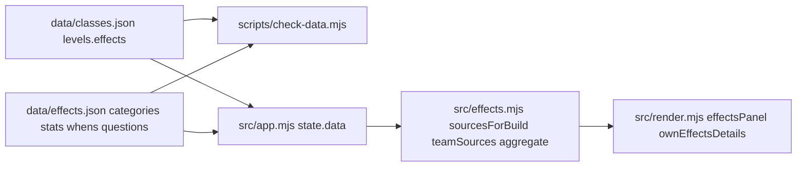

# Combined Effects - Plan

## Goal Capsule

- Objective: every class level in `data/classes.json` carries validated effect tags, and the app shows a grouped "Combined effects" panel with totals for one build on the Classes page (own build and a visitor's build) and for a team on the Team page (team-wide totals plus each member's own effects).
- Means: a one-time merge of the reviewed draft into `classes.json`, `check-data` validation against the taxonomy in `data/effects.json`, a pure aggregation module `src/effects.mjs` with node tests, and two render panels built from its output.
- Authority hierarchy: user statements in the session > this plan's Product Contract > Key Technical Decisions > implementer judgment.
- Stop conditions: a unit would need a game fact not in `data/effects.json` notes or questions; a change to share codes, URLs, or any storage schema; a dependency beyond Node built-ins; a `check` violation that can only be fixed by weakening a rule in D2.
- Execution profile: implementation runs on sonnet subagents; one unit per commit in the order U1 to U6; commits only when the user asks; each unit's Verification passes before the next unit starts.
- Tail ownership: the implementer runs the Verification Contract on `PORT=8099` (never port 8090) and records evidence in the PR body.

---

## Product Contract

### Summary

Each level of each class lists its effects (`stat`, optional `value`, `scope`, optional `when`, optional `uncertain`). The Classes page gets a "Combined effects" panel under the passives panel: categories and sub-categories from the taxonomy, one row per stat with a summed total, its sources, warnings for same-class stacking, a rounded mark for Recruit-scaled values, conditional rows grouped by their condition, flags listed without a value, nearby bonuses called out, and an Uncertain group that shows the open question and is left out of totals. The Team page gets a "Team effects" panel that totals only team-wide bonuses across members, and each member card gets a collapsed "Own effects" section.

### Problem Frame

Level text is prose, so a player comparing passive sets or a lead composing a team adds percentages by hand and cannot tell which bonuses reach the team. The reviewed draft tags (`data/effect-tags.draft.json`, 180 effects) and the taxonomy (`data/effects.json`) exist but are untracked and unused.

### Requirements

**Data**

- R1. Every `levels[i]` entry in `data/classes.json` has a non-empty `effects` array of `{ stat, value?, scope, when?, uncertain? }`; `data/effect-tags.draft.json` and `docs/effect-tags-review.md` are removed.
- R2. `data/effects.json` keeps `categories`, `stats`, `questions`, `notes` and gains `whens` (`when` id to display label); it is loaded by the app, the check, and the build.
- R3. `npm run check` fails when: a stat id is unknown; a stat's `cat`/`sub` is not in `categories`; a flag stat carries a value or a pct/flat stat lacks a number; `scope` is not `self|nearby|team`; `uncertain` is not a `questions` key; `when` is not a `whens` key; a level has no effects; an L4 effect is `self`-scoped.

**Aggregation**

- R4. Same stat, same `when` (or both absent), not uncertain: pct and flat values sum additively; flags are listed with their sources and never summed.
- R5. Effects with a `when` are grouped under that condition's label and never summed with unconditional effects of the same stat; conditional flags are listed in their condition group without a value. An uncertain effect goes only to the Uncertain group, even when it has a `when`.
- R6. Uncertain effects form a separate Uncertain group showing the question text and are excluded from totals.
- R7. A total that combines the same class from more than one source instance (two passive slots, or two team members) is marked with a same-class warning ("stacking unconfirmed"); one build's cumulative base levels count as a single instance and never trigger it.
- R8. Base class Recruit owned at L5 multiplies the pct and flat values of passive-slot effects by 1.25; each scaled source value is rounded to one decimal place and marked rounded when that changed it (current rule, pending question `recruit-rounding`); the base class's own levels are never scaled.
- R9. A build's sources are the base class levels 1 to its owned level and each passive slot's single level; a visitor build uses the visitor's levels.
- R10. Nearby-scoped effects are shown as a callout ("close players get a higher bonus") and never enter totals.

**Classes page**

- R11. The "Combined effects" panel renders after the passives panel in the loadout column for my build and for a visitor's build, grouped category > sub-category > stat rows, then Conditional, Nearby, Flags, and Uncertain groups, each omitted when empty; sub-categories without rows are omitted; the panel shows "No effects yet" only when every group is empty. Self- and team-scoped effects of the build sum into one row per stat, because L4 team bonuses also apply to their owner (Samurai L1 + L4 = +30%). A Recruit base owned at L5 shows the note "Passives scaled ×1.25 (Recruit L5); values rounded".
- R12. Each row shows the stat name, total with unit (`+12%`, `+50`, or none for flags), a rounded mark when R8 applied, the same-class warning when R7 applied, and its sources as one muted, wrapping line ("Recruit L1, Samurai L4 (team), Salvager 2 (passive)"). The rounded mark and the warning carry text (visible or visually hidden), never glyph or color alone.

**Team page**

- R13. The "Team effects" panel above the team grid totals `team`-scoped effects from every member's selected class levels 1 to that player's owned level and that class's passive slots; `nearby` effects appear as callouts; R4 to R7 apply across members, so two members with the same base class at L4 produce a same-class warning.
- R14. Each team card (active team and opened team link) gets a collapsed "Own effects" disclosure with that member's self-scoped totals (R4 to R8), or "No own effects" when empty; its open state survives repaints for the session but is not persisted.

**Docs**

- R15. README "Adding a class" lists `effects` per level with the field rules, and the README Classes page and Players and teams sections describe the panels in one paragraph each; the Help page explains how to read the Combined effects panel.

### Key Decisions

- D1. **Effects live in `classes.json` per level; the draft is deleted; `effects.json` stays as taxonomy plus open questions.** (session-settled: user-directed). Governs R1, R2.
- D2. **The check validates ids, units, scopes, questions, whens, non-empty levels, and L4 scope.** (session-settled: user-directed). Governs R3.
- D3. **Additive totals, conditionals grouped by `when`, flags listed, uncertain excluded, same-class stacking flagged.** (session-settled: user-directed). Governs R4 to R7.
- D4. **Recruit L5 is ×1.25 on passive-slot effects, rounded and marked.** (session-settled: user-directed; rounding rule remains question `recruit-rounding`). Governs R8.
- D5. **Team page totals only team-wide bonuses; own effects collapse per card.** (session-settled: user-confirmed). Governs R13, R14.
- D6. **Base contributes cumulative owned levels; passives contribute one level.** (session-settled). Governs R9.

### Scope Boundaries

- No change to share codes, URLs, or storage schemas; no AI summaries; no remote state.
- Level text stays the display source on class lists and cards; effects are an addition.
- The generated review snapshot `docs/effect-tags-review.md` is deleted: it duplicates data that now lives in `classes.json` and the `effects.json` questions, and goes stale on every edit.

---

## Planning Contract

### Key Technical Decisions

- KTD1. **`levels[i].effects` in `classes.json`, merged by a throwaway script in the session scratchpad (not committed).** The script reads the draft keyed by class code, asserts every class in `classes.json` has exactly five effect arrays, writes `effects` after `tag` on each level, and rewrites the file with 2-space JSON. Rationale: the data stays one file per concern; the merge is a one-off with no durable value. Cites D1.
- KTD2. **`data/effects.json` gains `whens: { id: label }` for the 16 ids in use, and `checkData(data, registry, taxonomy)` takes the taxonomy as a third argument.** The `scripts/check-data.mjs` CLI always reads the repo's `data/effects.json` (whatever `argv[2]` names for `classes.json`), so the existing temp-file CLI test keeps working; `scripts/build.mjs` reads `effects.json` from `DATA_DIR` and already copies the whole `data/` dir. Rationale: labels belong to the taxonomy, so the check proves every `when` has a label. Cites D2.
- KTD3. **The app fetches `data/effects.json` alongside `data/classes.json` and stores it as `state.data.effects`.** `src/app.mjs` fetches both with `Promise.all`, validates `categories`, `stats`, `whens` exist, and keeps the single `status: 'error'` path. Rationale: one load phase, no lazy fetch in render. Cites R2.
- KTD4. **Pure module `src/effects.mjs`.** `sourcesForBuild(classes, base, ownedLevel, slots, { recruitMaster })` returns `[{ cls, level, kind: 'base'|'passive', effect }]`, scaling each passive pct/flat value by 1.25, rounded to one decimal, with `rounded: true` on that source when rounding changed it when `recruitMaster` (base code `rec` owned at 5). `aggregate(taxonomy, sources, { scopes })` keeps sources whose `effect.scope` is in `scopes` and returns `{ categories: [{ id, name, subs: [{ id, name, rows }] }], conditional: [{ when, label, rows }], flags: [row], nearby: [row], uncertain: [{ question, rows }] }` where a row is `{ stat, name, unit, total, rounded, sameClass, sources: [{ label, value, cls, kind }] }`. Grouping key is `stat` plus `when`; `sameClass` is true when two sources share `cls.code` and are not both base levels of the same build or member (each source carries an `instance` key: `base` or the slot index, prefixed by the member name on the team page); an effect with `uncertain` goes only to `uncertain`, even with a `when`; flag and nearby rows carry no total; uncertain rows are grouped by question id with its `q` text. `teamSources(classes, members)` maps `[{ player, base, slots }]` through `sourcesForBuild` and tags each source with the member name so labels read "Bob: Samurai L4". Rationale: one aggregator serves both pages; scopes decide the view (`['self','team','nearby']` for a build, where self and team rows of one stat merge and nearby goes to callouts; `['team','nearby']` for the team panel; `['self']` for a card). Team-scoped sources are labelled "(team)". Cites D3, D4, D5, D6.
- KTD5. **Crit "is X%" rows are ordinary pct additions; no special casing.** The taxonomy already encodes them as pct.
- KTD6. **Render helpers `effectsPanel(title, model)` and `ownEffectsDetails(model)` in `src/render.mjs`.** The panel is a `section.panel.effects` with `panel-head`/`panel-title`, nested lists per category and sub, rows as `li.effect-row` with `span.effect-total`, `span.effect-warn`, and a `ul.effect-sources`; the card section is a native `
` with `
Own effects
` (summary has a `data-fk` like `member-<name>-effects` and a 44px touch target), closed by default; because `render()` rebuilds the DOM on every paint, open disclosures are tracked in transient `state.openEffects` (a set of member names, not persisted) via the `toggle` event. Sources render as a muted comma-separated line that wraps; totals right-align. Styles go in `src/theme.css` next to the level styles. Rationale: matches the existing hyperscript panel pattern. Cites R11 to R14.
- KTD7. **Classes page placement: `loadout` and `visitorLoadout` append `effectsPanel` after the passives section inside `loadout-col`.** Own build uses `state.store.owned[base.code]` and `state.build.slots`; visitor uses `player.levels[base.code]` and `toSlots(player.sets[base.code])`. Cites R9, R11.
- KTD8. **Team page: a sibling `section.panel.effects` "Team effects" follows the team panel (and the team link panel), with the same group set as the Classes panel minus the Recruit note; `playerCard` appends `ownEffectsDetails` after the passives list.** Member inputs come from the existing `memberBase` and `player.levels` resolution, so fallback bases are consistent with the card. Cites D5, R13, R14.

### High-Level Technical Design

### Assumptions

- Every class in the draft has five arrays and every draft code exists in `classes.json` (the merge script asserts this and stops otherwise).

---

## Implementation Units

### U1. Merge effects into class data and extend the taxonomy

- **Goal:** `classes.json` carries effects per level; `effects.json` has `whens`; draft and review snapshot are gone.
- **Requirements:** R1, R2.
- **Files:** `data/classes.json`, `data/effects.json`, delete `data/effect-tags.draft.json`, delete `docs/effect-tags-review.md`; merge script in the scratchpad only.
- **Approach:** Write the scratchpad script per KTD1, run it once, check that only `effects` keys were added (`git diff --stat`, spot-check `mi`, `rec`, `sal`, `sam`). Add `whens` with plain labels for all 16 ids (`as_driver` "While driving", `in_darkness` "In darkness", `blessed_by_staff` "While blessed by a Priest", and so on; wording from the level text, no new facts). Add a note line to `effects.json` stating effects live in `classes.json`. Delete the two files with `rm -f`.
- **Test Scenarios:**
  1. Every class has five levels each with `effects.length >= 1` (script assertion; count equals 31 × 5).
  2. `rec` L5 is `passive_strength 25 self`; `sal` L5 is the flag `shred_also_coins`; `sam` L1 is `melee_crit_chance 20 self`.
  3. Every `when` in `classes.json` is a key of `whens`.
- **Verification:** `npm test` green (no behavior change yet); `git status` shows the draft and review file removed, no scratch files in the repo.

### U2. Validate effects in check-data and the build

- **Goal:** `checkData` enforces R3 with the taxonomy; CLI and build read `effects.json`.
- **Requirements:** R3.
- **Files:** `scripts/check-data.mjs`, `scripts/build.mjs`, `tests/check-data.test.mjs`, `tests/build.test.mjs` (if it stubs data).
- **Approach:** Add `taxonomy` as a third parameter (KTD2); build `statIds`, `subsByCat`, `whenIds`, `questionIds` sets once; per level, report `${slug}: level N effect K ...` messages per rule in R3, plus a taxonomy pass that reports a stat whose `cat`/`sub` is missing from `categories`. Update `fresh()` in the test to return the three files and add a `withEffect(code, level, effect)` helper that overrides one level's effects.
- **Test Scenarios:**
  1. Real data: `checkData(...fresh())` is `[]`.
  2. Unknown stat `nope` -> one violation naming the level; a stat with `cat` `gather` and `sub` `zzz` -> taxonomy violation.
  3. Flag `shred_also_coins` with `value: 5` -> violation; `pickaxe_damage` without value -> violation; `value: "50"` -> violation.
  4. `scope: 'friend'` -> violation; `uncertain: 'no-such'` -> violation; `when: 'while_flying'` -> violation.
  5. Empty `effects` on L2 -> violation; L4 effect with `scope: 'self'` -> violation; L4 `nearby` passes.
- **Verification:** `npm test` green; `npm run check` prints `data ok`; `npm run build` exits 0 with `dist/data/effects.json` present and no `effect-tags.draft.json`.

### U3. Aggregation module and tests

- **Goal:** `src/effects.mjs` turns build or team inputs into the grouped model.
- **Requirements:** R4 to R10, R13 (model side).
- **Files:** `src/effects.mjs` (new), `tests/effects.test.mjs` (new).
- **Approach:** Implement KTD4 and KTD5. Row order inside a sub follows taxonomy `stats` order; categories follow `categories` order; conditional groups follow `whens` order; sources keep input order. Tests use the real `data/classes.json` and `data/effects.json` via `readFileSync`, plus small synthetic taxonomies for edge cases.
- **Test Scenarios:**
  1. Recruit owned L5 with passive Salvager 2 (`shred_cogs 50`): source value 63 (from 62.5, `rounded: true`) -> row total 63 with `rounded: true`; Recruit's own L1 `gun_damage 20` is unscaled.
  2. Recruit owned L4 with the same passive: total 50, `rounded` false.
  3. Synthetic: passive pct 10 under Recruit L5 -> 12.5 -> 13 rounded.
  4. Synthetic same stat from Salvager 2 and Salvager 3 -> `sameClass: true` and total summed; the real Salvager 2 + Salvager 3 pair shares no stat, so no warning.
  5. Recruit owned L3 with passive Nightcrawler 1: unconditional `melee_damage` total 20 (Recruit L1); conditional group "In darkness" holds `melee_damage 30` and `move_speed 30`; the two `melee_damage` rows never merge.
  6. Mercenary owned L3: L3's `per_consecutive_hit` effects appear only under `uncertain` with the `consecutive-hit-scaling` question text; L1's unconditional `melee_attack_speed 30` still totals 30.
  7. Salvager L5 `shred_also_coins`: in `flags` with source "Salvager L5", no total; Healer L3 `heal_items_share` (nearby): in `nearby`, not in categories; Nightcrawler L2 `darkness_stealth` (flag with `when`): in the "In darkness" group without a value.
  8. Samurai owned L4 base: `melee_crit_chance` self 20 + team 10; `aggregate(['self','team'])` total 30 with `sameClass` false; `aggregate(['team'])` total 10. Tank owned L3: `max_health` from L1 and L3 sums with `sameClass` false.
  11. Mercenary L3 `per_consecutive_hit` effects (uncertain with a `when`) appear in `uncertain` only, not in `conditional`.
  9. Team: two members both base Samurai at L4 -> team row `melee_crit_chance` total 20 with `sameClass: true`, sources labelled with both names; a member at Samurai L3 contributes nothing team-scoped.
  10. Empty sources -> empty categories, conditional, flags, nearby, uncertain.
- **Verification:** `npm test` green including `tests/effects.test.mjs` covering all scenarios.

### U4. Classes page panel

- **Goal:** "Combined effects" panel for my build and a visitor's build.
- **Requirements:** R9, R11, R12.
- **Files:** `src/app.mjs`, `src/render.mjs`, `src/theme.css`.
- **Approach:** KTD3 loading; KTD6 helpers; KTD7 placement. Groups and the Recruit note per R11; one `aggregate(['self','team','nearby'])` call.
- **Test Scenarios (browser, PORT=8099):**
  1. Recruit owned at 5 with passive Salvager 2: the Shred Cogs row shows `+63%` with a rounded mark and source "Salvager 2 (passive)"; Recruit rows unscaled.
  2. Samurai owned at 4: one Melee Crit Chance row `+30%`, sources "Samurai L1, Samurai L4 (team)", no same-class warning.
  3. Mercenary owned at 3: Uncertain group lists the consecutive-hit question; Melee Attack Speed still shows `+30%`.
  4. Visitor link `/sal5?u=bob`: panel renders from the visitor's levels with "Shredding Also Grants Sell Value in Coins" under Flags.
  5. No base selected: no panel; base at level 0 with no passives: panel reads "No effects yet".
- **Verification:** `npm test` green; Playwright script in the scratchpad asserts the texts above and zero console errors; no horizontal scroll at 390px.

### U5. Team page panels

- **Goal:** "Team effects" panel and per-card "Own effects" disclosure.
- **Requirements:** R13, R14.
- **Files:** `src/render.mjs`, `src/theme.css`, `src/app.mjs` (member input helper if needed).
- **Approach:** KTD8. Build member inputs from the active team (via `playerByName` + `memberBase`) or from `state.team.link.members`; `teamSources` -> `aggregate(['team','nearby'])` for the panel; each card runs `aggregate(['self'])` on its own sources inside `ownEffectsDetails`. The panel shows "Add players to see team effects" when the team is empty and "No team effects" when members have none.
- **Test Scenarios (browser, PORT=8099):**
  1. Team with Bob (Samurai L4) and Ann (Samurai L4): Team effects shows Melee Crit Chance `+20%` with the same-class warning and both names as sources.
  2. Bob switched to a class he owns below L4 via the card select: the Samurai row drops to `+10%` without warning.
  3. Each card has a closed `
` "Own effects"; opening Bob's shows his self rows only and it stays open after changing Ann's class select.
  4. Team link `/team/bob.sam4~ann.mi3?n=Raid`: panel and disclosures render read-only; Miner L3 adds no team rows; no console errors.
- **Verification:** `npm test` green; Playwright script asserts the texts above; keyboard opens the `
`.

### U6. README, Help, and final browser pass

- **Goal:** docs describe effects and the panels; whole feature verified in the browser.
- **Requirements:** R15.
- **Files:** `README.md`, `src/render.mjs` (`helpView`).
- **Approach:** README "Adding a class" step 2 lists `effects` per level with the R3 rules and points at `data/effects.json` for stat ids, `whens`, and `questions`; the Classes page and Players and teams sections get one paragraph each on the panels. The Help page gains a "Combined effects" section: how totals are formed, and what rounded, same-class, conditional, nearby, flags, and uncertain mean.
- **Test Scenarios:**
  1. `/help` shows the new section.
  2. Full Verification Contract run.
- **Verification:** `npm test`, `npm run check`, `npm run build` all pass; Playwright pass over U4 and U5 scenarios with zero console errors.

---

## Verification Contract

| Gate | Command or check | Pass signal |
|---|---|---|
| Unit tests | `npm test` | zero failures; `tests/effects.test.mjs` present |
| Data check | `npm run check` | `data ok`, exit 0, reads `data/effects.json` |
| Build | `npm run build` | exit 0; `dist/data/effects.json` exists; no draft file in `dist/data` |
| Data merge | `git status`, level count | draft and review snapshot absent; 155 levels each with effects |
| Classes page | `PORT=8099 node scripts/serve.mjs`, Recruit L5 + Salvager 2 | `+63%` rounded row, no console errors |
| Team page | team with two Samurai L4 members | `+20%` with same-class warning |
| Layout | 390px and 1440px | no horizontal scroll with the new panels |
| Port discipline | never start, stop, or reuse port 8090 | the user's server on 8090 is untouched |

---

## Definition of Done

- All six units committed in order, each passing its Verification; commits made only when the user asks.
- Every R1 to R15 traceable to a unit and a passing test or recorded browser check.
- `data/effect-tags.draft.json` and `docs/effect-tags-review.md` deleted; no merge script in the repo; `package.json` has no dependencies.
- `README.md` and the Help page describe only current behavior.
