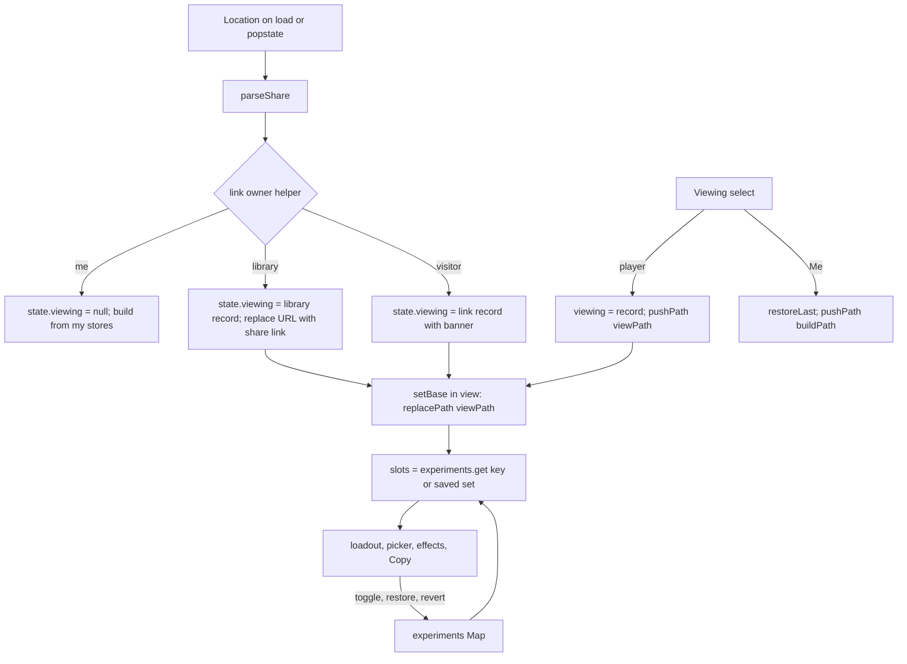

# Roster Browser and Passive Experiments - Plan

## Goal Capsule

- **Objective:** On the Classes page I can open any saved player, or any shared link, and browse their classes and builds the way I browse my own. I can also try out different passives from their unlocks without changing their saved data.
- **Means:** one "viewed player" state replaces the visitor-only view and drives the whole Classes page; experiments live in an in-memory map keyed by player and base (KTD1, KTD4).
- **Product authority:** the user (sole product owner). Decisions below were settled in the 2026-10-30 brainstorm and the planning session.
- **Open blockers:** none.
- **Stop conditions:** stop and ask when a change would write to the players library from the Classes page by any path other than Remove or Save to players, or when the Team page would need to read experiments.

---

## Product Contract

Product Contract preservation: clarified, no scope change — R2 names library players, R5 limits the banner to names not in the library, and R11 states what leaving the Classes page does; this plan adds the Problem Frame and the sections after the Product Contract.

### Summary

A "Viewing" select in the You panel switches the Classes page between me and any player in the Players library. Another player's view is read-only for their roster, base levels and saved passives. Passives can be changed as an in-memory experiment, shown as a set diff against the saved passives, with Revert.

### Problem Frame

The Classes page only shows my own classes, or one read-only build from a shared link. The Players library holds every other player's roster and sets, but there is no way to browse them like my own build, and no way to try different passives for a player without changing their saved data.

### Key Decisions

- **The select lists the Players library, not a new roster store.** There is one source of other players. (session-settled: user-directed — chosen over a separate list of named roster imports: the library already holds roster, base and sets.) Governs R1, R4.
- **The select lives in the You panel on the Classes page, not the app header.** (session-settled: user-directed — chosen over a header select visible on every page: it sits beside my name, as asked.) Governs R1.
- **Experiments last until revert or reload, per player and base.** (session-settled: user-directed — chosen over discarding on navigation and over sessionStorage persistence.) Governs R11.
- **Experiments stay on the Classes page.** The Team page always shows saved passives, so the team view never mixes real and hypothetical builds. (session-settled: user-directed — chosen over team cards and Team effects using experiments.) Governs R12.
- **A shared link opens the same player view.** (session-settled: user-directed — chosen over leaving the shared-link view as a read-only single build.) Governs R5.
- **Viewing a player puts their share link in the URL.** (session-settled: user-directed — chosen over in-page state only: back/forward and reload work.) Governs R3.
- **Changes show inline with a single Revert.** NEW tags mark added passives, ORIGINAL ghost rows mark removed ones and can restore them, and one Revert resets everything. (session-settled: user-directed — chosen over Revert only with no per-row restore, and over side-by-side Saved/Experiment columns.) Governs R8–R10.

### Requirements

**Choosing whose view**

- R1. The You panel has a "Viewing" select beside my name. It lists Me first, then the library players A to Z. Picking an entry switches the Classes page to that view.
- R2. While a library player is selected, the You panel offers Remove. Remove deletes the player from the library and from every team, exactly as Remove does on the Team page, with no confirmation. The view then returns to Me.
- R3. The URL of another player's view is that player's share link: their saved base, saved passives and roster, plus `?u=<name>`. Back, forward and reload restore the view. Picking Me returns to my own URL.
- R4. When the library is empty, the select shows only Me. It stays visible so the feature can be discovered.

**Another player's view**

- R5. A player's view shows their owned classes in the class list, their levels in the base panel, and the saved passives for the selected base in the loadout and Combined effects. An opened shared link for a name not in the library shows the same view, with the existing "Save to players" banner above it.
- R6. Any class the player owns can be selected as base. That base shows the player's saved set for it, or an empty set when none is saved. The roster, levels, owned-class Edit and Import roster cannot be changed: the class-list Edit and Import roster are hidden while another player is viewed.

**Passive experiments**

- R7. The passive Edit picker works on another player's view. Choices are limited to that player's unlocked passive levels, the same rules as my own picker. Changes never write to the library.
- R8. A change is the set difference between the current passives and the saved ones; order and slot position are ignored. A passive that was removed and re-added is not a change.
- R9. When the current set differs from the saved set:
  - Added passives carry a NEW tag.
  - Each removed saved passive appears as a dimmed ORIGINAL row below the current ones. Tapping it restores the passive if a slot is free.
  - A Revert button in the passives panel head resets to the saved set. Revert is hidden when nothing differs.
- R10. In the Edit picker, each saved passive that is not currently selected is highlighted as ORIGINAL.
- R11. Each experiment is kept separately per player and base, in memory, until Revert or a page reload. Switching player or base and coming back shows it again. Leaving the Classes page returns to Me (KTD3); picking the player again shows the experiment.
- R12. Combined effects on the Classes page reflect the experimental passives, including Recruit L5 scaling when the base is Recruit L5. Team cards and Team effects ignore experiments.
- R13. Copy link and Copy code in another player's view share their saved build, never the experiment.

### Acceptance Examples

- AE1. **Covers R8, R9.** Bob's saved Scout passives are Salvager 2, Scout 1 and Miner 3. I remove Salvager 2 and Scout 1, then add Scout 1 back. Scout 1 shows no tag; Salvager 2 shows as an ORIGINAL ghost row, Revert is visible, and a free slot remains.
- AE2. **Covers R8, R9.** Starting from AE1, I add Salvager 2 back. No tags or ghost rows remain and Revert is hidden.
- AE3. **Covers R9.** I swap Miner 3 for Pirate 2. Pirate 2 shows NEW and Miner 3 shows as an ORIGINAL ghost row. Tapping Miner 3 does nothing while all three slots are full, and restores it after I remove Pirate 2.
- AE4. **Covers R11.** I change Bob's Scout passives, switch to Alice, then back to Bob: the experiment is still there. After a reload, Bob shows his saved passives.
- AE5. **Covers R6.** Bob owns Miner but has no saved Miner set. Selecting Miner as base shows an empty loadout with no tags, and any passive I add shows NEW.
- AE6. **Covers R2, R3.** While viewing Bob, I tap Remove. Bob is gone from the library and his teams, the select shows Me, and the URL is my own.

### Scope Boundaries

- Editing another player's roster, base levels or saved passives.
- Saving an experiment to the library, or sharing it by link or code.
- Experiments on my own build. My passives already save as I edit them.
- Showing the select on the Team or Help pages.

#### Deferred to Follow-Up Work

- Keeping the viewed player across a visit to the Team or Help page. Today leaving those pages restores my own build, and this plan keeps that (KTD3).
- A confirmation on Remove. R2 asks for none.

### Sources / Research

- `src/render.mjs`:
  - `rosterSection` is the You panel.
  - `visitorBanner` / `visitorLoadout` are the current shared-link view.
  - `loadout` / `pickerEditor` / `passivePicker` handle passive editing.
  - `passiveRow` renders read-only rows.
  - `basePanel` shows the Copy buttons only when `actions` is passed.
  - `ownRow` / `classesView`: the class list reads `state.store.owned`.
  - `libraryRow` holds the Team page Remove.
  - `focusKey` / `restoreFocus`: focus survives the full repaint through `data-fk`.
- `src/app.mjs`:
  - `state.visitor` is created in `syncFromLocation` for a link that is not mine. It is cleared in `restoreLast`, `setBase` and `setView`.
  - `myPlayer`, `buildPath`, `shareBlock`, `currentUrl` and `currentCode` always serialize my own record.
  - `setSlots` saves to `state.passives` and replaces the URL.
  - The `storage` listener reloads `state.players` on a cross-tab change and never touches the visitor.
- `src/players.mjs`:
  - Player record shape is `{ name, base, levels, sets }`.
  - `playerByName`, `ownedBase`, `players` (sorted A to Z) and `get(name)`.
  - `remove(name)` also drops team memberships.
- `src/passives.mjs` has `MAX_PASSIVES`, `normalizeSet` and `toSlots` / `fromSlots`. `src/router.mjs` has `sameSlot`, `addSlot` (no-op when full), `removeSlot`, `pushPath`, `replacePath` and `currentPath`.
- `src/code.mjs`:
  - `parseShare` returns `{ player, hasRoster, hasSets, notices }`.
  - `serializeShare` accepts any player record and writes the build code with roster, `u` and `s`.
- `src/render-effects.mjs` has `buildEffectsPanel(state, base, level, slots)`. Recruit L5 scaling follows the level passed in (`src/effects.mjs` `isRecruitMaster`).
- `docs/plans/2026-10-29-1539-feat-players-teams-player-code-plan.md` defines the player code and share link format.

---

## Planning Contract

### Key Technical Decisions

- KTD1. **`state.viewing` replaces `state.visitor` and holds the viewed player for both a library player and an opened link.**
  - `state.viewing` is `null` for Me. Otherwise it is `{ player, source, link }`:
    - `player` is the record `{ name, base, levels, sets }`.
    - `source` is `'library'` or `'link'`.
    - `link` carries the existing banner fields (`bare`, `nameDraft`, `saved`, `savedName`, `error`), only when `source` is `'link'`.
  - `state.build` keeps meaning "what the loadout column shows". Its `base` is the selected base and its `slots` are the current passives, for me and for a viewed player alike.
  - Rationale: `loadout`, `pickerEditor`, `ownRow` and the effects panel already read `state.build`, so one state shape drives every panel.
  - (session-settled: user-approved — chosen over keeping `state.visitor` beside a new library view: two view states would need every render branch twice.) Cites R5, R6, R12.
- KTD2. **Link resolution moves to a pure helper in `src/players.mjs` and prefers the library.**
  - Inputs: the players store, the parsed record and the bare-code flag.
  - It returns `'me'` when the name is mine, or when the code is bare and nameless, as today.
  - It returns `'library'` when the name matches a saved player, and `'visitor'` otherwise.
  - For `'library'`, `syncFromLocation` opens the stored record, not the link's data. It uses the link's base when the record owns it, else the record's `ownedBase`.
  - When the link's roster, levels or sets differ from the stored record, the view keeps a banner offering "Update <name>", which upserts the link's data with the existing merge rule. The address bar keeps the link until the user updates or dismisses the banner. When nothing differs, the address bar is replaced with that player's share link right away. (user-approved in doc review — chosen over silently dropping the newer link.)
  - (session-settled: user-approved — chosen over always treating a foreign `?u=` as a visitor: a known player should open as that player.) Cites R3, R5.
- KTD3. **History: entering a player view pushes, base changes inside it replace, and picking Me pushes my own URL.**
  - The viewed player's path is their share link, built with `serializeShare` from `{ ...player, base: selected base code }` and made base-relative. A `viewPath` helper beside `buildPath` owns this.
  - Leaving the Classes page for Team or Help still drops the view and returns to my last base, as today.
  - (session-settled: user-approved — chosen over pushing every base change: Back leaves the player view in one step.) Cites R3, R6.
- KTD4. **Experiments are an in-memory `Map` on state, keyed by lower-cased player name plus base code. The map holds slot arrays and nothing is persisted.**
  - A nameless link is keyed by its canonical build code, so two nameless links never share an experiment.
  - `setSlots` branches. For Me it saves to `state.passives` and replaces the URL, as today. For a viewed player it writes the map and repaints, without touching the URL or the library.
  - Entering a base reads the map first and the saved set second.
  - Revert deletes the key. Removing the viewed player deletes that player's keys.
  - Cites R7, R11.
- KTD5. **The set diff is a pure helper in `src/passives.mjs` that compares slots by class code and level, ignoring order.** It returns the added slots, the removed saved slots, and whether anything differs. Render asks for it once per paint for the viewed base. Me never has a diff. Cites R8, R9, R10.
- KTD6. **`passivePicker` gains an `original(code, level)` option instead of a new picker.**
  - The option marks a cell or level row as ORIGINAL when the saved set has it and the current set does not. Cells and level rows render an ORIGINAL badge with the existing `level-tag` style.
  - The read-only loadout reuses `passiveRow` with an optional tag (NEW). It adds dimmed ghost rows for removed passives, each a button that calls a restore action.
  - Rationale: one picker keeps the unlock rules of R7 in one place.
  - Cites R9, R10.
- KTD7. **The class list and base panel take their levels from the viewed player.**
  - A `levelsOf(state)` helper returns `state.viewing.player.levels` or `state.store.owned`. `classesView`, `ownRow`, `basePanel`, `passiveRow` and the effects call use it.
  - `passivePicker`'s level-row pill also takes its levels from a picker option fed by `levelsOf(state)`; it must not read `state.store.owned`.
  - A viewed player whose levels hold only the base (a library player saved from a bare code) has an unknown roster. `passiveRow` keeps the existing `passiveOwned` rule, so saved passives show no "Not owned" tag. The R7 picker treats passive levels 1-3 of every other class as unlocked for that player.
  - While viewing, the class-list Edit button and the Import roster toggle are not rendered, and `state.list.editing` is forced off. `state.linkView` is cleared on entering a view.
  - Cites R5, R6, R7, R12.
- KTD8. **Copy link and Copy code serialize the viewed player's saved record with the selected base.**
  - `currentUrl`, `currentCode` and `shareBlock` go through a `sharedRecord()` helper. It returns `myPlayer()` for Me and `{ ...viewing.player, base: selected base code }` otherwise.
  - `shareBlock` reads the owned level from that record.
  - The base panel receives `actions` in every view, so the Copy buttons show.
  - Cites R13.
- KTD9. **A cross-tab removal falls back to Me.** After reloading `state.players`, the `storage` listener re-resolves a library view by name.
  - While `state.viewing` is set, the listener never reloads slots from `state.passives`. On any owned, passives or players event it keeps the current slots from the experiment map or the saved set.
  - If the name is missing, it deletes that player's experiment keys, calls `restoreLast` and replaces the URL with `buildPath()`.
  - If the name is present, it refreshes `viewing.player` from the store and reloads the current slots from the experiment map or the saved set.
  - Cites R2, R3.
- KTD10. **Save to players keeps the banner in its saved state.**
  - After a successful `saveVisitor`, the view switches to `source: 'library'` for the saved name and keeps the banner in its "Saved <name>" state with the Team page link, as today. The temporary option is dropped, so the select never lists the player twice.
  - While an unsaved link is open, the "Viewing" select shows a temporary option for it directly after Me, labelled with its name, or "Shared link" when it has none. That option disappears when Me or a library player is picked.
  - Remove shows only for `source: 'library'`.
  - Cites R1, R2, R5.

### High-Level Technical Design

### Assumptions

- The Players library already stores every roster, base level and set the view needs. No new storage key is added.
- `addSlot` stays the single place that enforces the 3-slot cap, so restoring a ghost row is a plain add.
- `state.players.players` is already sorted A to Z, so the select needs no extra sort.

### Sequencing

1. U1 adds the pure helpers with tests.
2. U2 builds the view on U1.
3. U3 adds experiments on U2.
4. U4 documents and verifies the whole feature.

Each unit is one commit on main, made only when the user asks to commit.

---

## Implementation Units

### U1. Pure helpers: passive set diff and link owner

- **Goal:** `src/passives.mjs` can diff two passive sets, and `src/players.mjs` can say whether a parsed link is mine, a library player or a visitor.
- **Requirements:** R3, R5, R8.
- **Dependencies:** none.
- **Files:** `src/passives.mjs`, `src/players.mjs`, `tests/passives.test.mjs`, `tests/players.test.mjs`.
- **Approach:**
  1. Add the set diff helper per KTD5. The input is two slot arrays of `{ cls, level }`. The output lists the added slots and the removed slots, plus a boolean for any difference.
  2. Add the link owner helper per KTD2. The input is the players store, the parsed record and the bare flag. The output is one of `'me'`, `'library'` or `'visitor'`. Name matching uses `sameName`.
  3. Export both. No caller changes yet.
- **Patterns to follow:** the style of `normalizeSet` and `sameName`. Tests use the in-memory storage helpers already in `tests/passives.test.mjs` and `tests/players.test.mjs`.
- **Test scenarios:**
  - Covers AE1. Saved is Salvager 2, Scout 1, Miner 3; current is Scout 1, Miner 3. Removed is Salvager 2, nothing is added, and the sets differ.
  - Covers AE2. Saved and current hold the same three passives in a different order. Nothing is added or removed, and there is no difference.
  - Covers AE3. Saved is Salvager 2, Scout 1, Miner 3; current is Salvager 2, Scout 1, Pirate 2. Added is Pirate 2 and removed is Miner 3.
  - Covers AE5. Saved is empty; current is Scout 1. Added is Scout 1 and nothing is removed.
  - Both sets empty: no difference.
  - Link owner: a `?u=` equal to my name, ignoring case, is `'me'`. A bare code with no name is `'me'`.
  - Link owner: the name of a saved player, ignoring case, is `'library'`, also when the link carries a roster and sets.
  - Link owner: an unknown name is `'visitor'`. A nameless link with a roster is `'visitor'`.
  - Link owner: my name wins over a saved player with the same name.
- **Verification:** `npm test` passes with the new cases. No file outside the four listed changes.

### U2. Viewed player state, navigation and the You panel select

- **Goal:** The Classes page can show any library player or opened link as a read-only view with its own URL, Copy buttons and Remove.
- **Requirements:** R1, R2, R3, R4, R5, R6, R13.
- **Dependencies:** U1.
- **Files:** `src/app.mjs`, `src/render.mjs`, `src/theme.css`.
- **Approach:**
  1. In `src/app.mjs`, replace `state.visitor` with `state.viewing` per KTD1. Add the `viewPath` helper (KTD3), the `sharedRecord` helper (KTD8) and the `levelsOf` helper (KTD7). Update `restoreLast`, `setView`, `setVisitorName` and `saveVisitor` to the new shape (KTD10).
  2. Rewrite the non-mine branch of `syncFromLocation` with the link owner helper (KTD2).
     - `'library'` opens the stored record and replaces the URL.
     - `'visitor'` opens the link record with the banner fields.
     - Both set `state.build` to the selected base and its saved slots, and clear `state.list.editing`.
  3. Add a `viewPlayer(name)` action. An empty name restores Me and pushes `buildPath()`. A library name sets `viewing`, selects the player's `ownedBase` with its slots, then pushes `viewPath()`. Focus stays on the select; the page does not scroll. Add `removeViewed()`, which calls `state.players.remove` and then behaves like `viewPlayer('')`.
  4. Change `setBase` for view mode (KTD3). It accepts only classes the viewed player owns, keeps `viewing`, loads that base's saved slots and replaces the URL.
  5. Route `currentUrl`, `currentCode` and `shareBlock` through `sharedRecord` (KTD8). Make `buildPath` return `viewPath()` while viewing, so `setView` and the storage listener need no special case.
  6. Update the `storage` listener per KTD9.
  7. In `src/render.mjs`, delete `visitorLoadout` and update the views:
     - `loadout` renders `visitorBanner` only when `viewing.source` is `'link'`. Then it renders `basePanel` with `levelsOf(state)` and `actions`, the passive list, and `buildEffectsPanel` with the viewed level.
     - Hide the loadout Edit button in this unit; U3 enables it.
     - `classesView` and `ownRow` read levels from `levelsOf(state)`. They hide the Edit button and the Import roster toggle while viewing, and show "<name> has no classes." when the viewed player owns none.
     - The Loadout jump button keys off `build.base` only.
  8. Add the "Viewing" select to `rosterSection` beside `usernameField`: a native `<select>` with a visible "Viewing" label tied by id, and `data-fk` `viewing`. After Remove, focus moves to the select.
     - It lists Me first, then `state.players.players`, plus the temporary link option (KTD10).
     - Add a Remove button with `data-fk` `viewing-remove`, the class and hidden label of the Team page Remove, shown only for a library view. It sits on its own row below the select, not beside it, to avoid mis-taps on phones.
     - Style the select row in `src/theme.css` next to `.username`.
- **Patterns to follow:** `usernameField` for the field label and row layout. `libraryRow` for the Remove button. `navButton` for `aria-current` style state. Every new control carries `data-fk`.
- **Test scenarios:** in the browser, with a scratchpad Playwright script against `PORT=8099 node scripts/serve.mjs`.
  - With Alice and Bob in the library, the select lists Me, Alice, Bob in that order. With an empty library it lists only Me.
  - Pick Bob:
    - The class list shows Bob's owned classes with his level pills.
    - The base panel shows his levels and the loadout shows his saved set.
    - The URL is Bob's share link with `?u=Bob`.
    - Edit and Import roster are absent.
  - Pick Bob's Miner, which has no saved set: the loadout is empty, and the URL is replaced rather than pushed (history length is unchanged).
  - Back after picking Bob returns to my URL and my build. Forward restores Bob.
  - Reload on Bob's URL shows Bob with no Save banner.
  - Open a link with an unknown name: the Save to players banner shows above the player view, and the select shows the link name. After Save, the banner reads Saved.
  - Open a link whose `?u=` is a library name and whose data matches the record: that record opens with no banner, and the URL is rewritten to the canonical share link.
  - Open a link for a library name with a newer roster or sets: the stored record opens with an "Update Bob" banner. Update saves the link's data and rewrites the URL.
  - While viewing Bob, Copy link equals Bob's share link and Copy code equals his code with roster.
  - Covers AE6. Remove while viewing Bob: Bob is gone from the library and from his teams on the Team page, the select shows Me, and the URL is mine.
  - Remove Bob in a second tab while viewing him: this tab falls back to Me.
  - Go to Team and back to Classes while viewing Bob: my own build shows.
- **Verification:**
  - `npm test` is green.
  - The browser scenarios above pass with no console errors.
  - `grep -n visitor src/app.mjs src/render.mjs` finds only banner-related names.

### U3. Passive experiments

- **Goal:** The Edit picker works on a viewed player, with NEW tags, ORIGINAL ghost rows, ORIGINAL picker marks and Revert, kept in memory per player and base.
- **Requirements:** R7, R8, R9, R10, R11, R12, R13.
- **Dependencies:** U1, U2.
- **Files:** `src/app.mjs`, `src/render.mjs`, `src/theme.css`.
- **Approach:**
  1. Add `state.experiments` (a `Map`) and a key helper per KTD4. Whenever a base is loaded in view mode, take the map's slots when present, else the saved set. This applies in `syncFromLocation`, `viewPlayer`, `setBase` and the storage listener.
  2. Branch `setSlots` per KTD4. `toggleSlot` and `clearSlots` stay as they are and inherit the branch.
     - Add `restoreSlot(slug, level)`, which calls `addSlot` and then `setSlots`.
     - Add `revertSlots()`, which deletes the key and reloads the saved set.
     - `removeViewed` also deletes that player's keys.
  3. In `render.mjs`, compute the diff once in `loadout`, only while viewing. Compare the saved set (`toSlots` of `viewing.player.sets[base.code]`) with `state.build.slots`. Show the loadout Edit button in every view. Render Revert in the panel head, with `data-fk` `loadout-revert`, when the diff has a difference.
  4. Extend `passiveRow` with an optional tag; NEW uses the `level-tag` style. Below the current rows, render one dimmed ghost row per removed slot:
     - each row is a button with `data-fk` `ghost-<slug>-<level>` and the label "Restore <class> level <n>";
     - it carries an ORIGINAL tag, and its accessible name includes "original, removed";
     - it is `aria-disabled` when all slots are full, with a visible hint "Remove a passive to restore" tied by `aria-describedby`.
     - After Revert, focus moves to the loadout Edit button. After a ghost restore, focus moves to the restored passive row.
  5. Add the `original(code, level)` option to `passivePicker` per KTD6, and pass it from `pickerEditor`. `pickerEditor` reads unlocks from `levelsOf(state)`, so R7's rule holds for the viewed player. The `has` and `flag` callbacks use the same levels.
  6. Add styles in `src/theme.css`:
     - `.passive-ghost`, dimmed with a dashed outline so it reads as removed, not locked;
     - tag colors for NEW and ORIGINAL;
     - Revert button spacing in `.head-actions`.
  7. Effects already use `state.build.slots`, so Combined effects follow the experiment. When the diff has a difference, the Combined effects panel head shows an "Experiment" label. The Team page reads `player.sets` and is unaffected.
- **Patterns to follow:** `toggleSlot` for changing slots through `setSlots`. `levelChip` and `level-tag` for badges. `notOwned` for an inline marker span.
- **Test scenarios:** in the browser, with the same script.
  - Covers AE1. Remove Salvager 2 and Scout 1 from Bob's Scout, then add Scout 1 back. Scout 1 is untagged, Salvager 2 is a ghost row, Revert is visible, and the header shows 2/3.
  - Covers AE2. Add Salvager 2 back: no tags, no ghost rows, and Revert is hidden.
  - Covers AE3. Swap Miner 3 for Pirate 2: Pirate 2 shows NEW and Miner 3 is a ghost row. Tapping the ghost while all slots are full changes nothing. After removing Pirate 2, tapping it restores Miner 3.
  - Covers AE4. Change Bob's Scout passives, pick Alice, then pick Bob: the experiment still shows. A reload shows Bob's saved set and no Revert.
  - Covers AE5. Bob's Miner with no saved set: the loadout is empty with no tags, and adding Scout 1 shows NEW.
  - The picker shows Salvager 2 as ORIGINAL after it is removed, and not after it is added back.
  - The picker offers only levels Bob has unlocked. A locked level cannot be selected. Its level pills show Bob's levels, not mine.
  - A library player saved from a bare code (only the base level known): saved passives show no "Not owned" tag, and the picker offers levels 1-3 of every other class.
  - While viewing Bob, changing my own passives in another tab leaves Bob's loadout and experiment untouched.
  - Combined effects change with the experiment, and their panel head shows "Experiment" until Revert. With Bob's base as Recruit L5, the Recruit note and the scaled values appear.
  - Bob's Team page card and Team effects show his saved passives while an experiment exists.
  - Copy link and Copy code while an experiment exists both give the saved build.
  - My own build cannot have an experiment: for Me, the loadout shows no Revert and edits save as before.
  - The `class-combo-viewer:players` value in local storage is unchanged after every step above.
- **Verification:**
  - `npm test` is green.
  - The browser scenarios pass with no console errors.
  - The players JSON in `localStorage` is byte-equal before and after the experiment steps.

### U4. README, Help and final browser pass

- **Goal:** The docs describe the Viewing select and experiments, and the whole feature is checked at phone and desktop widths.
- **Requirements:** R1 to R13 (documentation and end-to-end check).
- **Dependencies:** U2, U3.
- **Files:** `README.md`, `src/render.mjs` (`helpView`).
- **Approach:**
  1. In `README.md` under "Players and teams", rewrite the shared-link paragraph for the unified view. Add a short paragraph covering the Viewing select, Remove, the URL, and experiments: NEW, ORIGINAL, Revert, in memory only, and no effect on the Team page.
  2. In `helpView`, extend the players section with two or three sentences on viewing a saved player and trying passives.
  3. Run the U2 and U3 browser scripts again at 390px and 1440px widths. Fix any layout defects in `src/theme.css`.
- **Patterns to follow:** README sentences describe the final state only. Help uses the `section` helper and plain `p` blocks.
- **Test scenarios:**
  - Test expectation: none for the docs text, which is verified by reading.
  - Layout: at 390px, the Classes page has no horizontal scroll with the select, ghost rows and Revert showing.
- **Verification:**
  - `npm test` passes, `npm run check` prints `data ok`, and `npm run build` exits 0.
  - README and Help mention Viewing, Remove, NEW, ORIGINAL and Revert.
  - The browser scripts pass at both widths.

---

## Verification Contract

| Gate | Command or check | Pass signal |
|---|---|---|
| Unit tests | `npm test` | zero failures; new cases in `tests/passives.test.mjs` and `tests/players.test.mjs` |
| Data check | `npm run check` | `data ok`, exit 0 |
| Build | `npm run build` | exit 0 |
| Browser: view | scratchpad Playwright script against `PORT=8099 node scripts/serve.mjs` | U2 scenarios pass, no console errors |
| Browser: experiments | same script | U3 scenarios pass; players storage byte-equal before and after |
| Layout | 390px and 1440px | no horizontal scroll on the Classes page |
| No library writes | storage JSON diff | `class-combo-viewer:players` changes only through Remove and Save to players on the Classes page |
| Port discipline | never start, stop or reuse port 8090 | the user's server on 8090 is untouched |

---

## Definition of Done

- All four units are committed in order on main, each passing its Verification. Commit only when the user asks.
- Each of R1 to R13 traces to a unit and to a passing unit test or recorded browser check. Each of AE1 to AE6 is covered by a named scenario.
- `state.visitor` and `visitorLoadout` are gone. The only remaining visitor names are the link banner functions.
- The repo contains no Playwright script, scratch file or debugging code, and `package.json` still has no dependencies.
- `README.md` and the Help page describe only current behavior.
- Abandoned approaches and dead branches from implementation are removed from the diff before the last commit.
