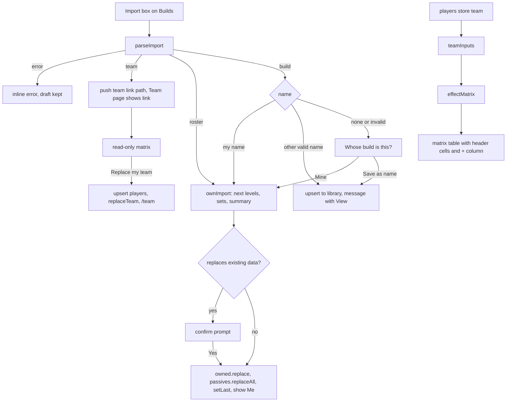

# Builds Import, Single Team and Team Effect Matrix - Plan

## Goal Capsule

- **Objective:** I can paste anything I copied from the app (a link, a code, or a roster code, including my own) into one box on the Builds tab and it is accepted. I keep one team, and its page shows who contributes which effect in a single table with one column per player.
- **Means:** one pure input classifier feeds a single import box on the renamed Builds tab (KTD1, KTD2); the players store holds one team (KTD5); a pure per-member effect matrix replaces the team cards and the Team effects panel (KTD7, KTD8).
- **Product authority:** the user (sole product owner). The four product decisions, the confirmed scope and the "+" column tweak were settled in the 2026-11-10 planning session.
- **Open blockers:** none.
- **Stop conditions:** stop and ask when a change would alter the share code, share link or team link format; when my owned classes or passive sets would be written by any path other than the class list Edit, the passive picker, or an import the user confirmed; or when the Team page would need to read passive experiments.

---

## Product Contract

Product Contract preservation: authored in this planning session from the user's request and the confirmed scope (no upstream requirements document).

### Summary

The Classes tab becomes "Builds" and holds the only import box. The box accepts a share link, a build code, a bare roster code or a team link, and can update my own roster and passives. The app keeps exactly one team. The Team page shows that team as a sparse matrix: effects as rows, players as columns, a Team total column, and a "+" column to add a player.

### Problem Frame

The "Import roster" box only decodes the bare roster segment, so the text produced by "Copy code" (`mi1-rec2-BCDF...`) or "Copy link" fails with `Invalid character "M" in roster code`. The Team page paste form rejects the same text for a different reason: my own link is refused as "That's you", and a code without a name asks for a name. There is no way to bring my own build to another device short of cutting out the roster segment by hand.

Named teams with create, switch and delete add controls the user does not need. The team cards plus the Team effects panel show each player's build and a merged total, but not who contributes what, so related skills across players are hard to spot.

### Key Decisions

- **My own link or code updates my roster.** It overwrites my levels and passives, after a confirm when that replaces existing data; a code with no name asks whose it is: me, or a new name. (session-settled: user-directed — chosen over "clearer error only": syncing from another device needs the import to work, not a better rejection.) Governs R3-R6.
- **The matrix shows self, team and nearby effects, each row tagged with its scope, with a Team total column for team-scope rows.** (session-settled: user-directed — chosen over "team + nearby only" and over a scope toggle: one table shows everything without a mode.) Governs R13-R17.
- **The Classes tab is renamed "Builds" and all importing lives there.** (session-settled: user-directed — chosen over "Players" and over keeping "Classes": the tab holds builds, mine and other players'.) Governs R1, R2.
- **The active team becomes the single team.** The active team, or the first one, is kept; the others are dropped; saved players are untouched. (session-settled: user-directed — chosen over merging members of every team capped at 8: the active team is the one in use.) Governs R9, R10.
- **Opening a team link offers "Replace my team" and saves its players.** (session-settled: user-approved — chosen over keeping a second team: there is only one team.) Governs R19.
- **The matrix replaces the Team effects panel and each card's "Own effects"; column headers carry each member's name, class and remove.** (session-settled: user-approved — chosen over keeping cards beside the matrix: the column headers carry what the cards did.) Governs R12, R13.
- **Players are added with a "+" placeholder at the end of the name columns.** (session-settled: user-directed — chosen over the separate "Add player" select above the cards: the add control sits where the new column appears.) Governs R12.

### Requirements

**Builds tab and import box**

- R1. The first header tab reads "Builds". Every user-facing mention of the Classes page or tab says Builds. The class list panel keeps the title "Classes", because it lists game classes.
- R2. The You panel on Builds has one always-visible import box labelled "Import link or code" with an Import button. It is shown for my own view and while another player is viewed. The Team page has no paste form.
- R3. The box accepts, with surrounding whitespace ignored: a full share link on any host, a path, a build code with or without a roster segment, a bare roster code, and a team link. Each input has the outcome in the table below.

| Input | Outcome |
|---|---|
| Link or code whose `u` is my username | Update my own build (R4), after the confirm of R5 |
| Link or code whose `u` is another valid name | Saved to the library at once: added, or updated with the existing merge rule (a code with neither roster nor `s` only updates the base, its level and its set). A message reads "Added <name>" or "Updated <name>" with a "View" button |
| Link or code whose `u` is a name while my username is unset | Prompt "Whose build is this?" with the name prefilled (R6); "Mine" also sets my username to that name |
| Build code or link with no `u` (with or without a roster), or whose `u` fails the username rules | Prompt "Whose build is this?" (R6), with any name prefilled |
| Bare roster code (`BCDFG...`) | Replaces my owned classes only, after the confirm of R5 |
| Team link (`/team/...`) | Opens that team link on the Team page (R19); nothing is saved |
| Anything else | Inline error; the typed text stays in the box and nothing changes |

- R4. Updating my own build writes only what the input carries.
  - With a roster segment, my owned classes are replaced by the roster, with the code's base level winning. Without one, only the base class level is set.
  - A full share link (an input with a URL scheme) that carries a roster is a complete snapshot: every passive set is replaced by the link's sets, and sets the link does not list are cleared, whether or not it has `s` (the app omits `s` when there are no other sets). Any other input (a pasted code or path) replaces every set only when it has `s`; without `s`, only the base class's set is replaced (cleared when the code has no passives) and my other sets stay.
  - The imported base becomes my selected class and the view returns to Me.
- R5. An own update asks for confirmation only when it would replace existing data: I own at least one class, or have at least one saved set that the import would replace. The prompt states what will be replaced ("your classes" and either "all passive sets" or "your <Class> passives"). On a browser with no data the import applies at once.
- R6. The "Whose build is this?" prompt offers "Mine" and "Save as" with a name field. "Mine" names what it replaces and applies R4 without a second prompt; when my username is unset and the input carried a valid name, "Mine" also sets my username to it. "Save as" follows the username rules, saves to the library like a named input, and rejects my own username with a message pointing to "Mine". Cancel leaves everything unchanged.
- R7. Notices from parsing (dropped tokens, extra roster classes) show under the box after a successful import. An error or a pending prompt keeps the typed text. Editing the box or pressing Import again dismisses an open prompt.
- R8. Opening a link by URL behaves as today: my own link shows the build without saving, and another player's link shows the read-only view with the save banner.

**Single team**

- R9. The Team page has one team with an editable name and up to 8 members. There is no team select, New or Delete.
- R10. On first load after the update, stored teams collapse to one: the active team, else the first stored team, else an empty team. Saved players and my username are unchanged, and the stored data stays readable by the previous version of the app.
- R11. "Copy team link" shares the team in the existing link format and is disabled with "Add players to share" while the team is empty.

**Team matrix**

- R12. The team is a table whose columns are, left to right: the stat (with its scope tag), one column per member in team order, the "+" column, then Team total. The "+" column's body cells are empty and narrow. Each member column header shows the player's name ("(you)" for me), a class select limited to the classes that player owns, and a remove button. The "+" column header adds a player with their saved class (me with my selected class): it lists me (when I have a username and own a class) and every saved player not on the team. It is disabled with a reason when the team is full or every player is added.
- R13. Each effect row shows the stat name, a scope tag (self, team or nearby), one cell per member with that member's summed contribution, and a Team total cell. A member who does not contribute has an empty cell. Sources (class and passive names) are not shown.
- R14. The table covers self, team and nearby effects of each member's selected class, at that player's level with their saved passives. Rows are grouped as in Combined effects: categories with their sub-groups, then Conditional per situation, Flags, Nearby and Uncertain per open question. A stat with both self and team contributions has two rows.
- R15. The Team total is the sum of the member cells for team-scope rows with a number. Self rows, Nearby rows and Uncertain rows have no total. A flag cell shows a check mark; a team-scope flag row shows a check in the total.
- R16. A row carries "rounded" when any contributing value was scaled by Recruit level 5 and rounded, and "stacking unconfirmed" when more than one copy of the same class contributes to that row. The Recruit scaling note shows under the table when it applies.
- R17. A row with two or more contributing members is marked, so related skills stand out. The mark is not colour alone and has an accessible name (for example "shared by 2 players"); a check mark has the text alternative "yes".
- R18. With no members the table shows only the "+" column and a line explaining how to add players, with a link to Builds when there is nobody to add. With members but no effect rows, the body shows "No effects from the selected classes". The header row stays visible while the table scrolls. On a phone the table scrolls sideways inside its panel with the stat column pinned; the page itself never scrolls sideways.
- R19. An opened team link shows the linked team as the same table, read-only (class as text, no remove, no "+"), with "Replace my team" and "Copy link". Replace asks for confirmation when my team has members. It sets my team's name and members from the link, adds players that are not in the library, updates saved players with the link's class, level and passives for that class, maps my own name to Me, and opens `/team`. A link that already equals my team shows "This is your team" with an "Open my team" button.
- R20. The Team page keeps the Players list (me first, then saved players with Remove) below the team, without the paste form. Its empty state points to the import box on Builds.

**Docs**

- R21. The in-app Help and `README.md` describe the Builds tab, the import box and its outcomes, the single team, the matrix and the team link replace flow.

### Acceptance Examples

- AE1. **Covers R3, R4, R5.** My username is Ann and I own classes. I paste my own "Copy link" text. A prompt says it will replace my classes and all passive sets. After Yes, my class list, levels and every passive set match the link, and the view shows the link's base class.
- AE2. **Covers R3, R6, R4.** I paste my own "Copy code" text (`mi1-rec2-BCDF...`, no name). The prompt asks whose build it is. I choose Mine: my classes match the roster, my Miner passives are Recruit 2, and my saved Scout passives are unchanged.
- AE3. **Covers R3, R5.** On a browser with no data I paste a bare roster code. It applies with no prompt and the class list shows the classes.
- AE4. **Covers R3, R6.** I paste Bob's code with no name, type "Bob" under Save as and save. The message reads "Added Bob", Bob appears in the Viewing select, and my own build is unchanged.
- AE5. **Covers R3.** I paste `hello world`. An inline error shows, the text stays in the box, and nothing changes.
- AE6. **Covers R10.** Storage holds teams A, B and C with B active. After loading the new version the Team page shows B's name and members; A and C are gone; all saved players remain.
- AE7. **Covers R13, R15, R17.** Ann and Bob both give a team-scope bonus to the same stat, +5% and +10%. The row shows 5% under Ann, 10% under Bob, 15% under Team total, a "team" tag, and the shared-row mark. Cy's cell is empty.
- AE8. **Covers R14.** Ann's class gives the same stat as a self effect and as a team effect. The table shows two rows for that stat, one tagged self with no total and one tagged team with a total.
- AE9. **Covers R12.** The team has 8 members. The "+" column is disabled and reads that the team is full.
- AE10. **Covers R19.** My team has two members. I open a team link with three other players and tap "Replace my team". After confirming, my team has the link's name and three members, the three players are in the library, and the address bar is `/team`.
- AE11. **Covers R3, R19.** I paste a team link into the import box. The Team page opens showing that link read-only; my team is unchanged.
- AE12. **Covers R3, R6, R4.** On a fresh browser with no username I paste my own Copy link (`u=Ann`). The prompt asks whose build it is with "Ann" prefilled. I choose Mine: my username becomes Ann and my classes and passives match the link, with no library player created.
- AE13. **Covers R4.** I paste my own Copy link from a device where only the base class has passives (no `s`). After Yes, my other classes' passive sets are cleared; pasting my own Copy code text instead keeps them.

### Scope Boundaries

- Changes to the build code, share link or team link formats.
- New passive mechanics or effect data.
- More than one team, or a way to keep an opened team beside my own.
- Showing each member's five levels and passive list on the Team page. The Viewing select on Builds shows a saved player's build.
- Passive experiments on the Team page.

#### Deferred to Follow-Up Work

- An "Update my roster from this link" action when my own link is opened by URL. Opening by URL keeps today's show-without-saving behavior (R8).
- A sort or filter for matrix rows (for example, shared rows first).
- Showing what each member receives (own self effects plus the team total) as opposed to what each contributes.

### Sources / Research

- `src/code.mjs`:
  - `parseShare` accepts a URL, path or code and returns `{ player, hasRoster, hasSets, notices }` or `{ error }`. A team path returns the private `TEAM_LINK_ERROR` message; this plan adds a machine-readable team marker to that result (U1).
  - `parseBuildCode` requires the first segment to be letters followed by digits. A valid roster code always ends in a roster letter, so a bare roster code never parses as a build code and the two inputs cannot be confused.
  - `serializeShare` omits `s` when the player has no other sets, so a missing `s` does not prove there are none.
- `src/owned.mjs`: `decodeRoster` handles only the bare segment. `createStore` has `replace(map)`; `setLevel` steps a level down when it equals the current one, so it cannot set an exact level.
- `src/passives.mjs`: the passive store has `set`, `get`, `all`, `setLast` and no bulk replace.
- `src/players.mjs`: `STORE_VERSION` is 1 and `load` returns empty for any other version. Team API: `teams`, `active`, `setActive`, `createTeam`, `renameTeam`, `deleteTeam`, `addMember`, `removeMember`, `setMemberBase`. `remove` and `rekey` map over every team. `upsert` rejects my name with `SELF_NAME`, whose text names the Classes page.
- `src/team.mjs`: `parseTeamLink` yields members whose player holds one class (`levels` and `sets` for the base only). `serializeTeamLink` takes `{ name, members }`.
- `src/effects.mjs`: scope is per effect (`self`, `team`, `nearby`), not per stat. `teamSources` tags each source with `member`. `aggregate` groups by `stat|when`, merges members and drops member and scope, so per-member values cannot be read from its output.
- `src/render-effects.mjs`: `teamInputs`, `teamEffectsPanel`, `ownEffectsDetails`, `formatEffect`, `RECRUIT_NOTE`.
- `src/app.mjs`: `syncFromLocation` (own links never write), `importRoster`, `pastePlayer`, `saveTeamLink`, `savedTeamFor`, `activeTeam`, `currentUrl`, `teamShareBlock`, `state.view` default `'classes'`, `state.team.paste`, `state.openEffects`, `state.list.rosterOpen`.
- `src/render.mjs`: `rosterSection` (You panel, import form hidden while viewing), `usernameField` (`.claim-prompt` confirm pattern), `visitorBanner` (name field plus save), `libraryPanel`, `playerCard`, `teamCard`, `addPlayerSelect`, `teamPanel`, `teamLinkView`, `teamView`, `helpView`, `header` (`navButton(.., 'classes', 'Classes')`).
- `tests/players.test.mjs` has team tests built on `createTeam` (they change) and a case asserting that a `v: 2` payload loads empty (it stays). `tests/code.test.mjs`, `tests/effects.test.mjs`, `tests/team.test.mjs` and `tests/passives.test.mjs` exist.
- `docs/plans/2026-10-30-1545-feat-roster-browser-plan.md` defines the viewed-player state this plan builds on.

---

## Planning Contract

### Key Technical Decisions

- KTD1. **A pure `parseImport` in `src/code.mjs` classifies the pasted text; the app only acts on its result.**
  - It returns one of: `{ kind: 'build', player, hasRoster, hasSets, isLink, notices }` (`isLink` is true when the input had a URL scheme), `{ kind: 'roster', owned, notices }`, `{ kind: 'team', path }` (base-relative path plus query, ready for the router) or `{ error }`.
  - Order: try `parseShare`; a team path yields `team`; a parse failure falls back to `decodeRoster` on the raw text.
  - The team case is detected by a machine-readable marker from the share parser, never by matching the error message text: `parseShare` keeps its `error` for a team path and adds `team: true` plus the base-relative `path` (with query) to that result, so existing callers are unaffected.
  - Error choice when both fail: when the text contains only roster characters (the six level letters, digits, the `O`/`I`/`L` aliases and whitespace) the roster error is shown; otherwise the share error. Empty text reads "Paste a link or code".
  - Rationale: the two grammars are disjoint (see Sources), so the fallback is unambiguous and testable without a DOM. Cites R3.
- KTD2. **Import outcomes are decided by owner, in this order.**
  - `kind: 'roster'` is always mine.
  - A build with a name equal to mine (case-insensitive) is mine.
  - A build with another name that passes `nameProblem` is saved with `upsert` (merge when it has neither roster nor `s`), with no confirm, matching the old paste form. The view does not switch; the message carries a "View" button that calls the existing `viewPlayer`. Rationale: several teammates can be pasted in a row without the view jumping.
  - A build with no name, or a name that fails the username rules, opens the "Whose build is this?" prompt with the name prefilled. This differs from URL handling, where a nameless bare code is mine: the address bar carries my own navigation, while pasted text has no such context.
  - When my username is unset, a named build also opens the whose-prompt with the name prefilled; "Mine" sets my username to that name (through the existing username setter) and applies the own update. Rationale: on a fresh device my own link carries my name but the app does not know it yet, and saving it as a library player would lose the build when I later claim the name.
  - Cites R3, R6, R8.
- KTD3. **An own update is computed by a pure helper and applied with one write per store.**
  - A pure `ownImport(current, parsed)` in `src/players.mjs` takes my current `{ levels, sets }` and the parsed build and returns the next `{ levels, sets, base }` plus a summary of what changes (`replacesRoster`, `replacesAllSets`, whether existing data is replaced). Levels: the full parsed map when `hasRoster`, else current levels with the base level set. Sets: the parsed sets (others cleared) when `hasSets`, or when `isLink` and `hasRoster` (an app-generated share link omits `s` only when there are no other sets); else current sets with the base's set replaced or removed.
  - The passive store gains `replaceAll(setsByCode)`, normalizing each set like `set` and saving once. The owned store's existing `replace` writes the levels; `setLevel` is not used because it toggles.
  - After applying: `setLast` to the imported base, `state.viewing` and `state.linkView` cleared, the build shows the saved set, and the address bar gets my build path (pushed when the view or base changed).
  - The no-`s` rule for pasted codes deliberately differs from the library's `upsert`, which replaces the whole record when a roster is present: "Copy code" never carries other sets, and wiping my other sets from my own code would destroy data the input cannot restore. A full link is a snapshot, so it does wipe them.
  - The passive store keys sets by class slug while parsed sets are keyed by code; `replaceAll` takes codes and converts.
  - Cites R4.
- KTD4. **Confirm only when something is lost; the whose-prompt's "Mine" is its own confirm.**
  - The confirm reuses the inline `.claim-prompt` pattern (role alert, Yes/No buttons) inside the import section, and its text comes from the KTD3 summary.
  - A bare roster code gains this confirm when I already own classes. Today it replaces silently; one rule now covers every own overwrite, and a first import on a new device stays one step.
  - "Mine" in the whose-prompt is labelled with what it replaces and applies directly.
  - Import state lives in `state.list.import`: `{ draft, error, message, savedName, notices, pending }`, where `pending` is null, `{ kind: 'confirm', parsed, summary }` or `{ kind: 'whose', parsed, nameDraft, error }`. Typed text is kept by draft setters that do not paint, except that a draft change while `pending` is set clears `pending` and repaints (a prompt must never act on text other than what is shown). Pressing Import again re-parses and replaces any pending prompt. The confirm stores the parsed input, not a precomputed result: `ownImport` runs again against my current data when Yes is pressed, so edits made while the prompt was open are not overwritten by a stale snapshot. `rosterOpen`, `draft`, `error`, `notices` on `state.list` and the `toggleRoster`, `setRosterDraft`, `importRoster` actions go away.
  - Cites R5, R6, R7.
- KTD5. **The players store exposes one team; the persisted v1 shape is kept so older code can still read it.**
  - Persisted shape stays `{ v: 1, me, players, teams, active }`, written with exactly one team: `teams: [{ id: 'team', name, members }]` and `active: 'team'`. `STORE_VERSION` stays 1. Rationale: older code (a stale tab, a reverted deploy, an older checkout on the same origin) loads any other version as empty and would overwrite saved players on its next write; keeping the shape makes the change reversible at the cost of a one-item array.
  - `load` cleans teams as today, then takes the team whose id equals `active`, else the first, else empty, and holds it in memory as one team. The next save writes the single-team form. Unknown versions and non-JSON data load empty; a malformed team loads as an empty team with players and `me` intact.
  - API: a `team` getter, `renameTeam(name)`, `addMember(name, base)`, `removeMember(name)`, `setMemberBase(name, base)` and `replaceTeam(name, members)` (cleaned with `cleanTeamName` and `cleanMembers`). `teams`, `active`, `setActive`, `createTeam`, `deleteTeam` and the `newId` option are removed from the API. `remove` and `rekey` act on the one team.
  - (session-settled: user-directed — chosen over merging members of every team capped at 8: the active team is the one in use.) Cites R9, R10.
- KTD6. **Replacing my team from a link updates saved players with the link's class data.**
  - For each link member: my own name maps to Me (never written); a new name is added with `upsert`; a saved player is updated with `upsert(..., { merge: true })`, which changes only the base, its level and its set. Then `replaceTeam(link name, members)`, the link is cleared and the path is replaced with `/team`.
  - Rationale: the matrix the user confirmed is the matrix they get. The older "existing players stay as they are" rule would show different numbers after the replace. The confirm text says saved players are updated.
  - "Already my team" compares the canonical team link: my team serialized with `serializeTeamLink` (bases and players resolved the way `currentUrl` resolves them) against the opened link re-serialized from its parsed form, path and query equal. A link copied from my own team always matches, and a re-shared link whose levels or passives changed offers Replace. The comparison lives in a pure `sameTeam(classes, mine, linked, resolvePlayer)` in `src/team.mjs`.
  - Confirm state is a flag on `state.team.link`; it shows only when my team has members.
  - (session-settled: user-approved — chosen over keeping a second team: there is only one team.) Cites R19.
- KTD7. **The matrix is a pure `effectMatrix(taxonomy, members)` in `src/effects.mjs`.**
  - Input is the `teamSources` member list (`{ player, base, level, slots }`), in column order, one entry per header column. A member without a base is passed as `{ player, base: null, level: 0, slots: [] }` and gets a column of `null` cells. All three scopes are included.
  - Output: `{ members: [name], groups: [{ section, title, sub, rows }] }`. `section` is `category`, `conditional`, `flags`, `nearby` or `uncertain`, assigned with the same precedence as `aggregate`: uncertain first, then nearby scope, then `when`, then flag unit, else category. `title` and `sub` carry the category and sub-group name, the situation label, or the open question.
  - A row is keyed by group plus `stat|when|scope` and is `{ stat, name, unit, when, scope, cells, total, rounded, sameClass, shared }`. `cells` has one entry per member: `null`, `{ value }` (the member's summed values) or `{ flag: true }`. `total` is decided by unit first: `true` for any team-scope row whose unit is flag, in any section; the sum of cells for team-scope numeric rows in the category and conditional sections; else `null`. `shared` is true when two or more cells are filled. `rounded` and `sameClass` follow the existing rules, computed within the row.
  - Groups follow taxonomy order; rows follow taxonomy stat order, then self before team.
  - Rationale: `aggregate` output has lost member and scope, and calling it once per member cannot produce the scope split or the row-level marks. `aggregate` is unchanged and still drives Combined effects.
  - (session-settled: user-directed — all scopes with a scope tag, chosen over team + nearby only and over a toggle.) Cites R13-R17.
- KTD8. **Column headers are the member cards; the "+" column is a native select.**
  - The table renderer lives in `src/render-effects.mjs` and takes the matrix model plus ready-made header cells, so it needs nothing from `src/render.mjs`. `src/render.mjs` builds the header cells: name, class select (`data-fk` `member-<name>-base`), remove button (`member-<name>-remove`) for my team; name and class text for a link.
  - Column order: stat, members, "+", Team total. The "+" header is a compact `<select>` whose placeholder option reads "+", with an accessible name "Add player" and `data-fk` `team-add`; its body cells are empty and narrow. Choosing a name calls the existing `addMember` with that player's saved base (mine: my selected class).
  - Header cells use `scope="col"`, stat cells `scope="row"`. The header row is sticky at the top of the scroll area and the stat column sticky at the left, both with opaque backgrounds in light and dark. The shared-row mark carries visually hidden text ("shared by N players"), and a check mark carries the text "yes". Disabled states keep the current wording ("Team is full (8)", "All players added"). A native select needs no popover state and works on phones.
  - The table sits in a wrapper with horizontal overflow; the first column is sticky. The team panel keeps the title with the member count, "Copy team link" and the team name field.
  - `playerCard`, `teamCard`, `addPlayerSelect`, `teamEffectsPanel`, `ownEffectsDetails`, `state.openEffects` and `setEffectsOpen` are deleted with their styles.
  - (session-settled: user-directed — the "+" placeholder at the name columns, chosen over the separate Add player select.) Cites R12, R18, R19.
- KTD9. **The tab rename covers the label and the state key, not CSS or the class list.**
  - `state.view` uses `'builds'` in place of `'classes'` everywhere it is set or compared; the nav key becomes `nav-builds`. No URL changes: the value was never a route.
  - `SELF_NAME` and Help, README and code comments that name the page say Builds. CSS class names (`main.classes`, `.classes-panel`), the class list panel title "Classes", "Filter classes" and "Loading classes" stay, because they refer to game classes.
  - (session-settled: user-directed — chosen over "Players" and over keeping "Classes": the tab holds builds, mine and other players'.) Cites R1.
- KTD10. **The Players list stays on the Team page, below the team, without the paste form.** The confirmed scope removes only the form, and the list is the one place that shows every saved player with Remove. `pastePlayer`, the paste draft setters and `state.team.paste` are deleted. Cites R2, R20.

### High-Level Technical Design

### Assumptions

- Older code reading the single-team store sees one team and works; it can create more teams, which the new code collapses again on load (keeping the active one).
- A team member whose player record cannot be resolved (for example after my username is cleared) is skipped in the table, as the cards skip it today.
- `README.md` contains a `$table` placeholder line that must stay as it is.

### Sequencing

1. U1 adds the pure helpers with tests; nothing calls them yet.
2. U2 renames the tab and builds the import box on U1.
3. U3 moves the store to one team and adapts every caller, so the app works after each unit.
4. U4 replaces the cards and effects panel with the matrix.
5. U5 updates the docs and runs the full verification.

U2 to U5 each edit `src/app.mjs` or `src/render.mjs`, so they run one after another, never in parallel. Each unit is one commit on main, made only when the user asks to commit.

---

## Implementation Units

### U1. Pure helpers: import classifier, own import, bulk passive replace, team equality, effect matrix

- **Goal:** Every new decision that needs no DOM exists as a tested pure function.
- **Requirements:** R3, R4, R5, R13-R17, R19.
- **Dependencies:** none.
- **Files:** `src/code.mjs`, `src/players.mjs`, `src/passives.mjs`, `src/team.mjs`, `src/effects.mjs`, `tests/code.test.mjs`, `tests/players.test.mjs`, `tests/passives.test.mjs`, `tests/team.test.mjs`, `tests/effects.test.mjs`.
- **Approach:**
  1. Add the team marker to `parseShare`'s team-path result and add `parseImport` to `src/code.mjs` per KTD1, including `isLink` and the error choice rule.
  2. Add `ownImport` to `src/players.mjs` per KTD3. It only computes; it touches no store.
  3. Add `replaceAll` to the passive store per KTD3.
  4. Add `sameTeam` to `src/team.mjs` per KTD6.
  5. Add `effectMatrix` to `src/effects.mjs` per KTD7, reusing `teamSources`.
  6. Existing exports and behavior stay as they are, apart from the added team marker fields.
- **Patterns to follow:** `parseShare` result shapes, `diffSets` and `linkOwner` as small pure helpers, `makeRows` for the rounded and same-class rules, the `synth` taxonomy in `tests/effects.test.mjs`, and the in-memory storage helpers in the store tests.
- **Test scenarios:**
  - `parseImport`: a full link with `u` and `s` is a build with both flags; a "Copy code" text is a build with a roster and no name; `mi3` is a bare build; a bare roster code is `roster` with the decoded map; a roster code with spaces and lower case decodes.
  - `parseImport`: a team URL and a `/team/...` path are `team` with the base-relative path and query; a link under a non-root base path resolves.
  - `parseImport`: empty text, `hello world` (share error) and `BC3` or similar roster-alphabet garbage (roster error) each return the documented error.
  - Covers AE1. `ownImport` with roster and `s`: levels equal the parsed map, sets equal the parsed sets, a current set absent from the input is gone, and the summary reports roster and all sets replaced.
  - Covers AE2. `ownImport` with roster, no `s` and `isLink` false: levels replaced, only the base's set changes, other sets kept.
  - Covers AE13. `ownImport` with roster, no `s` and `isLink` true: other sets cleared and the summary reports all sets replaced.
  - `parseImport`: a pasted URL sets `isLink`; a pasted code or path does not. `parseShare` on a team path still returns its error and now also `team: true` with the path.
  - `ownImport` bare code: only the base level and the base's set change; a code without passives removes the base's set.
  - Covers AE3. `ownImport` on empty current data reports that nothing existing is replaced.
  - `replaceAll`: sets are normalized, unknown codes dropped, absent classes cleared, and storage is written once in the store's format.
  - `sameTeam`: a team equals the parsed form of its own serialized link; different when a base, a member, the team name, or a member's level or passives for that class differ.
  - Covers AE7. `effectMatrix`: two members with a team-scope value on one stat give two filled cells, a total equal to their sum, `shared` true, and `null` for a third member.
  - Covers AE8. A stat with self and team effects yields two rows with scopes `self` (no total) and `team` (total).
  - `effectMatrix`: a member with `base: null` gets a column of `null` cells and the other columns keep their positions; a conditional team-scope flag has total `true`; a flag yields `{ flag: true }` and no numeric total; a nearby effect lands in the nearby group with no total; an uncertain effect lands under its question with no total; a conditional effect lands under its situation.
  - `effectMatrix`: Recruit level 5 scaling marks the row rounded only when a value was actually rounded; two passive levels of one class on one member mark the row `sameClass`; member order in `cells` matches the input; no members gives no groups.
- **Verification:** `npm test` passes with the new cases; `npm run check` prints "data ok". No file outside the ten listed changes.

### U2. Builds tab and the single import box

- **Goal:** The tab reads Builds and its You panel imports every input shape with the outcomes of R3.
- **Requirements:** R1-R8.
- **Dependencies:** U1.
- **Files:** `src/app.mjs`, `src/render.mjs`, `src/players.mjs`, `src/theme.css`, `tests/players.test.mjs`.
- **Approach:**
  1. Rename the view key and label per KTD9 in `src/app.mjs` and `src/render.mjs`, and update `SELF_NAME` in `src/players.mjs` to point to importing your own build on the Builds page. Help text is left to U5.
  2. Replace the roster import state and actions with `state.list.import` and these actions (KTD4): a draft setter, `importText`, `confirmImport`, `cancelImport`, a whose-name draft setter, `importAsMine` and `importAs`.
  3. `importText` runs `parseImport` and routes per KTD2. The team case clears the box, pushes the team path and syncs from the location. The own case calls `ownImport` with my current levels and sets, then applies or opens the confirm per KTD4.
  4. Applying an own import follows KTD3 and leaves edit mode and the passive picker closed.
  5. Saving to the library reuses `upsert` and `nameProblem` and sets the message and `savedName` for the "View" button.
  6. In `rosterSection`, replace the collapsible roster form with the always-visible import form, shown in the Me view and while another player is viewed (R2). When a prompt opens, focus moves to its first button; when it closes, focus returns to the import field. Below it render, as applicable: the error, the confirm prompt, the whose-prompt (Mine button, name field, Save, Cancel), the success message with View, and the notices. Every control carries `data-fk`.
  7. Style the prompts in `src/theme.css` next to `.claim-prompt`, in light and dark, fitting phone width.
  8. Leave the Team page paste form in place; U3 removes it.
- **Patterns to follow:** `usernameField` for the `.claim-prompt` confirm and the field messages, `visitorBanner` for a name field with a save button and its error rule, `setNameDraft` for non-painting drafts, `viewPlayer` and `restoreLast` for view changes.
- **Test scenarios:** `tests/players.test.mjs` keeps passing against the new `SELF_NAME` text. In the browser, with a scratchpad Playwright script against `PORT=8099 node scripts/serve.mjs`:
  - The first tab reads Builds and is current on `/`; Team and Help still navigate.
  - Covers AE1. With username Ann and owned classes, pasting Ann's own Copy link text shows the confirm naming classes and all passive sets; Yes applies it and the loadout shows the link's base.
  - Covers AE2. Pasting own Copy code text shows the whose-prompt; Mine applies the roster and the base's passives and keeps another class's saved set.
  - Covers AE3. With empty storage, a bare roster code applies with no prompt.
  - Covers AE4. Pasting a nameless code, typing Bob and saving shows "Added Bob"; the Viewing select lists Bob; View opens Bob.
  - A link with `u=Bob` saves at once; pasting it again reads "Updated Bob".
  - In the whose-prompt, typing my own username shows the message pointing to Mine and saves nothing.
  - No on the confirm and Cancel on the whose-prompt leave storage unchanged and keep the text.
  - Covers AE12. With empty storage and no username, pasting a link with `u=Ann` shows the whose-prompt with Ann prefilled; Mine sets the username to Ann and applies the build; no library player Ann exists.
  - Opening the confirm and then editing the box removes the prompt, and storage is unchanged.
  - A link whose `u` fails the username rules opens the whose-prompt.
  - Covers AE5. Garbage text shows an inline error and keeps the text; focus stays in the box across the repaint.
  - Covers AE11. A team link opens the Team page with that link.
  - While viewing a saved player, an own import returns the view to Me.
  - Opening my own link by URL still shows it without changing storage.
- **Verification:** `npm test` is green. The browser scenarios pass with no console errors. `importRoster`, `toggleRoster` and `rosterOpen` no longer appear in `src/`. At 375px width the You panel has no horizontal overflow.

### U3. One team in the store, and the team link replace flow

- **Goal:** The store, the actions and the Team page work with exactly one team, and a team link can replace it.
- **Requirements:** R2, R9, R10, R11, R19 (flow, on the existing card view), R20.
- **Dependencies:** U2.
- **Files:** `src/players.mjs`, `src/app.mjs`, `src/render.mjs`, `src/theme.css`, `tests/players.test.mjs`.
- **Approach:**
  1. Change the store per KTD5 and rewrite the team tests in `tests/players.test.mjs` for the new API, the single-team round trip and the multi-team collapse.
  2. In `src/app.mjs`: drop `activeTeam`, `createTeam`, `deleteTeam`, `setActiveTeam`, `openTeam`, `linkSavedTeam`, `savedTeamFor`, `pastePlayer`, the paste draft setters and `state.team.paste`. Point `renameTeam`, `setTeamNameDraft`, `addMember`, `removeMember`, `setMemberBase`, `currentUrl` and `teamShareBlock` at the single team. `teamShareBlock` returns only "Add players to share" or null.
  3. Replace `saveTeamLink` with a replace flow per KTD6: an action that either applies or sets the confirm flag, a confirm action and a cancel action. Expose whether the link equals my team through `sameTeam`, and an action that returns to `/team`.
  4. In `src/render.mjs`: remove the team select, New, Delete and the paste form. `teamPanel` always renders the team (name field, add control, members). `teamLinkView` shows "Replace my team" with the inline confirm, or "This is your team" with "Open my team". `libraryPanel` moves below the team and its empty state links to Builds through an action that opens Builds and focuses the import box.
  5. Keep the cards and the Team effects panel for now; U4 replaces them.
  6. Remove the styles of the deleted controls from `src/theme.css`.
- **Patterns to follow:** the field-by-field cleaning in `load`, `openUsername` for an action that switches page and focuses a field, `.claim-prompt` for the confirm.
- **Test scenarios:**
  - Covers AE6. A payload with teams A, B, C and `active` B loads with B's name and members; players and `me` are intact.
  - A payload whose `active` is missing or unknown loads the first valid team; a payload with no teams loads an empty team.
  - After any write, storage holds `v: 1` with `teams` holding exactly one team and `active` naming it, so the existing load code reads it unchanged.
  - The single-team payload round-trips; a malformed team loads as an empty team with players intact; unknown versions and non-JSON load empty (the existing `v: 2` loads-empty test stays).
  - `addMember` enforces the 8-member cap, duplicate names ignoring case, valid names and known bases; it refuses Me while my username is empty.
  - `replaceTeam` trims the name to 40 characters and cleans members (first occurrence per name, known bases, at most 8).
  - `remove` drops the player from the team; `setMe` and `claimAsMe` re-key memberships in the team.
  - Browser: with v1 storage seeded with two teams, the Team page shows the active one and no team select, New or Delete.
  - Browser, covers AE10: opening a team link while my team has members shows the confirm; Yes replaces the team, adds the players, and the URL is `/team`. With an empty team it applies with no confirm.
  - Browser: a saved player on the link gets the link's class, level and passives for that class and keeps their other classes. A member named like me maps to Me and my data is unchanged.
  - Browser: opening the link copied from my own team shows "This is your team".
  - Browser: the Team page has no paste form; with no saved players the Players list points to Builds and the link focuses the import box.
- **Verification:** `npm test` is green. The browser scenarios pass with no console errors. `createTeam`, `setActive`, `deleteTeam`, `pastePlayer` and `state.players.teams` no longer appear in `src/`.

### U4. Team effect matrix with member column headers and the "+" column

- **Goal:** The Team page and an opened team link show the team as the per-member effect table.
- **Requirements:** R12-R19.
- **Dependencies:** U1, U3.
- **Files:** `src/render-effects.mjs`, `src/render.mjs`, `src/app.mjs`, `src/theme.css`.
- **Approach:**
  1. In `src/render-effects.mjs`, add the table renderer per KTD8. It takes the `effectMatrix` model, the header cells and an optional trailing add cell. It renders a real `<table>`: a header row, one group-heading row per group spanning all columns, and effect rows with the stat name as a row header, the scope tag, the marks of R16, the member cells formatted with `formatEffect`, and the Team total cell. Shared rows get a class. The Recruit note shows when any member is a Recruit at level 5.
  2. Delete `teamEffectsPanel` and `ownEffectsDetails`. Change `teamInputs` to keep members without a base as `{ player, base: null, level: 0, slots: [] }` so its output matches the header cells one for one, and feed it to `effectMatrix`.
  3. In `src/render.mjs`, build the header cells and the "+" select per KTD8 and render the table inside `teamPanel` and `teamLinkView` (read-only headers there). Delete `playerCard`, `teamCard` and `addPlayerSelect`.
  4. The empty team renders the header with only the "+" column plus the empty-state line of R18; a team with members and no rows renders "No effects from the selected classes". After removing a member, focus lands on the "+" select; after adding one it stays there.
  5. In `src/app.mjs`, delete `state.openEffects` and `setEffectsOpen`.
  6. In `src/theme.css`, add the table styles with existing tokens for light and dark: the scroll wrapper, the sticky first column with an opaque background, compact header controls, the scope tags, the shared-row mark and the total column. Remove the card, grid and own-effects styles.
- **Patterns to follow:** `effectRow` for the mark classes (`effect-mark`, `effect-warn`), the `code-table` in Help for table markup, `level-tag` for small tags, `slot-select` for selects, the existing remove button with its hidden label.
- **Test scenarios:** in the browser at desktop width and at 375px:
  - A team of three shows three name columns, the "+" column and the Team total; each header has the name, a class select and a remove button; my column reads "(you)".
  - Covers AE7. A stat given team-wide by two members shows both values, their sum under Team total, a "team" tag and the shared mark; the third member's cell is empty.
  - Covers AE8. A stat with self and team contributions shows two rows; the self row has no total.
  - A flag shows a check mark; Nearby and Uncertain rows show values with no total, under their group headings.
  - Changing a member's class updates that column; the select keeps focus after the repaint.
  - Removing a member drops the column. The "+" select adds a saved player as the last column and lists only players not on the team.
  - Covers AE9. With 8 members the "+" select is disabled and reads that the team is full.
  - An empty team shows only the "+" column and the empty-state line; with nobody to add, the line links to Builds.
  - A Recruit level 5 member shows the scaling note and "rounded" on affected rows.
  - An opened team link shows the same table with class names as text and no select, remove or "+".
  - At 375px the table scrolls inside its panel, the stat column stays pinned, and `document.documentElement.scrollWidth` equals the viewport width.
  - Scrolling past the first group keeps the header row visible. Columns read stat, members, "+", Team total.
  - A member whose class gives no effects (or who has no class) keeps a column of empty cells and the other columns stay aligned.
  - Shared rows expose "shared by N players" and check marks expose "yes" to the accessibility tree.
- **Verification:** `npm test` is green. The browser scenarios pass with no console errors in light and dark themes. `teamEffectsPanel`, `ownEffectsDetails`, `playerCard`, `teamCard` and `openEffects` no longer appear in `src/`.

### U5. Help, README and full verification

- **Goal:** The docs describe the final behavior and the whole feature passes every gate.
- **Requirements:** R21, and a regression pass over R1-R20.
- **Dependencies:** U2, U3, U4.
- **Files:** `src/render.mjs` (`helpView` only), `README.md`.
- **Approach:**
  1. In `helpView`: say Builds wherever the page is named; describe the import box and what each input does, including updating your own build from another device; replace the "Players and teams" items with the single team, the "+" column, the class select in the column header and "Replace my team"; replace the Team effects and Own effects sentence with a short guide to the matrix (columns are who contributes, scope tags, Team total, shared rows); rewrite "Your data" to say that pasting your own link or code into the import box restores your classes and passives.
  2. In `README.md`: rename the Classes page section to Builds; replace the Import roster paragraph with the import box and the outcome table; rewrite the Players and teams section for one team, the stored shape, the migration, the matrix and the team link replace flow; update the Help section's page names. Keep the `$table` line. Write final-state prose with one paragraph per line.
  3. Run the Verification Contract in full.
- **Patterns to follow:** the existing Help `section` helper and list style; the README's present-tense reference tone.
- **Test scenarios:** `Test expectation: none -- docs only.` The Help page is checked in the browser for the new wording and for no remaining "Classes page", "Import roster", "Save team" or "named teams" text.
- **Verification:** the Verification Contract passes end to end.

---

## Verification Contract

- `npm test` passes (node --test over `tests/`).
- `npm run check` prints "data ok".
- `npm run build` completes and writes `dist`.
- A headless Playwright pass against `PORT=8099 node scripts/serve.mjs` (never port 8090), using the playwright-core install already on this machine, covers AE1-AE13 at desktop width and at 375px, in light and dark, with no console errors and no page-level horizontal scroll. The scripts live in the session scratchpad, not in the repo.
- A migration check: seed localStorage with a players payload holding several teams, load the app, and confirm the active team, the saved players and the username survive, and that the stored payload is still `v: 1`.
- A sweep of `src/` and `README.md` finds no user-facing "Classes page" or "Classes tab", and no references to the removed actions and state named in the unit verifications.

## Definition of Done

- R1-R21 hold and AE1-AE13 pass in the browser.
- Text copied with "Copy link" or "Copy code" from the app is accepted by the import box on the same and on a fresh browser profile.
- Existing storage loads into one team with no loss of saved players or username, and stays readable by the previous app version.
- The Team page has no team select, New, Delete, paste form, team cards, Team effects panel or Own effects disclosure.
- The share code, share link and team link formats are unchanged: the existing codec tests pass unmodified.
- Help and `README.md` describe the final behavior.
- Every gate in the Verification Contract passes, and nothing is committed until the user asks.
