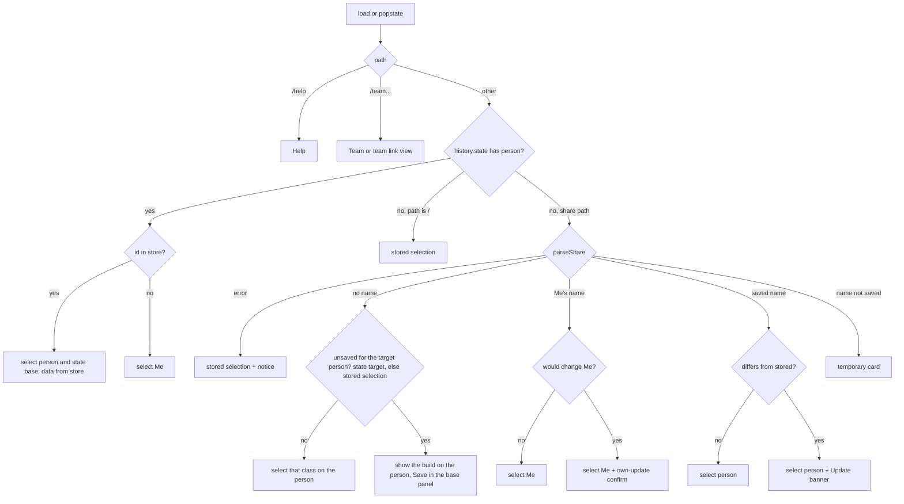
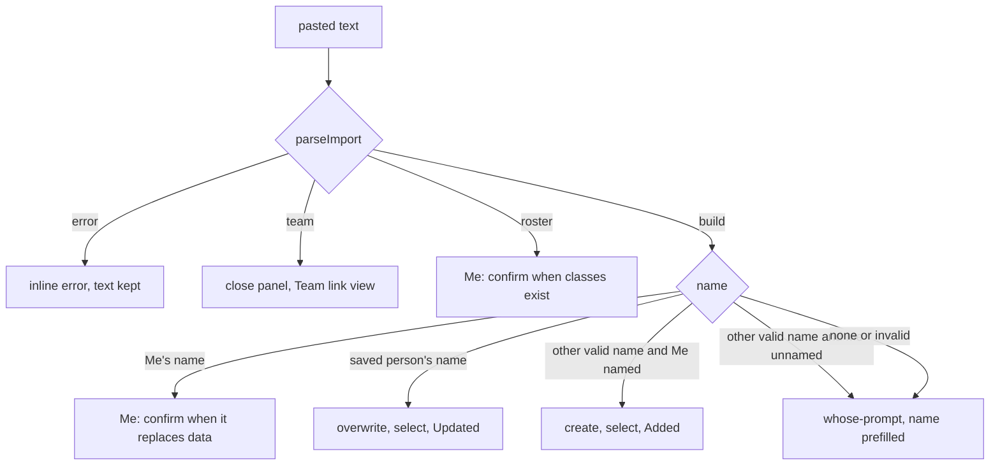

# People Cards and Top-Bar Import - Plan

## Goal Capsule

- **Objective:** I can keep a profile for anybody: create one from just a name, or import one, and edit every profile the same way I edit my own. The top-left box on Builds is a list of person cards with a "+" card. Import is a top-bar button that works from every page. A build URL I type in can be saved onto the person I am viewing.
- **Means:** one people store with stable ids under the new key `dtec:people` replaces the three per-kind stores, with no migration (KTD1). Selection is by person id, carried in history state and in the store (KTD3). Experiments, the viewing mode and the Me-only linkView flag and its view are removed; an explicit unsaved-build preview with Save takes that view's place (KTD12, KTD20). New rules live in pure tested modules (KTD16).
- **Product authority:** the user (sole product owner). "All people editable", the confirmed scope with its three call-outs, the new storage keys without migration, and the Save action for an entered build URL were settled in the 2026-11-11 planning session.
- **Open blockers:** none.
- **Stop conditions:** stop and ask when a change would alter the share code, share link or team link format; when any code path would read, write or remove a `class-combo-viewer:*` storage key; when the Team table layout or the effects tables would change; or when a flow can only work by writing a person's data without an explicit edit, import or Save.

---

## Product Contract

Product Contract preservation: authored in this planning session from the user's request, the answer to the blocking question, the confirmed scope and two later user amendments (no upstream requirements document).

### Summary

Every person is one kind of record: Me, people I import and people I create. Each has a card in the top-left box on Builds showing the name and the class with its level. A "+" card creates a person from a name. Clicking a card switches whose builds I see and edit. Import moves to the header and opens a paste box on any page. A build URL without a name shows on the selected person with a Save button that stores it and marks the classes it uses as owned. Temporary passive experiments and their revert are gone. Data starts fresh under a new storage key.

### Problem Frame

Saved players are read-only. Their passive changes are in-memory experiments, and their class levels cannot be changed at all, so a profile for somebody else can only come from a link that person produced. The import box sits in the You panel on Builds, so it cannot be reached from Team or Help. The You panel holds a Username field, a Viewing select and the import box, which hides who is saved behind a dropdown.

Me and saved players also live in different stores with different shapes (my levels and sets in two stores keyed by code and by slug, players in a third keyed by name), so every edit action is wired to Me only.

A build URL typed into the address bar, such as `/bo5-mi3`, shows the build with its classes flagged "Not owned", and offers Copy link and Copy code for a build the person does not have. There is no way to keep it.

### Requirements

**Person cards**

- R1. On Builds the top-left panel is a list of person cards: Me first, then every saved person A to Z by name (case ignored), then a "+" card. The Username field, the Viewing select and the inline import box are gone.
- R2. A card shows the person's name and their class with its icon, name and level. Me without a name reads "Me". A person who owns no class reads "No classes". Me's card is marked as mine.
- R3. Clicking a card selects that person. The selected card is highlighted, and Builds shows that person's class list and loadout.
- R4. The "+" card opens a name form. A valid name creates a person with no classes and selects them. An invalid name shows an inline error and creates nothing. Cancel and Escape close the form.
- R5. The selected card has an edit menu button. The menu offers Rename and Delete. Me's menu offers Rename only.
- R6. Rename saves the new name at once. The person keeps their place on the team and stays selected. The name rules are in KTD7.
- R7. Delete asks for a confirm in the form region (R36). The confirm says so when the person is on the team. After the delete Me is selected. There is no undo.
- R8. Below 720px the cards form one horizontally scrolling row, and the selected card is scrolled into view.
- R36. The edit menu, the add form, the Rename form, the Delete confirm and the temporary card's Save form open in one full-width region directly under the card row, at all widths. Their inline errors show inside that region. The originating card stays highlighted. The card and focus structure is in KTD21.
- R9. The selection survives switching between Builds, Team and Help, and survives a reload of `/`.

**One editable model**

- R10. Every saved person is edited like Me: class levels in the class list Edit, the selected class, and the passive set of each class. Each change is saved at once to that person only.
- R11. There is no experiment mode: no NEW or ORIGINAL tags, no dimmed removed rows, no Revert and no "Experiment" label.
- R12. Copy link and Copy code share the selected person's stored data. The reasons that disable them are unchanged.
- R13. For a person whose class levels are not known (created from a code without a roster), the passive picker treats levels 1 to 3 of every class as unlocked until the first level edit for that person.
- R14. The picker's "Unlocked only" preference is one setting for all people.

**Top-bar import**

- R15. The header shows Builds, Team, Help and Import. Import opens a paste panel below the header on every page.
- R16. The panel accepts the same inputs as today's import box. Each input has the outcome in the table below.

| Input | Outcome |
|---|---|
| Team link | The panel closes and the Team page shows that link read-only; nothing is saved |
| Bare roster code | Replaces Me's owned classes, after a confirm when classes exist; Me is selected |
| Link or code whose `u` is Me's name | Updates Me, after a confirm when it replaces existing data; Me is selected |
| Link or code whose `u` is a saved person's name | Applies to that person without asking (KTD4): a full link replaces the record, a bare code updates only its class; "Updated <name>" |
| Link or code whose `u` is another valid name, while Me has a name | Creates that person; "Added <name>" |
| Link or code whose `u` is an unsaved valid name, while Me has no name | "Whose build is this?" with the name prefilled; "Mine" also names Me |
| Build code or link with no `u`, or a `u` that fails the name rule | "Whose build is this?" with any name prefilled |
| Anything else | Inline error; the typed text stays in the box |

A rename changes the name that links match. A link or code that carries a person's old name counts as an unknown name: an import creates a new person and an opened link makes a temporary card. Names are not aliased.

- R17. The "Whose build is this?" prompt offers Mine, Save as with a name field, and Cancel. Save as with a saved person's name applies the import to that person under KTD4: a full link replaces the record and a bare code updates only its class. This is how "overwrite" applies to a bare code. Save as with Me's name is rejected with a pointer to Mine.
- R18. After an import that adds or updates a person, that person is selected and the current page stays. The message offers a "View" button that opens Builds when the current page is not Builds.
- R19. Escape and a Close button close the panel and return focus to the Import button. Closing discards a pending prompt.
- R20. The header and the panel fit at 375px and 520px with no horizontal page scroll.

**Shared links and navigation**

- R21. Opening a share URL from outside the app (typed, clicked or bookmarked) has the outcome in the table below.

| URL carries | Outcome |
|---|---|
| A name that is not saved | A temporary card (R22) |
| A saved person's name | That person is selected. When the link's data differs from the saved data, a banner offers "Update <name>" (R35); nothing is written until it is tapped |
| Me's name | Me is selected. When the link would change Me's data, the own-update confirm shows first (R35); nothing is written without it |
| No name | The build is shown on the currently selected person (R25) |
| An invalid code | The stored selection, with the existing invalid-link notice |

A link whose name is a person's old name before a rename counts as an unknown name (R16).

- R22. The temporary card sits last before the "+" card and shows the link's name. It is read-only: no class Edit, no passive picker, no edit menu. Its Save button opens a name form (prefilled) in the form region (R36) and saves the person under the Save as rules of R17, then selects them. Selecting another card discards it. It is never offered on the Team page. There is at most one.
- R23. Back and Forward restore which person and class were shown, always with the stored data. They never import from a URL. An entry for a deleted person shows Me. An entry for an unsaved build shows the build on the person it was aimed at (KTD3).
- R24. The address bar shows the selected person's share path: another person's share link with `u`, and `/` when the person has no class to share. Me's path is Me's share link with `u` once Me has a name, so a reopened URL selects Me. While Me is unnamed, Me's path is the bare build code.
- R35. A pending Update banner (a saved person's link) or own-update confirm (Me's link) keeps the incoming URL in the address bar with no person state, so a reload shows it again. It renders as the Update banner above the loadout and lists what it replaces. It offers Yes and Dismiss. Yes applies the link. Dismiss leaves the stored data untouched. Both then replace the entry with the person's share path. Selecting another card also clears it.

**Saving a build from a URL**

- R25. A build URL with no name shows its class and passives on the selected person, Me or another card. The person's class levels stay as stored, so a class or passive the person lacks is flagged "Not owned". A roster segment and `s` in such a URL are ignored. A URL with no passive run keeps the person's stored set for that class.
- R26. While the shown build is not what the person has stored, the base panel shows a Save button in place of Copy link and Copy code, and the loadout offers no passive Edit. An "Unsaved build" label next to Save names each class level Save will raise, for example Bounty Hunter 5 and Miner 3.
- R27. Save sets the build's class and raises that person's class levels so every class the build uses is owned: the base class at the build's level and each passive class at its passive level. A level that is already higher is never lowered. A URL with a passive run replaces that class's passive set. A URL with no passive run leaves the stored set as it is, so Save only sets the base and raises levels. Nothing else in the roster changes. Example: `/bo5-mi3` sets Bounty Hunter to level 5 and Miner to at least level 3.
- R28. After Save the base panel shows Copy link and Copy code again and the address bar shows the person's share path. Selecting a class or a card, opening class Edit, or changing a level discards an unsaved build. A URL build that would change nothing only selects its class.

**Team page**

- R29. The Players panel lists Me and every saved person and has no Remove buttons.
- R30. The add-to-team control offers only people who have a name and own at least one class. A hint says why the others are missing.
- R31. Deleting a person removes them from the team. Renaming keeps them on it. The team table, the team link and the "Replace my team" flow behave as today.

**Storage**

- R32. All data is stored in one browser entry, `dtec:people`. The first load starts with one unnamed Me with no classes.
- R33. The `class-combo-viewer:*` entries are never read, changed or removed.

**Docs**

- R34. `README.md` and the in-app Help describe the final behavior.

### Key Decisions

- **All people are editable.** Every person card, imported or created, has an editable roster and build like Me, and the separate experiment and revert mode is dropped. (session-settled: user-directed — chosen over "Created editable, imported read-only" and "All editable, keep experiments": one model for everyone.) Governs R10-R14.
- **Import is a top-bar button that opens a paste box from any page.** (session-settled: user-directed — chosen over the import box in the You panel on Builds: it must be usable for classes, teams and the rest.) Governs R15, R18-R20.
- **The top-left box is a list of person cards with the name and class with level, plus a "+" card.** (session-settled: user-directed — chosen over the Username field and Viewing select: each person is visible as a card.) Governs R1, R2, R8.
- **Clicking a card switches whose builds I see, replacing the Viewing dropdown.** (session-settled: user-approved — chosen over keeping the dropdown beside the cards: the cards carry the selection.) Governs R3, R9.
- **The "+" card creates a person from just a name, with no classes marked.** (session-settled: user-approved — chosen over requiring a code or a class at creation: classes are filled in via Edit like my own.) Governs R4.
- **Rename and delete live on the selected card's edit menu, and Me's name is edited the same way.** (session-settled: user-approved — chosen over keeping the Username field: one way to name a person.) Governs R5-R7.
- **An opened link of an unknown named player stays temporary, as a card with a Save button.** (session-settled: user-approved — chosen over auto-saving everyone who sends a link: the list holds only people I chose to keep.) Governs R21, R22.
- **Re-importing someone already saved matches by name and overwrites without asking.** (session-settled: user-approved — chosen over a confirm prompt: importing a person again is the request to update them.) Governs R16, R17.
- **My own link updates Me, and a pasted bare code still asks whose it is.** (session-settled: user-approved — chosen over treating every nameless code as a new person: my own code has no name either.) Governs R16, R17.
- **Storage uses new `dtec:` keys with no migration.** The old entries are left alone and I re-import my builds. (session-settled: user-directed — chosen over a one-time migration of the `class-combo-viewer:*` keys: nobody else uses the app yet, and the app is renamed to "DTEC Build Tool".) Governs R32, R33.
- **A build URL without a name gets a Save button that stores it on the person being viewed and marks its classes as owned.** (session-settled: user-directed — chosen over showing Copy link and Copy code for a build the person does not have: `bo5-mi3` implies Miner 3, so saving it must own Miner 3.) Governs R25-R28.

### Scope Boundaries

- The Team page layout, the team effect matrix and the effects tables do not change.
- The share code, share link and team link formats do not change.
- No migration and no import of the old storage entries.
- The class-data refresh in the working tree is separate work: `data/classes.json`, `data/effects.json`, `icons/ho.png`, `icons/sp.png`, `scripts/codes.lock.json`, the `33D` example in `README.md`, and the class-count edits in `tests/owned.test.mjs` and `tests/code.test.mjs`. No unit includes those hunks.
- The app-title rename to "DTEC Build Tool" is already in the working tree, in `index.html` and in the header of `src/render.mjs`. Those two hunks land with U3, which introduces the `dtec:` key.
- No undo for delete, no sync between devices, no per-person "Unlocked only" setting.
- A roster segment or `s` in a nameless URL is not applied by Save; pasting the link into Import applies everything.

---

## Planning Contract

### Key Technical Decisions

- KTD1. **One people store under a new key, with no migration.** The key `dtec:people`, version 1, holds every person record, the team, the selected person id and the global preferences. A record is `{id, name, base, levels, sets, rosterKnown}`, with `sets` keyed by class code. Me is the record with id `me` and is created on first load. Other ids are `p<n>` from a counter stored in the payload, so rename never re-keys anything. Team members reference a person id and keep their own base. An absent, unreadable or other-version payload gives a fresh store. No code reads or writes a `class-combo-viewer:*` key, so an old cached tab and the new app never touch each other's data. Chosen over a facade that keeps Me's two stores: every edit would need two code paths.
- KTD2. **Empty people are valid.** `base` may be null and `levels` may be empty. Un-owning a person's base keeps the record. The card shows the class from the `ownedBase` fallback, and "No classes" only when the person owns none. `base` may also be a class the person does not own, as Me's selected class can be today.
  - **Conflict note:** read literally, "No classes when base is null" mislabels a person who has levels but never selected a class. The class list in edit mode only expands rows and never sets the base (`selectClass`, `src/app.mjs:511-514`), so a created person who marks Miner 3 still has a null base. Resolution kept inside the decision: the card class comes from the existing `ownedBase` fallback (`src/players.mjs:77-82`): the stored base while owned, else the first owned class. The card reads "No classes" only when the person owns none.
- KTD3. **The store wins over the URL.** In-app navigation records `{person, base}` in `history.state` and the selected id in the store. A load or `popstate` whose entry carries that state selects by id and reads the store: no Update banner, no temporary card, no unsaved build, and a missing id falls back to Me. An entry with no state is an external link and keeps link semantics (R21). `/` restores the stored selection. The address bar keeps the selected person's share path via `replaceState` (R24), but navigation never imports from it. Entries for a temporary card or a pending update (R35) carry no state, so a reload resolves the URL again. An unsaved-build entry keeps its URL and carries only `{target: <person id>}`, no `person`; the resolver aims a nameless build at that id and falls back to the stored selection when the id is gone. A base change pushes an entry; a passive edit replaces the entry. Verified: `pushPath` and `replacePath` pass `null` state today (`src/router.mjs:43-49`), so the helpers gain a state argument.
- KTD4. **The import merge rule is unchanged.** A full link replaces the record's data fields. A bare code updates only that class's level and set, and is how "overwrite" applies to a bare code (R17). A name-matched import updates the existing record in place: it keeps the record id and the team membership and replaces only the imported data fields. Me keeps the `ownImport` rule (`src/players.mjs`), and the team-link replace keeps its merge. `rosterKnown` follows KTD11.
- KTD5. **After an import the imported person is selected and the page stays.** The success message offers "View", which opens Builds. A team link closes the panel and routes to the Team link view.
- KTD6. **Me cannot be deleted, and Me's name may be empty.** The card then reads "Me". While Me is unnamed, a named link whose name is not saved keeps today's whose-prompt (Mine, or save under that name). Clearing Me's name is rejected while Me is on the team, because a team link needs every member's name.
  - **Conflict note:** today the whose-prompt also appears for a saved person's name while Me is unnamed, because the direct-save branch requires a non-empty `me` (`src/app.mjs:369-374`). Kept literally, that contradicts the user-approved decision "re-importing someone already saved overwrites without asking". Resolution: the saved-name match is checked first. The whose-prompt applies only to names that are not saved (R16).
- KTD7. **Rename rules.** Names follow `isValidName`. A name that equals another person's name, case ignored, is rejected. A case-only change of the person's own name is allowed. Renaming someone to Me's name is rejected. Renaming Me to a saved person's name is rejected with a message; the claim-as-me merge flow is removed.
- KTD8. **Delete rules.** The confirm opens in the form region (R36) and names the team removal when it applies. Delete removes the team membership, and the selection falls back to Me. A pending import prompt or Update banner for that person is dropped.
- KTD9. **The selection persists across page switches.** Opening Builds from Team or Help no longer resets to Me.
- KTD10. **Selecting a class on Builds persists `person.base`.** A team member's base stays independent.
- KTD11. **`rosterKnown` flag.** An import with a roster sets it true. A bare-code import that creates a person sets it false. A bare-code merge onto a saved person keeps the flag. Any level edit in the class list sets it true. A person created with the + card, and Me, are true. Saving a URL build (KTD20) keeps the flag as it was: a known roster stays known, and an unknown one stays unknown.
- KTD12. **The Me-only linkView flag and its view are removed.** The flag and its save-on-edit behavior go away; the Team link view of KTD5 stays. Opening a link with Me's name by URL uses the own-update confirm of R35, shown whenever applying the link would change Me's data; a link equal to the stored data only selects Me.
  - **Conflict note:** the original form of this decision sent every nameless bare URL through the own-update confirm as well. The later user-directed Save decision overrides that part: a nameless build URL targets the selected person and writes nothing until Save (R25-R28). Evidence that an unsaved shown build must exist: the amendment requires `/bo5-mi3` to show as "Not owned" with a Save button, which is a build on screen that the store does not hold. Resolution: the flag is removed as decided, and the explicit preview of KTD20 replaces it for every person.
- KTD13. **The paste panel's open state lives in `state`.** `render()` rebuilds the DOM on every paint, so the panel, the card menu and the add form are rebuilt from state and keep focus through `data-fk`. Escape and Close dismiss the panel and focus the Import button. The confirm and whose prompts render inline in the panel. The header fits at 520px.
- KTD14. **Below 720px the cards are a horizontal scroller**, so the class list stays near the top.
- KTD15. **The Team page Players panel keeps its list and loses its Remove buttons.** Cards own delete. People with no classes are left out of add-to-team with a hint.
- KTD16. **New logic goes into pure modules; the UI is verified in a headless browser.** `src/app.mjs` and `src/render.mjs` have no DOM test harness. The module map is in the technical design.
- KTD17. **The legacy store factories are deleted.** With no migration nothing reads them. U3 removes the store factories of `src/owned.mjs`, `src/passives.mjs` and `src/players.mjs`, the exports with no caller left (`diffSets`, `mePlayer`, `playerByName`, `linkOwner`), and their tests. The pure helpers stay (`cleanMax`, `ownedClasses`, the roster codec, `normalizeSet`, slot helpers, the name rules, `ownImport`, `ownedBase`, `cleanTeamName`).
- KTD18. **Team link code keeps its name-keyed input.** The app derives a `{name, members: [{name, base}]}` view and a resolve-by-name function from the people store for `serializeTeamLink`, `sameTeam` and the team matrix. `src/team.mjs` does not change.
- KTD19. **The shown build derives from the selected person.** The base and slots come from the person record on every paint; no second copy of the slots is kept in `state`. Three exceptions live in `state` only: the temporary card's record, the pending update (the incoming record behind the Update banner, R35), and the unsaved build of KTD20.
- KTD20. **A nameless URL build is an explicit preview with Save.** One pure function takes a person record and a build (base, base level, passives) and returns the next record: base set, the base level raised to the build's level, each passive class raised to its passive level, nothing lowered, nothing else changed. When the build has a passive run, that class's passive set is replaced; when it has none, the stored set is kept. The build is "unsaved" exactly when that function would change the person's levels or sets; a base that differs alone is not a change. An unsaved build is held in `state` for the selected person; the base panel then shows Save and the "Unsaved build" label of R26 instead of the copy actions, and the passive picker is not offered. The unsaved check is recomputed on every paint and the held build is cleared once it would change nothing. Opening class Edit or changing a level discards it (R28). A build that would change nothing only selects its class.
- KTD21. **Card structure and focus.** Each card is a container holding a select button and, on the selected card, a sibling menu button. The select button carries `aria-current`. The menu button has `aria-expanded` and `aria-controls` pointing at the form region of R36, and a touch target of at least 44px. Tab order is the card, then its menu button, then the menu items. After Create focus goes to the new card's select button. After Rename focus goes to the menu button. After Delete focus goes to Me's card. After a successful Import focus goes to the new or updated person's card. Import and form messages render in a `role=status` polite live region. Validation errors set `aria-invalid` and `aria-describedby` on the field.
- KTD22. **U3, U4 and U5 land as sequential commits pushed together.** Every push to main deploys, so no intermediate state of the three units may deploy. U3 builds no interim You panel; the Username field and the Viewing select are left for U4 to delete. This coexists with the temporary card by one rule: a URL with a name that is not saved makes a temporary card; a URL with no name always targets the selected person.

### High-Level Technical Design

Stored payload (directional):

```
dtec:people
{ v: 1, seq: <last p-number used>,
  people: [ { id: 'me' | 'p<n>', name: '' (Me only) | valid name,
              base: class code | null, levels: { code: 1..5 },
              sets: { CODE: [ { code, level } ] }, rosterKnown: bool } ],
  team: { name, members: [ { id, base } ] },
  selected: person id,
  unlockedOnly: bool }
```

Load cleans field by field: unknown classes and bad levels are dropped, a later duplicate id or name is dropped, Me is added when missing, team members keep known ids and known bases (first occurrence, at most 8), and an unknown `selected` becomes `me`.

Module map:

| Module | Role |
|---|---|
| `src/people.mjs` (new) | Record cleaning, the people store, level step rule, name rules, import apply, build save, card model |
| `src/selection.mjs` (new) | Pure: location and history state to an outcome; pasted input to an import target |
| `src/router.mjs` | History helpers carry a state object |
| `src/render-people.mjs` (new) | Cards panel, add form, edit menu, temporary card |
| `src/render-import.mjs` | The top-bar paste panel with its prompts |
| `src/owned.mjs`, `src/passives.mjs`, `src/players.mjs` | Pure helpers only (KTD17) |

Build save (directional):

```
saveBuild(person, { base, level, passives }):
  levels[base] = max(levels[base], level)
  for each passive: levels[passive.class] = max(levels[passive.class], passive.level)
  sets[base] = passives          (only when passives is not empty; no passives keeps the stored set)
  person.base = base; rosterKnown unchanged
unsaved(person, build) = saveBuild changes levels or sets
```

Location resolution, run on load and on `popstate`:



Every outcome except the temporary card, the unsaved build and the two pending updates ends with `replaceState` to the selected person's share path with `{person, base}`. The unsaved build replaces its entry with `{target}` and keeps its URL. A pending update keeps its URL until Yes or Dismiss (R35). Save does the same as the first rule.

Import routing for pasted text:



Card kinds and actions:

| Action | Me | Saved person | Temporary card |
|---|---|---|---|
| Select | store selection, push entry | store selection, push entry | shown only from an external named link |
| Edit levels, class, passives | saved to `me` | saved to that id | not available |
| Save a nameless URL build | saved to `me` | saved to that id | not available |
| Rename | allowed; empty allowed when not on the team | allowed per KTD7 | not available; Save asks for the name |
| Delete | not available | confirm, team removal, select Me | discarded by selecting another card |
| Back to its entry | Me | that person, or Me when deleted | the link is parsed again |

### Risks

- **Existing data is not carried over.** The app starts empty under `dtec:people`. The user accepted this and re-imports their builds.
- **U3 is large.** It rewires every action in `src/app.mjs` in one commit, because a half-rewired app does not run. The pure rules land first in U1 and U2 to keep U3 mechanical. The delivery rule is KTD22.
- **Mixed hunks in shared files.** `README.md` and `tests/owned.test.mjs` carry unrelated uncommitted hunks (Scope Boundaries). Units that edit these files include only their own hunks.
- **Whole-store writes.** A card click writes the full payload to record the selection. The payload is small. A tab keeps its own in-memory selection when another tab changes the stored one.
- **Concurrent tabs (accepted).** A storage event arrives after the write, so two tabs editing at once can lose one edit. This is a single-user app: the last whole-store write wins, and the `storage` listener reloads before the next write. No code change.

---

## Implementation Units

### U1. People store, person rules and build save

- **Goal:** The fresh people store and every person rule exist as a tested module that the app does not use yet.
- **Requirements:** R6, R7, R10, R13, R14, R27, R31, R32, R33.
- **Dependencies:** none.
- **Files:** `src/people.mjs` (new), `tests/people.test.mjs` (new).
- **Approach:**
  1. Add the people store per KTD1 and KTD2. On create it loads `dtec:people`; an absent, unreadable or other-version payload gives a store with one unnamed Me. Reads and writes never throw; a blocked store degrades to memory. It reads and writes no other key.
  2. Add mutators, one write each: add a person by name, rename, delete, set a level with the step-back rule of the current owned store, set the base, set one passive set, apply an import (KTD4, KTD11), team operations by id (add, remove, set base, rename, replace), selection, and the "Unlocked only" preference.
  3. Add the pure build-save function and its "unsaved" check per KTD20, and a store mutator that applies it to a person in one write. A build with no passives keeps the stored set.
  4. Add the rename and add-name rules per KTD6 and KTD7 as a pure function that returns a reason or null.
  5. The list getter returns Me first, then the others by lower-cased name.
  6. Comments state standing invariants only. No requirement or decision ids appear in code.
- **Patterns to follow:** `createPlayersStore` for the load-clean-save shape and the never-throw rule; `normalizeSet` and `cleanMax` for cleaning; `ownImport` for Me's merge; the `memory()` storage helper and the fixtures at the top of `tests/players.test.mjs`.
- **Test scenarios:**
  - Me seeded on first load: an empty storage gives exactly one person, id `me`, name "", base null, no levels, no sets; the selection is `me`; the team is empty.
  - Empty person round-trip: add "Ann"; the record has base null, empty levels and empty sets; a second store on the same storage returns the same record; un-owning Bob's only class keeps Bob with empty levels.
  - Rename: rename Bob to "Bobby" keeps the id, the team membership and the selection, and survives a reload; "bob" to "BOB" on the same person is allowed; renaming Ann to "bobby" is rejected; with Me named Fotios, renaming Ann to "fotios" is rejected and renaming Me to "Ann" is rejected; "ab" is rejected with the name rule; Me to "" is allowed off the team and rejected on the team.
  - Delete of the selected person: with Bob selected and not on the team, delete Bob; the record is gone and the selection is `me`.
  - Delete of a person on the team: with a team of Me, Bob and Ann and Me selected, delete Bob; the team keeps Me and Ann in order and the selection stays `me`. Deleting `me` is refused and changes nothing.
  - Corrupt payload ignored: a value that is not JSON, a payload with `v: 2`, and a payload whose `people` is a string each load as the fresh store with one unnamed Me.
  - Other keys untouched: with the three `class-combo-viewer:*` values seeded, the store loads fresh, and after an add, a rename and a delete the recording storage saw `getItem` and `setItem` for `dtec:people` only.
  - Cleaning on load: a payload with an unknown class code, a level of 9, a duplicate id, a duplicate name in another case, a team member with an unknown id and a `selected` that does not exist loads with each of those dropped or reset, and Me present.
  - Level step rule: Bob at Scout 3, set Scout 3 gives 2; set Scout 5 gives 5; set 0 removes the class; any level edit sets `rosterKnown` true.
  - Import apply: a full link for a saved Bob replaces levels and sets and sets `rosterKnown` from the roster flag; a bare `mi3-rec2` onto Bob changes only Miner's level and Miner's set and keeps the flag; a bare code creating "Cy" gives `rosterKnown` false; an import onto `me` matches `ownImport` on the same inputs.
  - Name-matched import keeps identity: importing a full link for saved team member Bob (`p1`) keeps id `p1`, his team position and the team size, and replaces only the imported data fields.
  - Build save, bare base keeps the set: `bo5` on a person with Bounty Hunter 5 and a stored Bounty Hunter set of Miner 3 is not unsaved and keeps the set; `bo5` on a person with Bounty Hunter 4 is unsaved, and Save raises the level to 5 and keeps the set.
  - Build save, `bo5-mi3` on an empty person: levels become Bounty Hunter 5 and Miner 3, the base is Bounty Hunter, and Bounty Hunter's set is Miner 3.
  - Build save, Miner already 5: `bo5-mi3` on a person with Miner 5 leaves Miner at 5 and sets Bounty Hunter 5.
  - Build save onto a non-Me person: with Ann (`p1`) selected, saving `bo5-mi3` changes Ann's record only; Me's record is deep-equal to before.
  - Build save, passive class not owned: `c5-sc1sal23` on a person with Crafter 5 and Scout 2 adds Salvager at 3, keeps Scout at 2 and Crafter at 5, and leaves every other class untouched.
  - Build save, lower base level: `bo3` on a person with Bounty Hunter 5 keeps level 5; the "unsaved" check is then false for the same build.
  - Build save and `rosterKnown`: a person with the flag false keeps false; a person with true keeps true.
  - Blocked storage: a storage that throws on read gives the fresh store; one that throws on write keeps the in-memory change.
- **Verification:** `npm test` passes with the new files. `src/app.mjs` and `src/render.mjs` are unchanged.

### U2. Selection and import routing, and history state

- **Goal:** The decisions of "which person and build does this location show" and "who does this pasted input belong to" are pure tested functions, and the history helpers can carry state.
- **Requirements:** R16, R17, R21, R23, R25, R28, R35.
- **Dependencies:** U1.
- **Files:** `src/selection.mjs` (new), `src/router.mjs`, `tests/selection.test.mjs` (new), `tests/router.test.mjs`.
- **Approach:**
  1. Add the location resolver per KTD3 and the resolution diagram. Inputs are the parsed share result (or none for `/`), the history state and the people store. The result names one outcome: a person with a base, a person with an unsaved build, Me with a pending own update, a person with a pending update, a temporary record, or the stored selection with a notice. A nameless build is aimed at the `target` id of the history state, else at the stored selection. The result also says whether the address bar is replaced with the person's share path: not for a temporary record, an unsaved build or a pending update (KTD3, R35).
  2. Add the "differs" check for named links: applying the link with the KTD4 rule to a copy of the stored record changes it. For Me the check is "any change" (KTD12). Nameless builds use the U1 "unsaved" check.
  3. Add the import target function per the import routing diagram, with the saved-name match first (KTD6).
  4. Add an optional state argument to the push and replace helpers. Existing callers keep working with no state.
- **Patterns to follow:** `linkOwner` and `linkDiffers` for the current rules being replaced; `parseImport` result shapes; the window-like fake in `tests/router.test.mjs`.
- **Test scenarios:**
  - History state for a deleted person: state `{person: 'p2'}` with no `p2` in the store resolves to Me, with no temporary record, no unsaved build and no pending update, even when the path is that person's old share link.
  - History state after a rename: state `{person: 'p1', base: SC}` resolves to `p1` on Scout while the path still carries the old name.
  - `/` with no state and stored selection `p1` resolves to `p1` on its stored base; with a stored selection that is gone it resolves to Me.
  - Nameless build, unsaved: `/bo5-mi3` with stored selection `p1` (no classes) resolves to `p1` with an unsaved build of Bounty Hunter 5 and Miner 3.
  - Nameless build, already stored: `/mi3-rec2` with Me selected, Me owning Miner 3 and Recruit 2 with Miner's set Recruit 2, resolves to Me on Miner with nothing unsaved.
  - Nameless bare base keeps the set: `/mi3` with Me selected, Me owning Miner 3 and Miner's set Recruit 2, resolves to Me on Miner with nothing unsaved. With Miner at 2, it resolves to an unsaved build that raises Miner to 3 and keeps the set.
  - Unsaved build target: state `{target: 'p1'}` on `/bo5-mi3` with stored selection `me` aims the build at `p1`. With `p1` gone it aims at the stored selection.
  - Nameless build with a roster segment: the outcome is an unsaved build for the selected person, and the roster is not part of it.
  - External link, unknown name "Zed": a temporary record with the link's data and name.
  - External link for saved Bob with equal data: Bob, no pending update. With Scout 4 against stored Scout 3: Bob with a pending update holding the incoming record.
  - External link with Me's name and different passives: Me with a pending own update. With equal data: Me with nothing pending.
  - Pending outcomes keep the URL: a pending update, a pending own update, a temporary record and an unsaved build each report that the address bar is not replaced.
  - Renamed person's old-name link: Bob renamed to "Bobby", then a link with `u=Bob` resolves to a temporary record, and import target `u=Bob` is create "Bob".
  - Invalid code: the stored selection plus the notice text from the parser.
  - Import targets, Me named Fotios with Bob saved: a team link is `team`; a roster code is own; `u=fotios` is own; `u=BOB` is Bob's id; `u=Cy` is create "Cy"; no name is whose with an empty name; `u=ab` is whose.
  - Import targets, Me unnamed with Bob saved: `u=Bob` is Bob's id; `u=Cy` is whose with "Cy" prefilled.
  - Router: push with a state object stores that object on the entry; push without one stores null.
- **Verification:** `npm test` passes. No caller in `src/app.mjs` changes yet.

### U3. One editable model: wire the app to the people store, add build Save, and remove experiments, viewing and the Me-only linkView flag

- **Goal:** The app reads and writes only `dtec:people`. The selected person, whoever it is, is edited like Me. A nameless URL build shows with Save. Experiments, `state.viewing`, `linkView` and the legacy stores are gone with their tests and CSS.
- **Requirements:** R9-R14, R21, R23-R28, R32, R33, R35.
- **Dependencies:** U1, U2.
- **Files:** `src/app.mjs`, `src/render.mjs`, `src/render-effects.mjs`, `src/render-import.mjs`, `src/owned.mjs`, `src/passives.mjs`, `src/players.mjs`, `src/theme.css`, `index.html`, `tests/owned.test.mjs`, `tests/passives.test.mjs`, `tests/players.test.mjs`.
- **Approach:**
  1. Replace `state.store`, `state.passives` and `state.players` with the people store. Replace `state.viewing`, `state.experiments` and `state.linkView` with a selected person id, an optional temporary record, an optional pending update and an optional unsaved build (KTD19, KTD20).
  2. Point every edit action at the selected person: level edits, base selection, passive toggles and clear, and "Unlocked only". Class Edit and the passive picker are available for every stored person and hidden for the temporary record.
  3. Replace `syncFromLocation` with the U2 resolver, and write history entries with person state (KTD3). Opening Builds from Team or Help keeps the selection (KTD9). Me's address-bar path is Me's share link with `u` once Me has a name (R24).
  4. Show an unsaved build from state: the loadout shows its class and passives against the person's stored levels, and the stored set when the URL has no passive run; the base panel shows Save and the "Unsaved build" label where the copy actions sit, with its own `data-fk`; the passive Edit is not offered. While a build is shown, replace its history entry with `{target: <person id>}` (KTD3). Recompute the unsaved check on every paint and clear the build once it would change nothing (KTD20). Save applies the U1 mutator, clears the unsaved build, replaces the entry with the person's share path and state, and moves focus to Copy link. Selecting a class or a card, opening class Edit, or changing a level clears the unsaved build.
  5. Route the import actions through the U2 import target and the store's import apply. After an import the person is selected (KTD5).
  6. Feed the team code through the name-keyed view (KTD18). "Replace my team" maps Me's name to `me`, updates saved people with the merge, and adds new ones.
  7. Change the cross-tab `storage` listener to match `dtec:people` (and a cleared storage) only. On a change, reload the store, keep this tab's selection when the person still exists, else select Me.
  8. Delete the experiment code: the experiment helpers and the `setSlots` branch, `restoreSlot`, `revertSlots`, the ghost rows, the NEW and ORIGINAL tags, the picker's original diff, the "Experiment" label, and their CSS rules.
  9. Delete the legacy store factories and the dead exports with their tests (KTD17). In `tests/owned.test.mjs` remove only the store tests; the class-count hunks stay out of this unit.
  10. Hold a pending update in state and render it as the Update banner above the loadout, for a saved person's link and for Me's link alike, listing what it replaces, with Yes and Dismiss (R35). Dismiss clears it and replaces the entry with the person's share path. Selecting another card also clears it. The delivery rule is KTD22; the inline import box keeps working until U5.
  11. Include the two title-rename hunks in `index.html` and the header of `src/render.mjs` (Scope Boundaries).
- **Patterns to follow:** the action style and `data-fk` focus keys in `src/app.mjs`; `levelsOf` as the single levels reader in `src/render.mjs`; `copyButton` and `basePanel` for the Save button's place and style; the comment-above-function invariant style.
- **Test scenarios:**
  - `npm test`: the store tests of the three legacy modules and the `diffSets`, `mePlayer`, `playerByName` and `linkOwner` tests are gone; every remaining test passes, including the roster codec, `normalizeSet`, name rule, `ownImport` and `ownedBase` tests.
  - Browser, fresh start: a profile seeded with the three `class-combo-viewer:*` values loads with an unnamed Me and no classes; after one edit those three values are byte-identical and `dtec:people` exists with `v: 1`.
  - Browser, edit another person: seed `dtec:people` with Bob (Scout 3) selected, tap Edit, set Miner 2, select Miner, add Scout 1 in the picker, reload. Bob shows Miner 2 with Scout 1, and the stored record for Bob holds both.
  - Browser, no experiment UI: after that edit the page contains no "NEW", "ORIGINAL", "Revert" or "Experiment" text.
  - Browser, Save on Me: with an empty Me, load `/bo5-mi3`. The loadout shows Bounty Hunter with Miner 3 flagged "Not owned", the base panel shows Save and no Copy link or Copy code, and the store is unchanged. Tap Save: Bounty Hunter reads L5, Miner L3, the copy actions are back, and a reload shows the same.
  - Browser, Save keeps higher levels: with Me at Miner 5, load `/bo5-mi3` and Save. Miner stays L5.
  - Browser, Save on another person: with Bob selected in the seeded store, load `/bo5-mi3` in the same tab and Save. Bob's record gains Bounty Hunter 5 and Miner 3; Me's record is unchanged.
  - Browser, nothing to save: with Me owning Miner 3 and Recruit 2 and Miner's set Recruit 2, load `/mi3-rec2`. The copy actions show and there is no Save.
  - Browser, discard: load `/bo5-mi3`, then select another class. The Save button is gone and the store is unchanged. Load it again and open class Edit, or change a level: the build is discarded the same way.
  - Browser, unsaved label: load `/bo5-mi3` on an empty Me. The "Unsaved build" label next to Save names Bounty Hunter 5 and Miner 3.
  - Browser, bare base keeps the set: with Me at Miner 3 and Miner's set Recruit 2, load `/mi3`. There is no Save and the set is unchanged. With Miner at 2, `/mi3` shows Save; after Save Miner is 3 and the set is still Recruit 2.
  - Browser, Me's reopened path: with a seeded store where Me is named and Bob is the stored selection, open Me's address-bar path in a fresh tab. Me is selected and no unsaved build shows.
  - Browser, pending update: with Bob saved at Scout 3, open Bob's link with Scout 4. The Update banner shows above the loadout listing what it replaces, the address bar keeps the link, and a reload shows the banner again. Dismiss clears it, leaves Bob unchanged and puts Bob's share path in the address bar. Open Me's named link with different passives: the same banner shows for Me, and Yes applies it.
  - Browser, external named link: a fresh load of an unknown player's link shows the read-only view with no Edit buttons.
  - Sweep: `src/` contains none of `class-combo-viewer`, `experiments`, `linkView`, `state.viewing`, `revertSlots`, `restoreSlot`, `ghostRow`, `tag-new`, `tag-original`, `tag-experiment`, `passive-ghost`, `ghost-hint`, `claimAsMe`, `createPlayersStore`, `createPassiveStore`; `diffSets` appears nowhere in `src/` or `tests/`.
- **Verification:** `npm test`, `npm run check` and `npm run build` pass. The built app loads in a headless browser with no console errors on `/`, `/team` and `/help`. The browser scenarios above select people through the seeded store or the URL, since the cards arrive in U4. Team link copy and "Replace my team" still work on an imported two-member team.

### U4. Person cards

- **Goal:** The top-left panel on Builds is the card list with the "+" card, the edit menu and the temporary card. The Username field and the Viewing select are gone.
- **Requirements:** R1-R8, R22, R29, R30, R31, R36.
- **Dependencies:** U3.
- **Files:** `src/render-people.mjs` (new), `src/people.mjs`, `src/render.mjs`, `src/app.mjs`, `src/theme.css`, `tests/people.test.mjs`.
- **Approach:**
  1. Add a pure card model to `src/people.mjs`: label, class, level and the empty flag, per R2 and the KTD2 fallback.
  2. Render the cards panel in the new module and mount it where the You panel sits. Each card follows the structure of KTD21, with a `data-fk` built from the person id.
  3. Add the "+" card with its name form, rendered in the form region (R36). The form state (open, draft, error) lives in `state` (KTD13).
  4. Add the edit menu on the selected card: a menu button, Rename with a form, Delete with a confirm that names the team removal (KTD8), all in the form region. Me's menu has Rename only. Menu state lives in `state`; Escape closes it and focus returns to the menu button.
  5. Render the temporary record as the last card with a Save button whose name form opens in the form region. The Update banner stays above the loadout (R35). Apply the focus map and the live region of KTD21 to Create, Rename, Delete and the temporary card's Save.
  6. Remove the Username field, the Viewing select, their actions and their state fields, and their CSS. The inline import box stays until U5.
  7. Team page: remove the Remove buttons from the Players panel, replace the "Set your username" link with a pointer to the card's Rename, and add the hint for people left out of add-to-team (KTD15).
  8. CSS: card styles from the existing tokens; the selected card reuses the gold selection treatment; below 720px the list is one scrolling row and the selected card is scrolled into view (KTD14).
- **Patterns to follow:** `libraryRow` and `meRow` for card content; `.own-row.is-selected` and `.player-row.is-me` for the selected and mine styles; `src/render-import.mjs` as the shape of a small render module; `hidden()` for visually hidden labels; the username form's Escape handling.
- **Test scenarios:**
  - Card model: unnamed Me with no classes gives label "Me" and "No classes"; Ann with base null and levels `{MI: 3}` gives Miner L3; Bob with base Scout unowned and Miner 3 gives Miner L3; Bob with Scout 2 as base gives Scout L2.
  - Browser, order: Me named Fotios with saved "zed" and "Bob" shows cards Fotios, Bob, zed, "+".
  - Browser, create: tap "+", type "Ann", submit. The card "Ann, No classes" is selected, the class list shows its empty state with Edit, and a reload keeps Ann selected.
  - Browser, create errors: "ab" shows the name rule and creates nothing; "bob" with Bob saved shows the duplicate message; Escape closes the form with focus on the "+" card.
  - Browser, form region: at 1280px and 375px the add form, the Rename form, the Delete confirm and the temporary card's Save form each open full width directly under the card row, an invalid name shows its error inside that region, and the originating card stays highlighted.
  - Browser, structure and focus: no button sits inside another button; the menu button has `aria-expanded` and `aria-controls` and measures at least 44px; Tab goes card, menu button, menu items. After Create focus is on the new card, after Rename on the menu button, after Delete on Me's card. Messages appear in the `role=status` region and an invalid field has `aria-invalid` and `aria-describedby`.
  - Browser, Back to an unsaved build: with Me and Bob saved and Me selected, load `/bo5-mi3`, click Bob's card, press Back. The build shows again on Me, not Bob, and Save changes Me only.
  - Browser, pending update and cards: open Bob's link with a different level so the Update banner shows, then click another card. The banner is gone and Bob is unchanged.
  - Browser, Back after delete: select Bob, open Bob's edit menu and delete Bob. Me is shown. Press Back: Me is shown, with no banner, temporary card or shared-link view. Press Forward: Me is shown.
  - Browser, rename: select Bob, rename Bob to "Bobby". The card and Bob's team column read Bobby. Renaming Me to "Bobby" shows the rejection message.
  - Browser, delete: select Bobby, open the edit menu and delete Bobby while on the team. The confirm mentions the team; after Yes the card and the team column are gone and Me is selected. Me's menu has no Delete.
  - Browser, temporary card: a fresh load of Zed's link shows a last card "Zed" with Save and no edit menu; Save stores Zed and selects the saved card; on another fresh load, clicking Me removes the temporary card.
  - Browser, card after build Save: with Ann selected and no classes, load `/bo5-mi3` and Save. Ann's card reads Bounty Hunter L5.
  - Browser, Team: the Players panel has no Remove buttons; a person with no classes is absent from the add control and the hint names the reason.
  - Browser, 375px: the cards are one row that scrolls sideways, the page itself does not, and the class list starts within the first screen.
- **Verification:** `npm test`, `npm run check` and `npm run build` pass. `src/` contains no `usernameField`, `viewingField`, `openUsername`, `viewPlayer` or `removeViewed`. No console errors in the headless load.

### U5. Top-bar import panel

- **Goal:** Import is a header button that opens the paste panel on every page, and Builds has no import box.
- **Requirements:** R15-R20.
- **Dependencies:** U4.
- **Files:** `src/render-import.mjs`, `src/render.mjs`, `src/app.mjs`, `src/players.mjs`, `src/theme.css`, `tests/players.test.mjs`.
- **Approach:**
  1. Add the Import button after Help in the header nav. It toggles the panel and is not a page: it never shows the current-page style.
  2. Turn the import section into a panel rendered between the header and the page on all three views. Its open flag, draft, error, message and pending prompt live in `state` (KTD13).
  3. Escape inside the panel and the Close button close it, clear the pending prompt and the message, and focus the Import button. Opening focuses the text field.
  4. Show the confirm and whose prompts inline. The success message shows "View" only off Builds; View opens Builds with the imported person selected (KTD5). A team link closes the panel.
  5. Retarget every pointer to the old box: the "No saved players yet" hint and the Team empty states open the panel in place.
  6. Reword the own-name message for Save as and the temporary card's Save to point at Mine and at Import, since the Builds box is gone.
  7. CSS: the header wraps cleanly at 520px and 375px; the panel uses the panel tokens; remove the You-panel import rules that no longer apply.
- **Patterns to follow:** `navButton` and `.app-nav` for the button; `confirmPrompt` and `whosePrompt` in `src/render-import.mjs`; `focusFk` for focus moves; the draft-setter rule that a prompt never acts on text other than what it shows.
- **Test scenarios:**
  - `npm test`: the own-name message test in `tests/players.test.mjs` passes with the new wording.
  - Browser, from Team: with Me named, on `/team`, open Import and paste a link with `u=Bob` (not saved). The page stays `/team`, the message reads "Added Bob" with View, the add control now offers Bob, and View opens Builds with Bob selected.
  - Browser, overwrite: with Me named, paste Bob's link again with Scout 4. No prompt appears, the message reads "Updated Bob", and Bob's card reads Scout L4.
  - Browser, team member import: with Bob on the team, paste Bob's link with Scout 4. Bob keeps his card position and his team column, and Back and Forward keep showing Bob.
  - Browser, focus after import: after a successful Import focus is on the new or updated person's card and the message is in the `role=status` region (KTD21).
  - Browser, own link: paste a link with my name and different passives. The confirm lists what is replaced; Yes updates Me and selects Me; Cancel changes nothing.
  - Browser, whose: paste `mi3`. The prompt appears; Save as "Cy" adds the card Cy; Save as with my name shows the pointer to Mine; Mine updates Me.
  - Browser, team link: paste a team link on Builds. The panel closes and the Team page shows the link read-only.
  - Browser, error: paste `hello world`. An inline error shows and the text stays.
  - Browser, dismiss: Escape closes the panel with focus on the Import button; reopening shows no stale prompt.
  - Browser, widths: at 520px and 375px the header shows Builds, Team, Help and Import with no horizontal page scroll, with the panel open and closed.
- **Verification:** `npm test`, `npm run check` and `npm run build` pass. Builds has no import field. `src/` has no `openImport` action that navigates to Builds. No console errors in the headless load.

### U6. README and in-app Help

- **Goal:** The docs describe the final behavior and nothing else.
- **Requirements:** R34.
- **Dependencies:** U4, U5.
- **Files:** `README.md`, `src/render.mjs`.
- **Approach:**
  1. `README.md` "Builds page": the people cards panel, the "+" card, the edit menu, sharing actions for the selected person, and the Save button for a URL build with its roster rule and the `bo5-mi3` example.
  2. `README.md` "Passive sets": replace the paragraph on opening my own link with the URL build rule of R25-R28.
  3. `README.md` "Players": rewrite as the people model: every person is editable, the temporary card and Save for a named link of an unknown player, the Update banner with its Dismiss, Back and Forward by person.
  4. `README.md` "Import box": the top-bar panel, the R16 table, the whose-prompt, and where the user lands after an import.
  5. `README.md` "Team": the Players panel without Remove, who can be added, and delete and rename effects. Replace the storage paragraph: all data is in `dtec:people` version 1, with its shape, and a first load starts with an unnamed Me.
  6. `README.md` "Help": match the Help sections after this change.
  7. In-app `helpView`: rewrite the lines on the username in the You panel, read-only opened links, the import box location, the View button and Mine, the Players list with Remove, the Viewing select, the experiments paragraph, and the "Your data" pointer to the import box. Add the Save button for a typed build URL to the sharing section.
  8. Write final state only: no change-log phrasing and no mention of removed features or old storage keys. The `33D` hunk in the "Roster code" section stays out of this unit.
- **Patterns to follow:** the existing README section voice and the import outcome table; the `section`/`code` helpers in `helpView`.
- **Test scenarios:**
  - Sweep: `README.md` and `helpView` contain none of "Viewing select", "You panel", "Username field", "Set your username", "read-only view as a saved player", "experiment", "Revert", "ORIGINAL", "class-combo-viewer", "v1 shape".
  - The README import table has the same eight rows and outcomes as R16.
  - The README names `dtec:people` as the storage entry and gives `bo5-mi3` as the Save example with Bounty Hunter 5 and Miner 3.
  - Browser: `/help` renders with no console errors, and its import and players sections name the Import button in the header and the person cards.
  - The diff of this unit in `README.md` touches only the sections named above; the "Roster code" line is as found.
- **Verification:** `npm test` and `npm run build` pass. The Help page loads in the headless browser.

### U7. Headless-browser smoke check

- **Goal:** The whole feature is proven in a real browser against the built app.
- **Requirements:** R1-R36.
- **Dependencies:** U6.
- **Files:** none in the repo. The scripts live in the session scratchpad.
- **Approach:**
  1. Build to `dist` and serve it with `PORT=8099 node scripts/serve.mjs dist`. Never use port 8090.
  2. Drive it with Playwright from `/home/fotios/personal/requirements-tool/node_modules/playwright-core/index.mjs` with `PLAYWRIGHT_BROWSERS_PATH=$HOME/.cache/ms-playwright`.
  3. Use a fresh browser context per scenario. Build data through the UI and the Import panel, or seed `dtec:people` before the first navigation. Build share links with the app's own Copy link or with `src/code.mjs`.
  4. Collect console errors and page errors in every scenario. Run the layout scenarios at 1280px, 520px and 375px.
  5. A failing scenario is a defect in the unit that owns the behavior. Fix it there and rerun the full pass.
- **Patterns to follow:** the verification approach of `docs/plans/2026-11-10-1402-feat-builds-import-single-team-plan.md`.
- **Test scenarios:**
  - S1 fresh start: an empty profile shows one card "Me, No classes" and the "+" card; `dtec:people` holds `v: 1`. A profile seeded with the three `class-combo-viewer:*` values shows the same, and those values are byte-identical after an edit and a reload.
  - S2 re-import: paste my own share link while Me is unnamed and choose Mine. Me takes the link's name, classes and passives.
  - S3 create and edit: "+" then "Ann" gives a selected "Ann, No classes"; Edit, Miner 2 gives "Ann, Miner L2"; add Scout 1 as a passive; reload keeps Ann selected with both.
  - S4 no experiment UI: after S3 the DOM has no "NEW", "ORIGINAL", "Revert" or "Experiment".
  - S5 rename and delete: import Bob and add him to the team; select Bob and rename him to "Bobby" (card and team column follow); select Ann and rename Ann to my name, which is rejected; select Bobby and delete him (confirm names the team; card and column gone; Me selected).
  - S6 import from Team: with Me named, on `/team` import a link for unsaved "Cy". The page stays, the message is "Added Cy" with View, View opens Builds on Cy. Import Cy again with another level: "Updated Cy", no prompt.
  - S7 own import: import a link with my name and other passives: confirm, then Me updated. Import a bare roster code: confirm, then my classes replaced.
  - S8 whose: import `mi3`: prompt; Save as "Dee" adds Dee; Escape at any point closes the panel with focus on Import.
  - S9 build Save on Me: with an empty Me load `/bo5-mi3`. Miner 3 reads "Not owned", Save replaces the copy actions, storage is unchanged. The "Unsaved build" label names Bounty Hunter 5 and Miner 3. Save: Bounty Hunter L5, Miner L3, copy actions back, the address bar is Me's build code while Me is unnamed, and a reload keeps it. With Me named, the address bar is Me's share link and reopening it in a fresh tab with Bob stored as selected selects Me.
  - S10 build Save rules: with Miner at 5, `/bo5-mi3` and Save keep Miner 5. With Ann selected, `/bo5-mi3` and Save change Ann only. `/c5-sc1sal23` on a person without Salvager adds Salvager 3. A URL equal to the stored build shows no Save. `/mi3` on a person with Miner 3 and a stored Miner set shows no Save and keeps the set.
  - S11 external named link, unknown: fresh load of Zed's link shows the temporary card with Save and no Edit; reload shows it again; Save stores Zed. In another context, clicking Me discards it and nothing is stored.
  - S12 external named link, saved: fresh load of Cy's link with a different level selects Cy with the "Update Cy" banner; before the tap the stored record is unchanged, and a reload shows the banner again; Dismiss leaves the record unchanged and puts Cy's share path in the address bar; after Yes the record matches the link. Me's named link with different passives shows the same banner for Me.
  - S13 history: select Cy, open Cy's edit menu and delete Cy; Me is shown and Back shows Me with no temporary card and no banner; Forward and Back across a base change show the stored data for each class. Preview `/bo5-mi3` on Me, select Bob, press Back: the preview shows on Me.
  - S14 selection: with Cy selected, open Team, open Help, open Builds: Cy is still selected. Reload `/`: Cy is selected.
  - S15 team rules: a person with no classes and an unnamed Me are absent from add-to-team and the hint says why; Copy team link and "Replace my team" work on a two-member team.
  - S16 layout: at 375px and 520px there is no horizontal page scroll on Builds, Team and Help with the import panel open and closed; at 375px the cards scroll sideways.
  - S17 console: no console errors and no page errors in S1-S16.
- **Verification:** S1-S17 pass in one run against a fresh build, after U6. `npm test`, `npm run check` (prints "data ok") and `npm run build` pass on the final tree.

---

## Verification Contract

Each unit's listed checks run after that unit. The full contract below, including the U7 S1-S17 pass, runs after U6.

- `npm test` passes (node --test over `tests/`).
- `npm run check` prints "data ok".
- `npm run build` completes and writes `dist`.
- The U7 headless pass covers S1-S17 against `PORT=8099 node scripts/serve.mjs dist` (never port 8090) at 1280px, 520px and 375px, with no console errors and no horizontal page scroll. The scripts stay out of the repo.
- A storage check: the app reads and writes `dtec:people` only, and seeded `class-combo-viewer:*` values are byte-identical after use.
- A sweep of `src/`, `tests/` and `README.md` finds none of the removed names listed in the U3, U4 and U6 verifications.
- Each unit's change set holds only that unit's hunks. The class-data refresh named in Scope Boundaries is in none of them.

## Definition of Done

- R1-R36 hold, and S1-S17 pass in the browser.
- Every person, imported or created, is edited and saved like Me, and no experiment, viewing, link-view or legacy store code remains.
- All data lives in `dtec:people`, and no `class-combo-viewer:*` entry is read or written.
- Import works from Builds, Team and Help, and Builds has no import box.
- A nameless build URL shows Save for the selected person, and Save owns every class the build uses without lowering any level.
- The share code, share link and team link formats are unchanged: the existing codec and team link tests pass unmodified.
- Help and `README.md` describe the final behavior.
- Each unit's listed checks pass after that unit. The full Verification Contract, including U7 S1-S17, passes after U6.
- U3, U4 and U5 are pushed together (KTD22).
